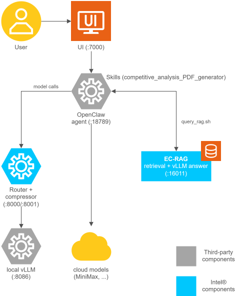

# Enterprise Data Intelligence - Multi-Agent Enterprise Knowledge Assistant

<!--hide_directive

  <a class="icon_github" href="https://github.com/open-edge-platform/metro-ai-suite/tree/main/enterprise-data-intelligence">
     GitHub
  </a>
  <a class="icon_document" href="https://github.com/open-edge-platform/metro-ai-suite/blob/main/enterprise-data-intelligence/README.md">
     Readme
  </a>

hide_directive-->

An agent-native automation platform that combines a local knowledge base with autonomous
agents to complete real enterprise tasks end-to-end. It wires together a UI service,
knowledge base retrieval (the Data Intelligence Engine), an LLM router with prompt compression,
and an OpenClaw agent runtime — agents run reusable Skills that query the knowledge base and
produce professional deliverables (e.g., competitive-analysis reports).

## Features

- **Multi-agent task automation** — OpenClaw runs a main agent that can spawn sub-agents to
  complete multi-step enterprise tasks without manual intervention.
- **Local knowledge base retrieval** — The Data Intelligence Engine indexes uploaded documents
  in a Milvus vector store and returns the most relevant chunks through embedding and
  retrieval; the agent writes grounded answers from them.
- **Hybrid model routing with cost savings** — The Router and compressor front local (vLLM)
  and cloud models (for example, MiniMax), shrinking prompts before dispatch to cut token
  usage and latency.
- **Token consumption monitoring** — The UI shows a live dashboard of local versus cloud
  token usage, latency, and tokens saved by compression.
- **Reusable Skills** — Agents load self-contained Skills, such as the competitive-analysis
  report generator, to produce professional deliverables like HTML and PDF reports.
- **Conversational UI** — A chat interface with slash commands (for example, `/model`,
  `/session`, `/tool`) and streaming responses for controlling agents and models
  mid-conversation.
- **Multi-language support** — The UI and generated reports support multiple languages,
  including English and Chinese.

## Skills

| Skill | Description | Status |
| ----- | ----------- | ------ |
| `competitive_analysis_PDF_generator` | Competitive-analysis report generator — gathers product info from the local RAG knowledge base plus web search, then produces a professional Chinese HTML/PDF comparison report | Shipped (`SKILL.md` + `query_rag.sh`) |
| `knowledgebase` | Generic RAG query skill — retrieves any information from the local knowledge base (Data Intelligence Engine) via a curl-based `data_intelligence_engine` wrapper and generates structured reports, summaries, comparisons, or Q&A responses | Shipped (`SKILL.md` + `data_intelligence_engine`) |

See the [skills folder](https://github.com/open-edge-platform/metro-ai-suite/tree/main/enterprise-data-intelligence/skills)
for the shipped Skills and the [Get Started guide](./get-started.md) for how to install and
enable a Skill in OpenClaw.

## Architecture

The platform is built around a UI service that talks to the OpenClaw agent runtime. OpenClaw
orchestrates work through Skills. A Skill retrieves grounded facts from the knowledge base
served by the Data Intelligence Engine, and the agent model writes the answer from them, while
an LLM router (with a prompt compressor) fronts local and cloud models.

### Components

- **UI** — browser-based front end for sending tasks to OpenClaw and viewing generated results.
- **Router + compressor** — LLM router that fronts local (vLLM) and cloud models, with a
  LinguaCompressor front end that shrinks prompts before dispatch.
- **Data Intelligence Engine** — knowledge base service: embedding + retrieval over an
  uploadable knowledge base (Milvus vector store). It returns the retrieved chunks to the
  Skills and does not generate answers.
- **vLLM** — local LLM serving (`Qwen/Qwen3.5-35B-A3B`) used by OpenClaw and the router.
- **OpenClaw** — the agent runtime that loads Skills, calls models via the router, and
  executes tasks (web search, RAG query, PDF generation).
- **Skills** — reusable, self-contained task recipes under the
  [skills folder](https://github.com/open-edge-platform/metro-ai-suite/tree/main/enterprise-data-intelligence/skills)
  that agents load at runtime.

## Additional Resources

- [Inference Router microservice](https://docs.openedgeplatform.intel.com/dev/edge-ai-libraries/inference-router/index.html) — the microservice that implements the Router and compressor.
- [Data Intelligence Engine microservice](https://github.com/open-edge-platform/edge-ai-libraries/tree/main/microservices/data-intelligence-engine) — the microservice that serves the knowledge base.
- [Get Started guide](./get-started.md) — step-by-step instructions for setting up the
  platform and running the demo.
- [Release Notes](./release-notes.md) — a changelog of updates and improvements to the platform.

<!--hide_directive
:::{toctree}
:hidden:

get-started.md
Release Notes <release-notes.md>

:::
hide_directive-->
