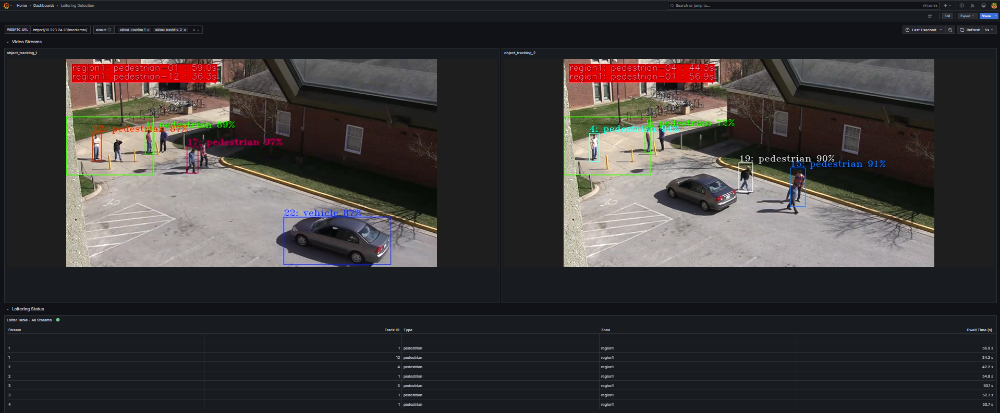

# Get Started

Loitering Detection leverages advanced AI algorithms to monitor and analyze real-time video
feeds, identifying individuals lingering in designated areas. It provides a modular
architecture that integrates seamlessly with various input sources and leverages AI models to
deliver accurate and actionable insights.

By following this guide, you will learn how to:

- **Set up the sample application**: Use Docker Compose to quickly deploy the application in your environment.
- **Run video analytics**: Start the predefined sample pipelines or use the optional Console UI.
- **View the results**: Watch video and loitering analytics in Grafana or the Console UI.

## Prerequisites

- Verify that your system meets the [minimum requirements](./get-started/system-requirements.md).
- Install Docker: [Installation Guide](https://docs.docker.com/get-docker/).
  Enable running docker without "sudo": [Post Install](https://docs.docker.com/engine/install/linux-postinstall/)
- Install Git: [Installing Git](https://git-scm.com/book/en/v2/Getting-Started-Installing-Git)

## Set up and first use

1. **Clone the Suite**:

   Go to the target directory of your choice and clone the suite.
   If you want to clone a specific release branch, replace `main` with the desired tag.
   To learn more on partial cloning, check the [Repository Cloning guide](https://docs.openedgeplatform.intel.com/dev/OEP-articles/contribution-guide.html#repository-cloning-partial-cloning).

   ```bash
   git clone --filter=blob:none --sparse --branch main https://github.com/open-edge-platform/metro-ai-suite.git
   cd metro-ai-suite
   git sparse-checkout set metro-vision-ai-app-recipe
   cd metro-vision-ai-app-recipe/
   ```

2. **Set up the Application and Download Assets**:
   Choose **one** installation command:

   <!--hide_directive ::::{tab-set} hide_directive-->
   <!--hide_directive :::{tab-item} hide_directive--> **Without the Console UI**
   <!--hide_directive :sync: grafana hide_directive-->

   Use the sample scripts and Grafana.

   ```bash
   ./install.sh loitering-detection
   ```

   > [!NOTE]
   > To select a specific host IP address, append it to the command:
   > `./install.sh loitering-detection <HOST_IP>`.
   > Replace `<HOST_IP>` with your target IP address.

   <!--hide_directive ::: hide_directive-->
   <!--hide_directive :::{tab-item} hide_directive--> **With the Console UI**
   <!--hide_directive :sync: console-ui hide_directive-->

   Add an operator interface for starting and stopping pipelines, selecting models and devices, and drawing zones. Grafana remains available.

   ```bash
   ./install.sh loitering-detection-ui
   ```

   > [!NOTE]
   > To select a specific host IP address, append it to the command:
   > `./install.sh loitering-detection-ui <HOST_IP>`.
   > Replace `<HOST_IP>` with your target IP address.

   <!--hide_directive
   :::
   ::::
   hide_directive-->

## Run the application

Run all commands from the `metro-vision-ai-app-recipe` directory.

1. **Start the application**:

   - Download the container images and start the microservices:

     ```bash
     docker compose up -d
     ```

     <details>
     <summary>Check Status of Microservices</summary>

     - To check that the services are running:

     ```bash
     docker ps
     ```

     The stack includes Grafana, DL Streamer Pipeline Server, MQTT, and supporting services.
     The `console` service is present only if you selected the `-ui` installation.

     </details>

2. **Follow your chosen workflow**:

   Choose either workflow below. When accessing the application remotely, replace `localhost`
   in the browser addresses with the host IP.

   > [!CAUTION]
   > Both workflows use the same Pipeline Server. `./sample_start.sh` stops **all** existing
   > pipeline instances before launching its four sample pipelines. `./sample_stop.sh` also
   > stops all instances, including those started in the Console UI. Do not run these scripts
   > while you want to keep Console pipelines running.

   <!--hide_directive ::::{tab-set} hide_directive-->
   <!--hide_directive :::{tab-item} hide_directive--> **Grafana**
   <!--hide_directive :sync: grafana hide_directive-->

   Run the predefined samples and view Grafana:

   1. Start the four sample pipelines (CPU is used when no device flag is supplied):

      ```bash
      ./sample_start.sh
      ```

   2. Check their status:

      ```bash
      ./sample_status.sh
      ```

   3. Open `https://localhost/grafana` and log in with username `admin` and password `admin`.
      You will be prompted to change the password on first login.

   4. Under **Dashboards**, open the preloaded **Video Analytics Dashboard**.
      Expect video streams with detection overlays and loitering metrics for objects in the
      configured zones.

   <!--hide_directive ::: hide_directive-->
   <!--hide_directive :::{tab-item} hide_directive--> **Console UI**
   <!--hide_directive :sync: console-ui hide_directive-->

   Start and view a pipeline in the Console UI
   This workflow requires the `-ui` installation choice in point 2 of the [setup](#set-up-and-first-use).

   1. Open `https://localhost/console/`.
   2. Leave **Number of pipelines** at `1`. The **Pipeline 1** card has a prefilled source,
      model, and device; select a device supported by your hardware if necessary.
   3. Click **Start pipelines**.
   4. Expect a panel titled **Pipeline N · source · model · device** with live WebRTC video
      and a per-object loitering table. Objects enter the table when they are inside a configured
      zone; a detection outside all zones can still have a bounding box without a table row.

   For comparisons, source/model selection, zone drawing, and panel interpretation, see
   [Use the Console UI](./how-to-guides/use-console-ui.md).

   <!--hide_directive
   :::
   ::::
   hide_directive-->

## Access the Application and Components

Console pipelines have their own video panels; for details see [Use the Console UI](./how-to-guides/use-console-ui.md).

### Nginx Dashboard

- **URL**: `https://localhost`

### Grafana UI

- **URL**: `https://localhost/grafana`
- **Log in with credentials**:
  - **Username**: `admin`
  - **Password**: `admin` (You will be prompted to change it on first login.)
- In Grafana UI, the dashboard displays detected people and cars
  

  > [!NOTE]
  > In the default pipeline, we use `gvatrack tracking-type=zero-term`
  > element. Zero-term tracking assigns unique object IDs and requires object
  > detection to run on every frame (the pipelines here already run detection
  > on every frame, so this is a direct drop-in). It uses image data for
  > re-identification, unlike the imageless trackers.
  >
  > ---
  >
  > Detection (`gvadetect`) and tracking (`gvatrack`) always run on the full video frame —
  > there is no element cropping input to the zone polygons. Only the `gvaanalytics` element
  > restricts its output to the configured zones: objects outside every zone are still
  > detected and tracked, just not reported as present/dwelling in a zone.

### DL Streamer Pipeline Server

- **REST API**: `https://localhost/api/pipelines/status`
- **WebRTC**: `https://localhost/mediamtx/object_tracking_1/`

## Stop the Application

To stop a Console pipeline, click **X** in the top-right corner of its panel; use **Stop all** for all pipelines shown
in the Console.

To stop all pipeline instances through the sample script:

```bash
./sample_stop.sh
```

> [!CAUTION]
> `./sample_stop.sh` stops all pipelines and streams, including Console-launched instances.
> Run it only when you are finished viewing those streams.

To stop the application microservices:

```bash
docker compose down
```

## Advanced options

- [Use the Console UI](./how-to-guides/use-console-ui.md): Compare models, change sources and devices, and draw zones.
- [Customize the Application](./how-to-guides/customize-application.md): Configure file-based zones, streams, and Grafana data.
- [Tune or disable the dwell-time overlay](./how-to-guides/customize-application.md#video-overlay): Set overlay properties at pipeline launch.
- [Update the Pipeline](./how-to-guides/update-pipelines.md): Edit pipeline definitions and REST-overridable properties.
- [All How-to Guides](./how-to-guides.md): Explore device, telemetry, offline packaging, and benchmarking guides.

## Supporting Resources

- [Support and Troubleshooting](./troubleshooting.md)
- [Docker Compose Documentation](https://docs.docker.com/compose/)
- [DL Streamer Pipeline Server](https://docs.openedgeplatform.intel.com/dev/edge-ai-libraries/dlstreamer-pipeline-server/index.html)

<!--hide_directive
:::{toctree}
:hidden:

get-started/system-requirements.md

:::
hide_directive-->
