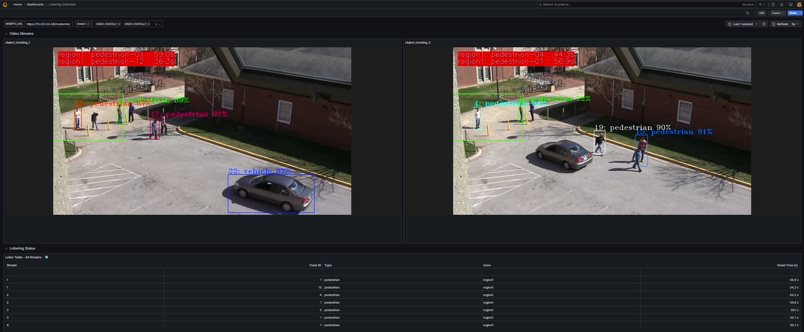

# Generate and Deploy Offline Package

## Overview

The Offline Package Generator creates self-contained deployment packages for Metro Vision AI
applications that can be deployed in environments without internet connectivity. This tool is
specifically designed for environments with no internet connectivity where traditional
cloud-dependent deployments are not feasible.

## Prerequisites

### System Requirements
- **Operating System**: Linux (Ubuntu 20.04 or later)
- **Docker**: Version 20.10.0 or higher
- **Docker Compose**: Version 2.0.0 or higher
- **Storage Space**: Minimum 15 GB available disk space
- **Memory**: 8 GB RAM recommended
- **Internet Connection**: Required for package generation only

> [!IMPORTANT]
> This process requires two environments - a connected system for package generation and an offline target system for deployment.

## Step 1: Generate Offline Package

> [!NOTE]
> Perform this step on a system with internet connectivity.

**Objective**: Create a complete offline deployment package containing all necessary components for the Loitering Detection application.

```bash
cd metro-ai-suite/metro-vision-ai-app-recipe/loitering-detection
```

Choose **one** generation command, matching the mode you want to run on the offline system:

<!--hide_directive ::::{tab-set} hide_directive-->
<!--hide_directive :::{tab-item} hide_directive--> **CLI mode**
<!--hide_directive :sync: cli hide_directive-->

Use the sample scripts and access the application through Grafana:

```bash
./offline-package-generator.sh
```

<!--hide_directive ::: hide_directive-->
<!--hide_directive :::{tab-item} hide_directive--> **Console UI mode**
<!--hide_directive :sync: console-ui hide_directive-->

This is the same package as CLI mode, plus the optional Console UI for starting and stopping
pipelines, selecting models and devices, and drawing zones. Grafana remains available.

```bash
./offline-package-generator.sh loitering-detection-ui
```

This bundles the `console-addon/` directory into the package, adds the `console` service to the
packaged `docker-compose.yml` (it reuses the DL Streamer Pipeline Server image, so no extra image
is downloaded) and adds the "UI Console" link to the nginx landing page.

> [!IMPORTANT]
> The mode is fixed when the package is generated. A CLI mode package does not contain the
> `console` service, so `https://<HOST_IP>/console/` cannot be used with it. Generate a Console UI
> mode package if you need the Console UI on the offline system.

<!--hide_directive
:::
::::
hide_directive-->

**What happens during generation:**
- Downloads and packages all Docker images (~2-3 GB)
- Collects AI models and sample videos (~500 MB)
- Gathers Grafana plugins and configurations (~100 MB)
- Prepares deployment scripts and documentation
- Creates a complete `offline-package/` directory

## Step 2: Prepare Package for Transfer

*Package the generated files for secure transport to offline environment*

**Objective**: Create a compressed, transferable archive optimized for offline environments.

```bash
# Create a timestamped compressed package for easy identification
tar -czf loitering-detection-offline-$(date +%Y%m%d-%H%M).tar.gz offline-package/

# Verify package integrity and size
ls -lh loitering-detection-offline-*.tar.gz
tar -tzf loitering-detection-offline-*.tar.gz | head -10

# Generate checksum for integrity verification
sha256sum loitering-detection-offline-*.tar.gz > package-checksum.txt
```

**Transfer the tar.gz package and checksum file to your offline environment:**

Both files need to be transferred together for integrity verification
 - loitering-detection-offline-YYYYMMDD-HHMM.tar.gz (main package)
 - package-checksum.txt (integrity verification file)

**Transfer options for offline environments:**
- **USB/External drive**: Copy files to removable media
- **Secure network**: Use SCP, SFTP, or approved file transfer protocols
- **Physical media**: Burn to DVD/Blu-ray for highly secure environments
- **Satellite/RF links**: For remote locations with limited connectivity

## Step 3: Deploy in Offline Environment

*Execute deployment on the target system without internet connectivity*

**Objective**: Deploy and start the Loitering Detection application in a completely offline environment.

### 3.1 Extract and Prepare

```bash
tar -xzf loitering-detection-offline-*.tar.gz
sha256sum -c package-checksum.txt

cd offline-package/
ls -la
```

### 3.2 Load Docker Components

```bash
chmod +x load-images.sh
./load-images.sh
docker images | grep -E "(grafana|influxdb|nginx|dlstreamer)"
```

### 3.3 Start the Application

```bash
docker compose up -d
docker ps
```

The `ui-console` container is present only in a Console UI mode package.

## Step 4: Run the Application

Follow the workflow that matches the mode the package was generated for. When accessing the
application remotely, replace `127.0.0.1` in the browser addresses with the host IP.

> [!CAUTION]
> Both workflows use the same Pipeline Server. `./sample_start.sh` stops **all** existing
> pipeline instances before launching its four sample pipelines. `./sample_stop.sh` also
> stops all instances, including those started in the Console UI. Do not run these scripts
> while you want to keep Console pipelines running.

<!--hide_directive ::::{tab-set} hide_directive-->
<!--hide_directive :::{tab-item} hide_directive--> **CLI mode**
<!--hide_directive :sync: cli hide_directive-->

Run the predefined samples and view Grafana:

1. Start the video streams to run the video inference pipelines:

   ```bash
   ./sample_start.sh
   ```

2. Check the status of the pipelines:

   ```bash
   ./sample_status.sh
   ```

3. Open `https://127.0.0.1/grafana` and log in with username `admin` and password `admin`.

   > [!NOTE]
   > If you experience issues while streaming videos on Grafana dashboard on
   > Firefox, it is recommended to use Google Chrome.

4. Check under the Dashboards section for the application-specific preloaded dashboard.
   **Expected Results**: The dashboard displays real-time video streams with AI overlays and detection metrics.

<details>
<summary>Stop Pipelines</summary>

To stop the pipelines without waiting for video streams to finish replay:

```bash
./sample_stop.sh
```

> [!NOTE]
> This will stop all the pipelines and the streams. **DO NOT** run this if you want to see loitering detection.

</details>

<!--hide_directive ::: hide_directive-->
<!--hide_directive :::{tab-item} hide_directive--> **Console UI mode**
<!--hide_directive :sync: console-ui hide_directive-->

This workflow requires a package generated with `./offline-package-generator.sh loitering-detection-ui`.
Start and view a pipeline in the Console UI:

1. Open `https://127.0.0.1/console/`.
2. Leave **Number of pipelines** at `1`. The **Pipeline 1** card has a prefilled source,
   model, and device; select a device supported by your hardware if necessary.
3. Click **Start pipelines**.
4. Expect a panel titled **Pipeline N · source · model · device** with live WebRTC video
   and a per-object loitering table.

To stop a Console pipeline, click **X** in the top-right corner of its panel; use **Stop all**
for all pipelines shown in the Console.

Grafana remains available at `https://127.0.0.1/grafana` (`admin` / `admin`). For details on
using the Console UI, see [Use the Console UI](./use-console-ui.md).

<!--hide_directive
:::
::::
hide_directive-->

## Access Application Components

### Nginx Dashboard
- **URL**: `https://127.0.0.1`

### UI Console (Console UI mode packages only)
- **URL**: `https://127.0.0.1/console/`
- Start/stop streams, draw a zone, and view live loitering analytics.
- Only available if the package was generated with
  `./offline-package-generator.sh loitering-detection-ui`; CLI mode packages
  do not contain the `console` service.

### Grafana UI
- **URL**: `https://127.0.0.1/grafana`
- **Credentials**:
  - **Username**: `admin`
  - **Password**: `admin` (You will be prompted to change it on first login)
- The dashboard displays detected cars in the parking lot.

  

### DL Streamer Pipeline Server
- **REST API**: `https://127.0.0.1/api/pipelines/status`
- **WebRTC**: `https://127.0.0.1/mediamtx/object_detection_1/`

## Stop the Application

To stop the application microservices, use the following command:

```bash
docker compose down
```
