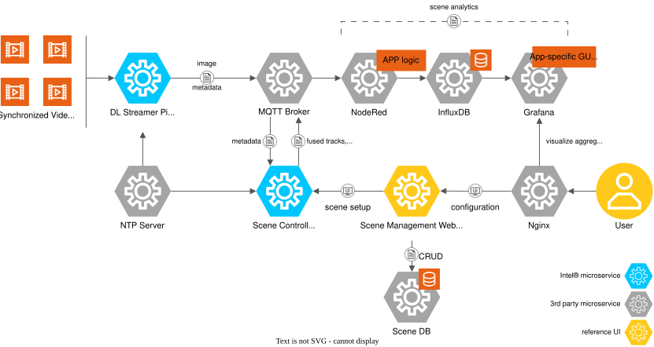

# Smart Corridor

The **Smart Corridor** is a sample application that unifies analytics across multiple
traffic intersections.

The application demonstrates how edge AI can address traffic management challenges using
scene-based analytics. It combines data from cameras at multiple intersections to create a
unified corridor view. This enables use cases such as tracking objects across multiple
viewpoints, analyzing motion vectors such as speed and heading, and understanding object
interactions in three-dimensional space. The application uses existing camera infrastructure
for real-time, multi-camera analytics, moving from frame-based analysis to an integrated view.

Example use cases include:

- **Pedestrian safety**: Improve safety for vulnerable road users (VRUs) at crosswalks.
  - Scene-based region of interest (ROI) analytics can identify VRUs using crosswalks and
    detect unsafe situations, such as pedestrians outside designated crosswalk areas.
- **Vehicle count and dwell time**: Measure the average vehicle count and dwell time in each
  lane. Dwell time is the amount of time a vehicle remains stopped, such as at a bus stop or
  train station.
  - Vehicles that remain in a lane for an unusually long time may indicate an anomaly such as
    a stalled vehicle, an accident, or congestion.

Key benefits include:

- **Multi-camera, multi-object tracking**: Track objects across multiple camera views.
- **Scene-based analytics**: Define regions of interest across multiple views on a map, rather
  than separately in each camera view. This simplifies business logic, provides flexibility
  when defining regions, and supports tracking vehicles and people with cameras, lidar, and
  radar.
- **Improved urban management**: Access object tracking and analytics in near real time
  through the Message Queuing Telemetry Transport (MQTT) broker to support traffic monitoring
  and safety applications.
- **Reduced total cost of ownership (TCO)**: Use existing cameras, simplify business logic
  development, and add sensors or cameras without changing the business logic.

## Get Started

See these guides for system requirements and installation instructions:

- [Get Started](./docs/user-guide/get-started.md):
  Follow step-by-step instructions to set up the application.
- [System Requirements](./docs/user-guide/get-started/system-requirements.md):
  Check the hardware and software requirements for deploying the application.

## How It Works

This section provides a high-level view of how the application integrates with a typical
system architecture:

### Diagram Description

- **Inputs**:
  - **Video files**: Synchronized recordings from traffic cameras simulate live feeds from
    multiple intersections. The application can also use live camera feeds.
  - **Scene database**: Preconfigured corridor and intersection scenes contain 3D maps of
    the intersections, calibrated cameras, and regions of interest.
- **Processing**:
  - **Video analytics**: The Deep Learning Streamer Pipeline Server (DL Streamer Pipeline
    Server) uses a pretrained object detection model to generate detection metadata, which it
    publishes to the MQTT broker. A local NTP server provides synchronized timestamps.
  - **Sensor fusion**: The Scene Controller Microservice combines video analytics metadata
    with scene data obtained through the Scene Management API. It uses the fused tracks and
    configured analytics, including regions of interest, to generate events for the MQTT
    broker.
  - **Aggregate scene analytics**: Node-RED application logic reads region-of-interest
    analytics from the MQTT broker and stores them in an InfluxDB bucket for time-series
    analysis through Flux queries.
- **Outputs**:
  - Fused object tracks are available on the MQTT broker and can be viewed in the Scene
    Management UI.
  - Aggregate scene analytics are available in a Grafana dashboard.

For more details, see the [Overview](./docs/user-guide/index.md).

## Learn More

- [Support and Troubleshooting](./docs/user-guide/troubleshooting.md): Find solutions to
  common issues.