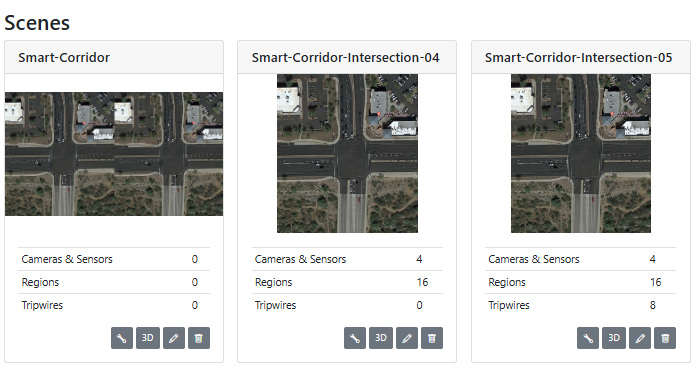
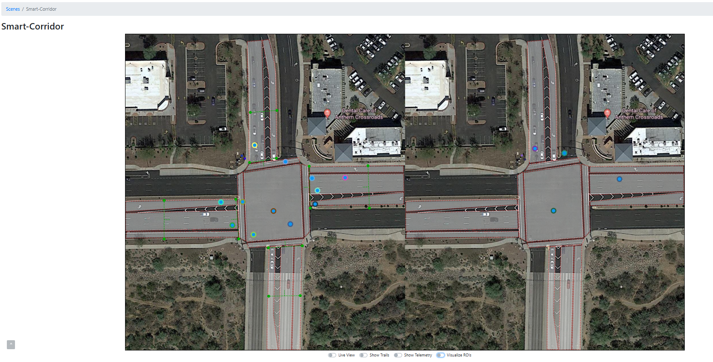
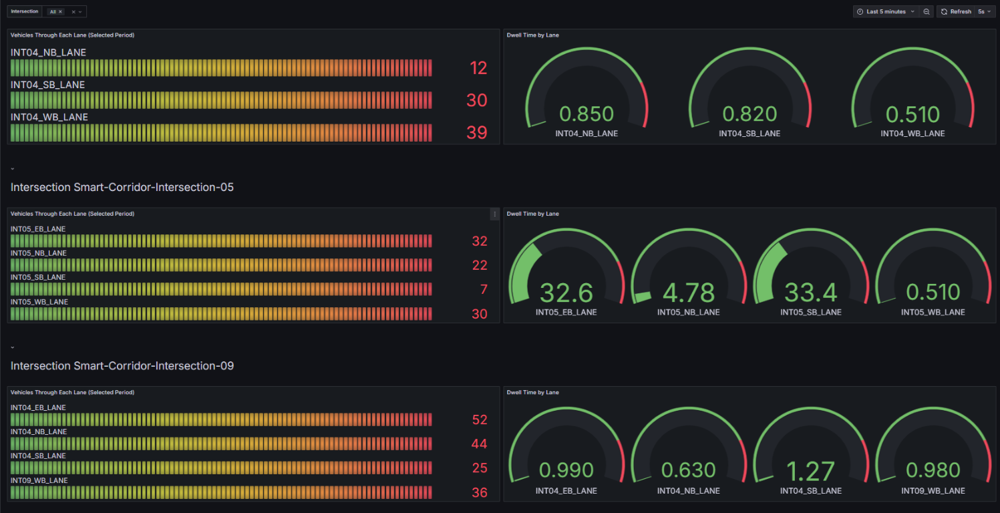
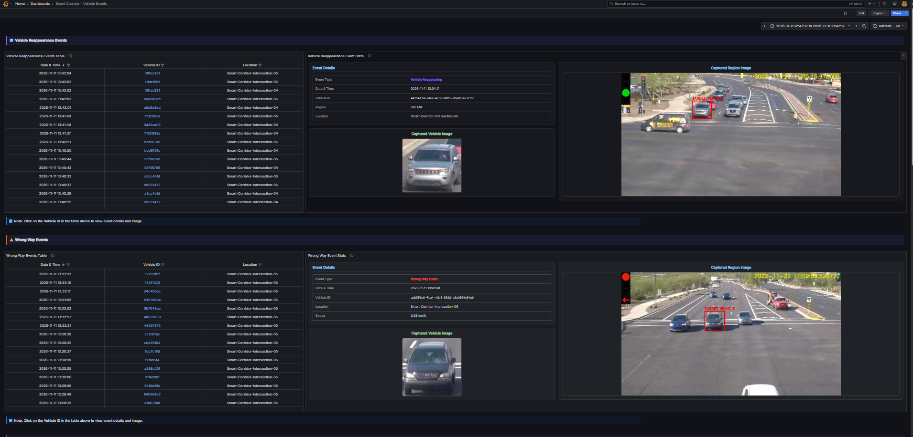

# Get Started

The Smart Corridor Sample Application is a modular sample application designed to help
developers create intelligent intersection monitoring solutions. By leveraging AI and sensor
fusion, this sample application demonstrates how to achieve accurate traffic detection,
congestion management, and real-time alerting.

To get started:

- **Set up the sample application**: use Docker Compose to quickly deploy the application in
  your environment.
- **Run a predefined pipeline**: execute a sample pipeline to see real-time transportation
  monitoring and object detection in action.
- **Access the application's features and user interfaces**: explore the Scenescape
  Web UI, Grafana dashboard, Node-RED interface, and DL Streamer Pipeline Server to monitor,
  analyze and customize workflows.
- **Consider Enabling Security features**: use hardware-based security measures to make your
  application safer.

> **Note:** The default dataset includes only two intersections,
> `Smart-Corridor-Intersection-04` and `Smart-Corridor-Intersection-05`. Intersections 01, 02,
> and 03 are not part of this dataset, so their absence does not indicate a deployment problem.

## Prerequisites

- Verify that your system meets the [minimum requirements](./get-started/system-requirements.md).
- Install Docker: [Installation Guide](https://docs.docker.com/get-docker/).
- Enable running docker without "sudo": [Post Install](https://docs.docker.com/engine/install/linux-postinstall/).
- Install Git: [Installing Git](https://git-scm.com/book/en/v2/Getting-Started-Installing-Git).

## Setup and First Use

**Clone the Suite**:

   Go to the target directory of your choice and clone the suite.
   If you want to clone a specific release branch, replace `main` with the desired tag.
   To learn more on partial cloning, check the [Repository Cloning guide](https://docs.openedgeplatform.intel.com/dev/OEP-articles/contribution-guide.html#repository-cloning-partial-cloning).

   ```bash
   git clone --filter=blob:none --sparse --branch main https://github.com/open-edge-platform/metro-ai-suite.git
   cd metro-ai-suite
   git sparse-checkout set metro-vision-ai-app-recipe
   cd metro-vision-ai-app-recipe/
   ```

## Multi-Node Deployment (Parent / Child)

The Smart Corridor application supports multi-machine deployments where one **parent** machine
aggregates scene data from one or more **child** machines. Each child runs its own set of
camera pipelines and sends tracking data to the parent's scene controller.

### Deployment Architecture

```
Parent Machine
├── SceneScape Controller (aggregates all scenes)
├── SceneScape Manager (Web UI)
├── DLStreamer (local cameras: camera1–camera4)
├── MQTT Broker (port 1883 TLS, 1882 internal)
└── CA Server (port 8888, serves CA cert to parent)

Child Machine
├── DLStreamer (child cameras: camera401–camera404)
├── MQTT Broker (port 1883 TLS)
└── CA Server (port 8888, serves CA cert to parent)
```

### Important Notes for Multi-Machine Deployments

- **Deploy child nodes first**: The parent's `ca-bundle.sh` fetches CA certificates from
  child nodes via HTTP (port 8888). **Child nodes must be installed and running before the parent node installation.**
- **Network access**: Port 8888 (CA server) and port 1883 (MQTT TLS) must be accessible
  between machines.
- **Scene configuration**: After deployment, add the remote child scene in the SceneScape
  Web UI under the parent scene's settings (see [Step 5](#deploy-a-parent-node) of Deploy a Parent Node).
- **Time synchronization**: Ensure NTP is synchronized across all machines to avoid a delayed or no tracking behaviour in Smart-Corridor Scene.

> **Note:** For a single-node deployment (no remote child), skip this below section and go
> directly to [Deploy a Parent Node](#deploy-a-parent-node).

### Deploy a Child Node

If there are multiple child nodes to be deployed, then number each node deployment(**REMOTE_CHILD_DEPLOY**) starting from `1` in their respective [.env](../../../.env) file:

1. Clone and enter the directory (same as [Setup and First Use](#setup-and-first-use) above).

2. The Smart-Corridor needs to know which Child node this deployment is. So, configure `REMOTE_CHILD_DEPLOY` as `1` or `2` or `3` in the [.env](../../../.env) file to select a specific child scene data and pipeline configuration:

   ```bash
   REMOTE_CHILD_DEPLOY=1
   ```

   - If `REMOTE_CHILD_DEPLOY=1` is set, the installer picks `smart-corridor-child-1-ri.tar.bz2` and `config_child_1.json`.
   - If `REMOTE_CHILD_DEPLOY=2` is set, the installer picks `smart-corridor-child-2-ri.tar.bz2` and `config_child_2.json`, and so on.

3. Run the install script:

   - Use the installation script to configure the application and download required models:

     ```bash
     ./install.sh smart-corridor
     ```

    > **Note:** For environments requiring a specific host IP address (for example, when deploying across different network interfaces), you can explicitly
    > specify the IP address (Replace `<HOST_IP>` with your target IP address.):
    > `./install.sh smart-corridor <HOST_IP>`

   The installer detects which child node deployment it is and
   automatically:
   - Uses child-specific scene data (`Smart-Corridor-Intersection-04.zip`)
   - Uses child-specific pipeline config (`config_child_${REMOTE_CHILD_DEPLOY}.json`)

4. **Start the Application**:
   - Export admin password as environment variable:

     ```bash
     export SUPASS=$(cat ./smart-corridor/src/secrets/supass)
     ```

   - Download container images with Application microservices and run with Docker Compose:

     ```bash
     docker compose up -d
     ```

- Repeat the above steps in [Deploy a Child Node](#deploy-a-child-node) section for all the Child node deployments by incrementing the REMOTE_CHILD_DEPLOY value for every other Child node deployment.

### Deploy a Parent Node

On the parent machine, configure the [.env](../../../.env) file to declare how many remote child nodes exist:

1. Clone and enter the directory (same as [Setup and First Use](#setup-and-first-use) above).

2. Configure the [.env](../../../.env) file with the remote child IPs:

   For Single Node deployment with no child nodes:

   ```bash
   TOTAL_REMOTE_CHILD=0
   ```
   For Multi Node deployment, mention total number of remote child nodes that were deployed and corresponding Host IP addresses:

   ```bash
   TOTAL_REMOTE_CHILD=1
   REMOTE_IP_1=<IP_ADDRESS_CHILD_NODE_1>
   ```

   For multiple child nodes:

   ```bash
   TOTAL_REMOTE_CHILD=2
   REMOTE_IP_1=<IP_ADDRESS_CHILD_NODE_1>
   REMOTE_IP_2=<IP_ADDRESS_CHILD_NODE_2>
   ```

3. Run the install script:

   - Use the installation script to configure the application and download required models:

     ```bash
     ./install.sh smart-corridor
     ```

    > **Note:** For environments requiring a specific host IP address (for example, when deploying across different network interfaces), you can explicitly
    > specify the IP address (Replace `<HOST_IP>` with your target IP address.):
    > `./install.sh smart-corridor <HOST_IP>`

   The installer detects a parent node deployment (`TOTAL_REMOTE_CHILD` defined in `.env`) and
   automatically:
   - Uses parent-specific scene data (`Smart-Corridor.zip`)
   - Uses parent-specific pipeline config (`config_parent.json` for multi-node / `config_sn_parent.json` for single-node) 
   - Runs `ca-bundle.sh` to fetch CA certificates from each remote child and build a
     combined trust bundle for TLS connectivity

4. **Start the Application**:
   - Export admin password as environment variable:

     ```bash
     export SUPASS=$(cat ./smart-corridor/src/secrets/supass)
     ```

   - Download container images with Application microservices and run with Docker Compose:

     ```bash
     docker compose up -d
     ```

   <details>
   <summary>
   Check Status of Microservices
   </summary>

   - The application starts the following microservices.
   - To check if all microservices are in Running state:

     ```bash
     docker ps
     ```

   **Expected Services:**
   - Grafana Dashboard
   - DL Streamer Pipeline Server
   - MQTT Broker
   - Node-RED
   - Scenescape services

   </details>

> **Note:** The following step is required for **Multi-Node (Parent / Child) deployments only**. For a Single-Node deployment, skip it and go to [Access the Application and Components](#access-the-application-and-components).

5. **Link the Remote Child Scene to the Smart-Corridor Scene**:

   The parent's Scene Controller only receives tracks from a child node after the child scene is
   linked to the Smart-Corridor scene in the SceneScape UI. Do this once for every remote child node, after both the child and the parent are running. 

   **Before you start**, make sure that:
   - The child node is running and the parent can reach it on port `1883` (MQTT TLS) and port `8888` (CA server).
   - The system time is synchronized between the parent and child nodes (see
     [Troubleshooting](./troubleshooting.md)).

   **Collect the following details from the child node:**

   | Detail | Where to find it |
   |---|---|
   | Child scene name | The scene name on the child's SceneScape UI, for example `Smart-Corridor-Intersection-04`. It must be unique across the parent and child nodes. |
   | Remote child ID | The UUID of the child scene. Open the child scene in the child's SceneScape UI (`https://<child_ip>/`) and copy the UUID from the browser address bar (`https://<child_ip>/<scene-uuid>/`). |
   | Hostname or IP | The IP address of the child node (the same value as `REMOTE_IP_<n>` in the parent's [.env](../../../.env) file). |
   | MQTT username and password | The `user` and `password` values in `./smart-corridor/src/secrets/controller.auth` on the child node. |

   **Link the child scene on the parent node:**

   1. Open the parent's SceneScape UI at `https://<parent_ip>/` and log in as `admin`.
   2. Click the **Smart-Corridor** scene card to open the parent scene.
   3. Select the **Children** tab below the scene map.
   4. Click **+ Link Child Scene**.
   5. Set **Child Type** to `remote` and fill in the form:
      - **Child Name**: The child scene name, for example `Smart-Corridor-Intersection-04`.
      - **Remote Child ID**: The child scene UUID.
      - **Hostname or IP**: The IP address of the child node.
      - **MQTT Username** and **MQTT Password**: The child node's MQTT credentials.
      - **Transform type and values**: The position, rotation and scale that place the child scene
        on the Smart-Corridor map. Keep the defaults if the child scene already shares the
        parent's coordinate system.
        For the default dataset, set **Transform type** to `Matrix` and change the value in
        row 1, column 4 to `170.1594097946251`.
      - **Retrack objects**: Keep it enabled so the parent tracker re-tracks the child's detections.
   6. Click **Add Child Scene**.
   7. Repeat steps 4–6 for every remaining remote child node, using that child's own scene name, UUID, IP address and credentials.

   **Expected result:** the child scene is listed in the **Children** tab of the Smart-Corridor
   scene, and its MQTT status indicator turns green. Vehicles tracked at the child intersection
   then appear on the Smart-Corridor map.

   > **Note:**
   >
   > - A scene can have only one parent, so link each child scene to the Smart-Corridor scene only once.
   > - If the status indicator stays red, check that port `1883` on the child node is reachable from the
   >   parent, that the CA certificates were fetched during the parent installation (`ca-bundle.sh`), and
   >   that the child MQTT credentials are correct.
   > - For details about local and remote child scenes, see the SceneScape guide
   >   [Create and Manage a Scene Hierarchy](https://docs.openedgeplatform.intel.com/dev/scenescape/index.html).


## Access the Application and Components

### Application UI

Open a browser and go to the following endpoints to access the application. Use `<actual_ip>`
instead of `localhost` for external access:

> **Note:**
>
> - All services are accessed through the nginx reverse proxy at `https://localhost` with appropriate paths.
> - For passwords stored in files (e.g., `supass` or `influxdb2-admin-token`), refer to the respective secret files in your deployment under ./src/secrets.
> - Since the application uses HTTPS with self-signed certificates, your browser may display a certificate warning. For the best experience, use **Google Chrome** and accept the certificate.

- **URL**: [https://localhost](https://localhost)
- **Log in with credentials**:
  - **Username**: `admin`
  - **Password**: Stored in `supass`. (Check `./smart-corridor/src/secrets/supass`)

> **Note**:
>
> - After starting the application, wait approximately 1 minute for the MQTT broker to initialize. You can confirm it is ready when green arrows appear for MQTT in the application interface. Since the application uses HTTPS, your browser may display a self-signed certificate warning. For the best experience, use **Google Chrome**.

### Grafana UI

- **URL**: [https://localhost/grafana/](https://localhost/grafana/)
- **Log in with credentials**:
  - **Username**: `admin`
  - **Password**: `admin` (You will be prompted to change it on first login.)

### InfluxDB UI

- **URL**: [http://localhost:8086](http://localhost:8086)
- **Log in with credentials**:
  - **Username**: `<your_influx_username>` (Check `./smart-corridor/src/secrets/influxdb2/influxdb2-admin-username`)
  - **Password**: `<your_influx_password>` (Check `./smart-corridor/src/secrets/influxdb2/influxdb2-admin-password`).

### NodeRED UI

- **URL**: [https://localhost/nodered/](https://localhost/nodered/)
- **Log in with credentials**:
  - **Username**: `<your_nodered_username>` (Check `./smart-corridor/src/secrets/nodered/nodered-admin-username`)
  - **Password**: `<your_nodered_password>` (Check `./smart-corridor/src/secrets/nodered/nodered-admin-password`).

### DL Streamer Pipeline Server

- **REST API**: [https://localhost/api/pipelines/status](https://localhost/api/pipelines/status)
  - **Check Pipeline Status**:

    ```bash
    curl -k https://localhost/api/pipelines/status
    ```

## Verify the Application

- **Fused object tracks**: in Scene Management UI, click on the Smart-Corridor or Smart-Corridor-Intersection cards to
  navigate to the Scene. On the individual intersection scene pages, you will see fused tracks moving on the map. You
  will also see greyed out frames from each camera. Toggle the "Live View" button to see the
  incoming camera frames. The object detections in the camera feeds will correlate to the
  tracks on the map.

  
  

- **Grafana Dashboard**: In Grafana UI, observe aggregated analytics of different regions of
  interests in the grafana dashboard. After navigating to Grafana home page, click on
  "Dashboards" and click on item "Smart Corridor - Generic Data".

  

  In the same Grafana UI, you can go to `Smart Corridor - Vehicle Events` dashboard to find Vehicle Events that get captured across intersections. For example: Vehicle Reappearance, Wrong Way and so on.

  

  > **Note:** The Wrong Way event is currently configured with inverted logic, and only on one
  > intersection, to demonstrate the functionality because there is no appropriate dataset available at present.

## **Stop the Application**

- To stop the application microservices, use the following command:

    ```bash
    docker compose down
    ```

- [Troubleshooting](./troubleshooting.md): Find detailed steps to resolve common issues during deployments.
- [DL Streamer Pipeline Server](https://docs.openedgeplatform.intel.com/dev/edge-ai-libraries/dlstreamer-pipeline-server/index.html): Intel microservice based on Python for video ingestion and deep learning inferencing functions.
- [Scenescape](https://docs.openedgeplatform.intel.com/dev/scenescape/index.html): Intel Scene-based AI software framework.

<!--hide_directive
:::{toctree}
:hidden:

get-started/system-requirements.md

:::
hide_directive-->
