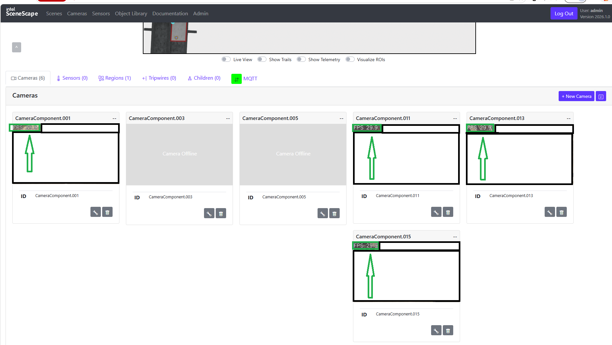

<!--hide_directive
```{eval-rst}
.. meta::
   :description: Set up and run the Smart Tolling application, verify the deployment, and
                 access the Scenescape, Grafana, Node-RED, and InfluxDB interfaces.
   :keywords: Smart Tolling, Scenescape, Docker Compose, Grafana, Node-RED, InfluxDB
```
hide_directive-->

# Get Started

This guide walks you through setting up and running the Smart Tolling application:

- Install and launch the full application stack using the provided setup scripts.
- Verify it is running by checking vehicle detections, dashboards, and events.
- Learn where to change configuration (cameras, videos, scene data) for your own setup.

> [!IMPORTANT]
> This application ships without sample videos or scene data — see
> [Bring Your Own Data](./get-started/bring-your-own-data.md) for what to prepare before you start.
>
> Need help running this application? Contact `<SUPPORT_EMAIL>` and we will help you get set up.

## Prerequisites

Before you begin, ensure the following:

- **System Requirements**: Verify that the system meets the
  [minimum requirements](./get-started/system-requirements.md).
- **Docker Installation Complete**: Install Docker. For installation instructions, see
  [Get Docker](https://docs.docker.com/get-docker/).
- **Your Own Videos and Scene Data Ready**: See
  [Bring Your Own Data](./get-started/bring-your-own-data.md) for the files you need to prepare.

## Setup Guide

### 1. Deploy the Source Code

If you want to clone a specific release branch, replace `main` with the desired tag.
To learn more on partial cloning, check the [Repository Cloning guide](https://docs.openedgeplatform.intel.com/dev/OEP-articles/contribution-guide.html#repository-cloning-partial-cloning).

Clone the suite to your Edge Server:

```bash
git clone --filter=blob:none --sparse --branch main https://github.com/open-edge-platform/metro-ai-suite.git
cd metro-ai-suite
git sparse-checkout set metro-vision-ai-app-recipe/
cd metro-vision-ai-app-recipe/
```

### 2. Configure the Environment

Verify the variables in `.env` match your camera RTSP endpoints.

### 3. Create the .yml File

Generate the `docker-compose.yml` file:

```bash
./install.sh smart-tolling
```

### 4. Launch Services

Start the application stack using Docker Compose:

```bash
export SUPASS=$(cat ./smart-tolling/src/secrets/supass)
docker compose up -d
```

To **stop** the application:

```bash
docker compose down -v
```

### 5. Verify Deployment

Check the status of all containers:

```bash
docker compose ps
```

## Accessing the Application

Open a browser and go to the following endpoints. The application uses a self-signed HTTPS
certificate, so your browser will show a security warning — use **Google Chrome** and accept it.
After starting the stack, wait about a minute for the MQTT broker to come up before the UI
shows live data.

> [!NOTE]
> Passwords stored in secret files (e.g., `supass`, `influxdb2-admin-token`) are under
> `./smart-tolling/src/secrets/` (Docker).

### Scenescape Web UI

- **URL**: [https://localhost](https://localhost)
- **Username**: `admin`
- **Password**: Stored in `./smart-tolling/src/secrets/supass`



The example above shows 4 of the 6 camera streams running live at ~30 FPS, using the
test videos used during development.

### Grafana UI

- **URL**: [https://localhost/grafana/](https://localhost/grafana/)
- **Username**: `admin`
- **Password**: `admin` (You will be prompted to change it on first login.)

### Node-RED UI

- **URL**: [https://localhost/nodered/](https://localhost/nodered/)
- **Username**: `<your_nodered_username>` (Check `./smart-tolling/src/secrets/nodered/nodered-admin-username`)
- **Password**: `<your_nodered_password>` (Check `./smart-tolling/src/secrets/nodered/nodered-admin-password`)

### InfluxDB UI

- **URL**: [http://localhost:8086](http://localhost:8086)
- **Username**: Stored in `./smart-tolling/src/secrets/influxdb2/influxdb2-admin-username`
- **Password**: Stored in `./smart-tolling/src/secrets/influxdb2/influxdb2-admin-password`

<!--hide_directive
:::{toctree}
:hidden:

./get-started/system-requirements
./get-started/bring-your-own-data

:::
hide_directive-->
