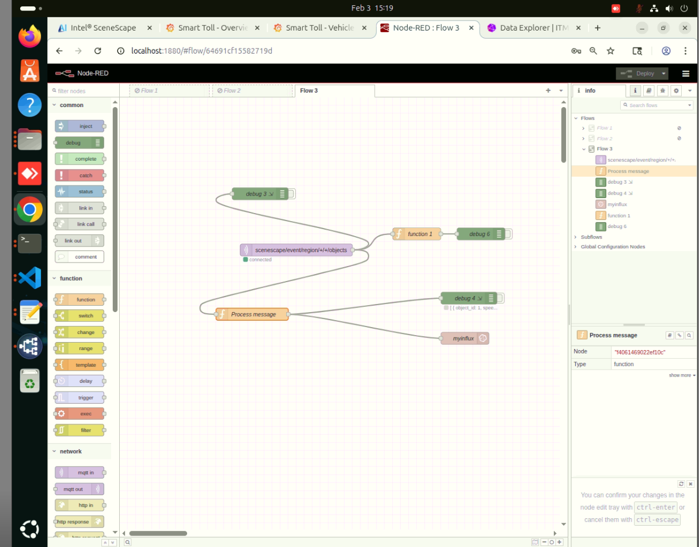
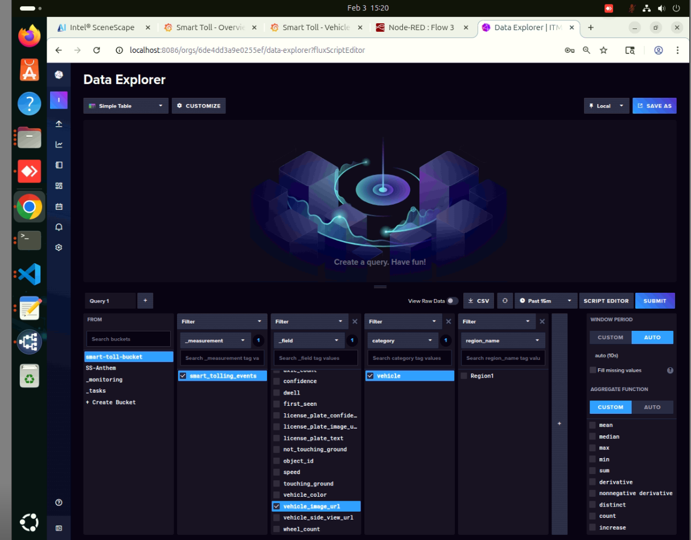
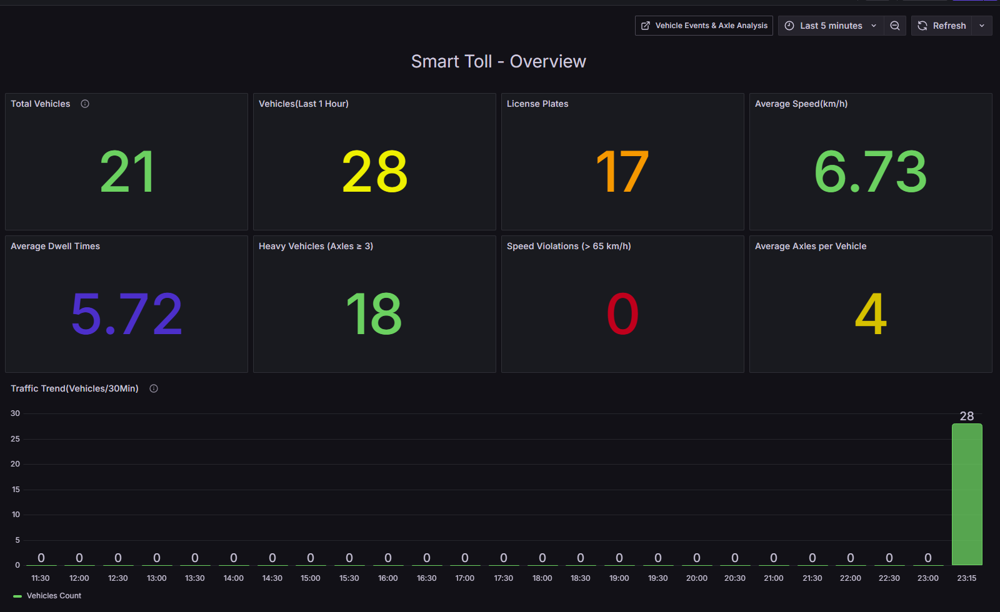
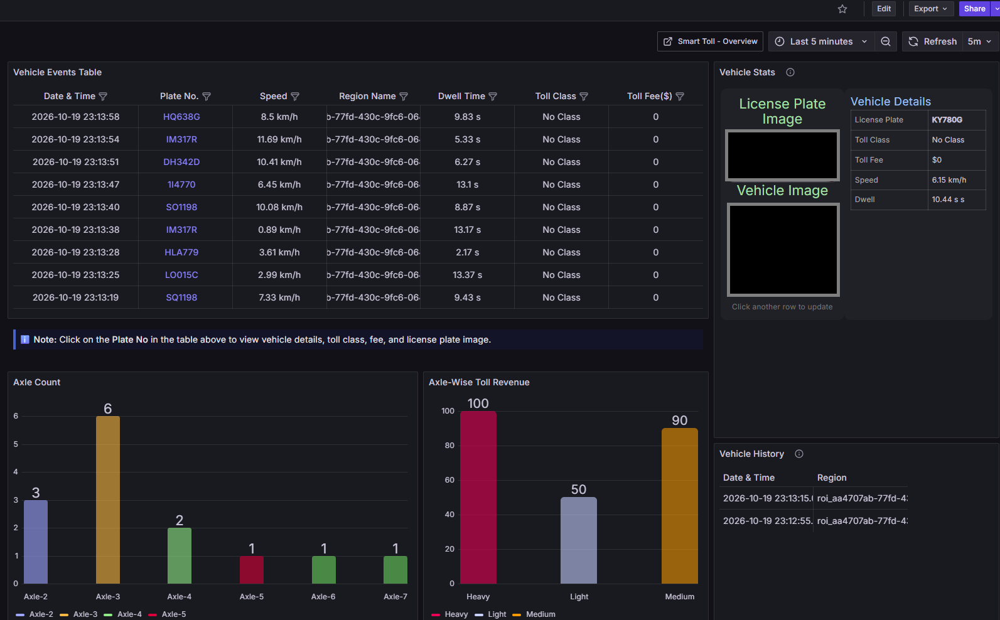

# Analytics Pipeline (Downstream)

Raw metadata is valuable, but actionable insights come from the Analytics Pipeline.

## Node-RED Transformation

- **Input:** The **MQTT IN Node** subscribes to `scenescape/event/region/+/+/objects`.
- **Logic:** The **Function node** tags each exited vehicle with its region, computes speed from
  velocity, and passes through the dwell time already calculated by Scenescape.
- **Output:** The **InfluxDB OUT Node** writes the tagged records to InfluxDB, where Grafana
  queries aggregate them into counts and flow metrics.

### Storage (InfluxDB)

InfluxDB stores the tagged vehicle-exit records as a time series for Grafana to query.

### Visualization (Grafana)

The system ships with pre-configured dashboards (`Overview.json` and
`Vehicle_Events_Axle_Analysis.json`) focusing on Traffic Volume, Flow Efficiency and Safety Alerts.

> [!NOTE]
> The vehicle and license plate images in the screenshot above have been masked for privacy.
> Your own deployment will show the actual evidence images captured for each event.

## Learn More

- [Perception Layer](./perception-layer.md)
- [Optimizations](./optimization.md)
- [Support and Troubleshooting](../troubleshooting.md)