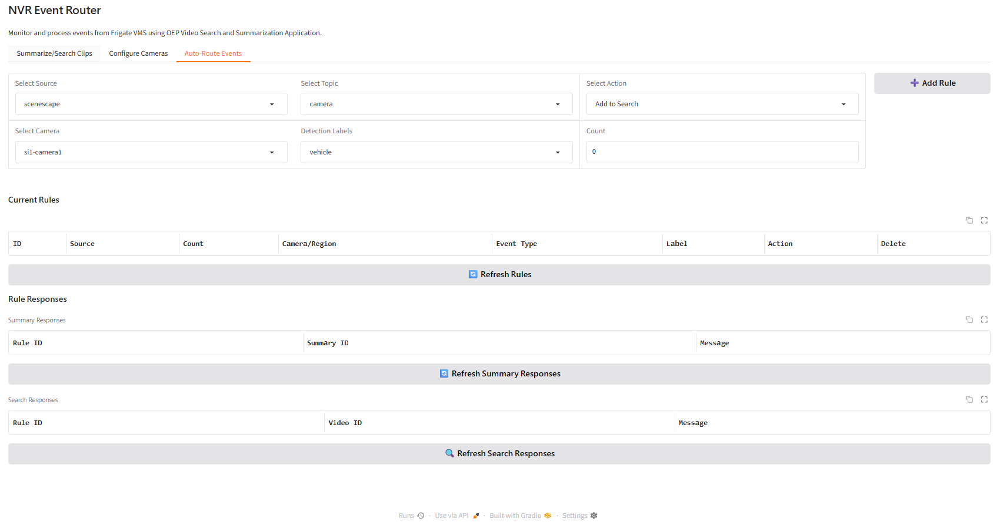

# Integrate Scenescape with Smart NVR

This guide describes how to integrate Intel® Scenescape with Smart NVR for enhanced traffic monitoring using live data from the Smart Intersection application.

## Overview

Smart NVR integrates with Intel® Scenescape to enable:

- Real-time object counting and tracking (vehicles, pedestrians)
- Traffic flow analysis
- Automated event routing based on count thresholds
- Enhanced surveillance for smart intersection management

## Prerequisites

- Docker and Docker Compose installed
- VSS (Video Search and Summarization) running and reachable from the NVR machine

## Deployment Modes

Smart NVR with Scenescape supports two deployment modes:

| Mode | Description | Command |
|------|-------------|---------|
| **Single-Node** | All services (SI + NVR) on one machine | `source setup.sh start` |
| **Distributed Node** | SI on System 1, NVR on System 2 | `source setup.sh start-si` / `source setup.sh start-nvr` |

## Single-Node Deployment

In single-node mode, all services run on one machine. The setup script performs the following steps automatically:

1. Validates required environment variables
2. Configures DL Streamer and Frigate for Scenescape mode
3. Downloads demo videos and starts the MediaMTX RTSP streamer
4. Starts the Smart Intersection stack (runs `install.sh` on first launch)
5. Starts the NVR stack and connects it to the Scenescape network

### Set Environment Variables

```bash
export NVR_SCENESCAPE=true
export VSS_IP=<vss_ip>
export VSS_PORT=<vss_port>                        # optional, default 12345
# export RTSP_STREAM_PORT=<rtsp port>      # optional, default 8554
# export MQTT_USER=<mqtt-username>         # optional, auto-generated if omitted
# export MQTT_PASSWORD=<mqtt-password>     # optional, auto-generated if omitted
```

### Start

```bash
source setup.sh start
```

When running in single-node SceneScape mode, `start` resolves SceneScape API
credentials from `smart-intersection/src/secrets/browser.auth` and writes them
into the `si1` entry in
[brokers.yaml](../../resources/broker-config/brokers.yaml) as
`scenescape_api_user` and `scenescape_api_password`.

### Verify

```bash
docker logs nvr-event-router | grep -i "scenescape\|subscribed"
# Expected:
#   Scenescape mode: starting multi-broker manager
#   [si1] subscribed to scenescape/data/camera/# at <host>:1883
```

The UI is available at `http://<host_ip>:7860`.

## Distributed Node Deployment

For distributed deployments where Smart Intersection runs on a dedicated machine
(System 1) and the NVR stack runs on a separate machine (System 2), see
[Multiple Scenescape Deployment](./multi-broker-scenescape.md).

## Stop Services

```bash
source setup.sh stop     # stop all services
source setup.sh restart  # restart all services
```

For distributed node stop commands, see [Multiple Scenescape Deployment](./multi-broker-scenescape.md#stop).

## Verify Integration

```bash
docker logs nvr-event-router | grep -i "scenescape\|subscribed"
# Expected:
#   Scenescape mode: starting multi-broker manager
#   [si1] subscribed to scenescape/data/camera/# at <host>:1883
```

## User Interface

### With Intel® Scenescape Enabled



When Intel® Scenescape is enabled (`NVR_SCENESCAPE=true`):

- Source dropdown shows only **"scenescape"** (Frigate source is not available in this mode)
- **Select Topic** supports **camera** and **region**
- When **Topic = camera**, the **Count** field is visible and editable, and the rules table includes a **Count** column for threshold tracking
- When **Topic = region**, topic-specific controls are shown (for example **Scene**, **Region**, and **Event Type**), and options change based on Event Type (such as count, dwell time, or near-miss)
- Count validation enforces non-negative integers

## Auto-Route Events Configuration

### Creating Rules

1. Navigate to the **Auto-Route Events** tab
2. **Source** is pre-set to "scenescape"
3. Select **Topic**:
   - **camera** for camera-based count thresholds
   - **region** for scene/region event rules
4. Configure fields based on the selected topic:
   - **If Topic = camera**:
     - **Select Camera**
     - **Set Count** (minimum threshold, for example 5)
     - **Choose Detection Label** ("vehicle" or "pedestrian")
   - **If Topic = region**:
     - **Select Scene**
     - **Select Region**
     - **Select Event Type** ("count", "dwell_time", or "near_miss")
     - For **count**, configure label selection and thresholds.
     - For **dwell_time**, configure a single label and duration in seconds.
     - For **near_miss**, configure near-miss distance.
5. **Select Action:** Choose "Summarize" or "Add to Search"
6. Click **Add Rule**

### Rule Behavior Example

**Camera topic example**

```text
Source: scenescape
Topic: camera
Camera: camera1
Count: 5
Label: vehicle
Action: Summarize
```

This camera rule triggers video summarization when 5 or more vehicles are detected on camera1.

**Region topic example**

```text
Source: scenescape
Topic: region
Scene: Intersection-1
Region: crosswalk-west
Event Type: count
Labels: vehicle,pedestrian
Vehicle Count: 3
Pedestrian Count: 2
Action: Search
```

This region rule triggers a search when both thresholds are met in the selected region (at least 3 vehicles and 2 pedestrians).

## Troubleshooting

**Scenescape features not visible in UI**

Verify that `NVR_SCENESCAPE` is set to `true` and restart the services:

```bash
echo $NVR_SCENESCAPE
export NVR_SCENESCAPE=true
source setup.sh restart
```

After restarting, perform a hard refresh in the browser (`Ctrl+Shift+R` or `Cmd+Shift+R`).

**Region topic rules not triggering after upgrading from older Smart NVR deployments**

Smart NVR stores broker/rule state in a persistent Redis Docker volume (`redis_data` in Compose).
If you previously ran an older Smart NVR version, stale Redis data can conflict with newer
region-topic subscription behavior. Reset the Redis volume and redeploy:

```bash
# 1) Stop Smart NVR services
source setup.sh stop

# 2) Remove the Redis persistent volume from prior runs
# Most common default volume name:
docker volume rm docker_redis_data

# If your Compose project name is different, list and remove the matching volume:
docker volume ls --format '{{.Name}}' | grep '_redis_data$'
docker volume rm <your_project>_redis_data

# 3) Start services again
source setup.sh start
```

After restart, recreate your Auto-Route rules from the UI.

**No Scenescape events received**

```bash
# Check MQTT connectivity to the Scenescape broker
docker logs nvr-event-router | grep -i scenescape

# Verify Smart Intersection containers are running
docker ps | grep metro-vision-ai-app-recipe
```

**Diagnostic commands**

```bash
# Monitor live Scenescape MQTT messages
docker logs nvr-event-router -f | grep "scenescape"

# List all running containers with status
docker ps --format "table {{.Names}}\t{{.Status}}"

# Check container resource utilization
docker stats --no-stream --format "table {{.Name}}\t{{.CPUPerc}}\t{{.MemUsage}}"
```

## Support

When reporting issues, verify the following:

1. **Environment variables** — Confirm all required variables are exported: `env | grep -E "NVR_|SCENESCAPE|MQTT|VSS"`
2. **MQTT connectivity** — Check logs for: `[si1] subscribed to scenescape/data/camera/#`
3. **Smart Intersection** — Confirm SI containers are running: `docker ps | grep metro`
4. **Distributed node** — See [Multiple Scenescape Deployment](./multi-broker-scenescape.md) for connectivity and broker troubleshooting.
5. **Resource utilization** — Run `docker stats --no-stream` to identify resource-constrained containers

For general Smart NVR issues, refer to the [Troubleshooting Guide](./troubleshooting.md).
