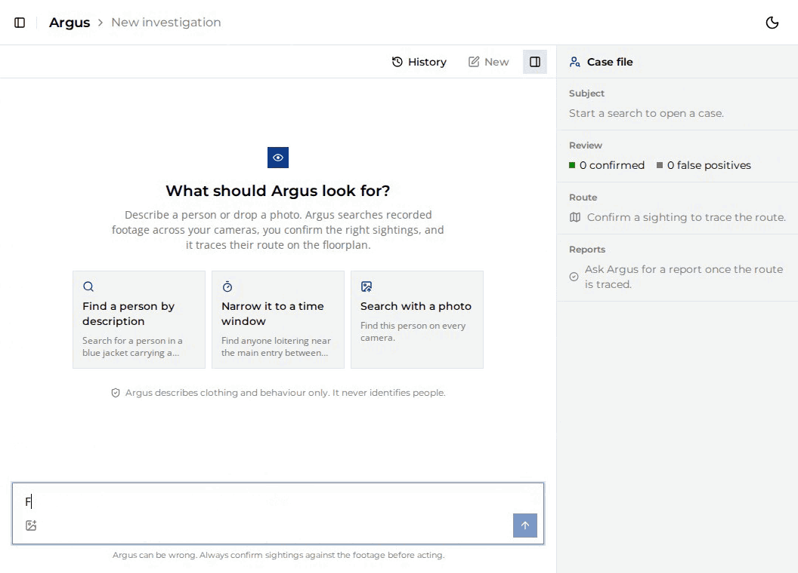

<!--
SPDX-FileCopyrightText: (C) 2026 Intel Corporation
SPDX-License-Identifier: Apache-2.0
-->

# Virtual Security Guard Agent

**Virtual Security Guard Agent (VSG)** is an operator console for the **VSG
agent**, an AI security agent named **Argus** that runs on a Hermes agent
server. The VSG agent searches recorded and live camera footage through Intel®
Video Search and Summarization (VSS). Hermes cannot show video or images. VSG
shows what the VSG agent finds instead: match grids for human review, a
floorplan route, live camera matches, and PDF incident reports.

## Get Started

- [System Requirements](./docs/user-guide/get-started/system-requirements.md)
- [Get Started Guide](./docs/user-guide/get-started.md)
- [Build from Source](./docs/user-guide/get-started/build-from-source.md)

## Learn More

- [How It Works](./docs/user-guide/how-it-works.md)
- [How-to Guides](./docs/user-guide/how-to-guides.md)
- [Known Issues](./docs/user-guide/known-issues.md)
- [Release Notes](./docs/user-guide/release-notes.md)
