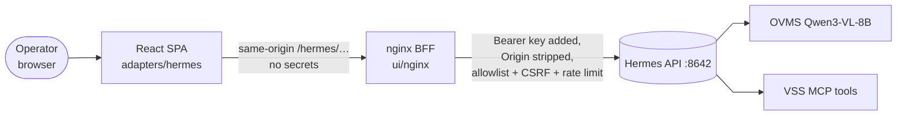
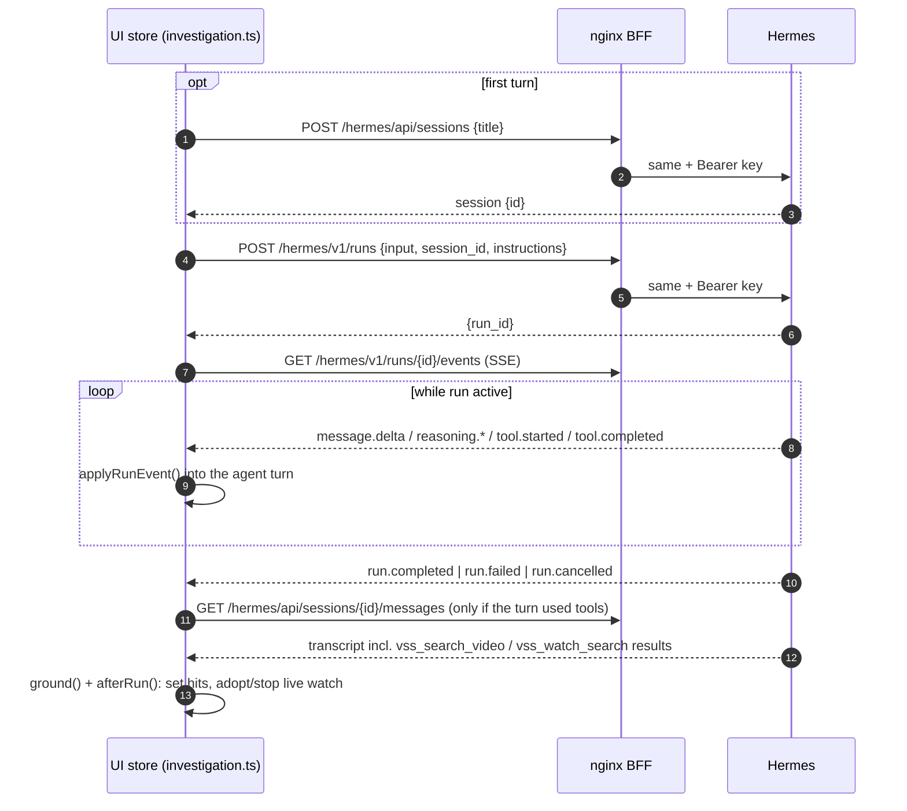

<!--
SPDX-FileCopyrightText: (C) 2026 Intel Corporation
SPDX-License-Identifier: Apache-2.0
-->

# Hermes API Flow — Virtual Security Guard Agent

Reference for how VSG talks to the Hermes Agent API today.

## 1. TL;DR

VSG uses the Hermes-native **Sessions + Runs** REST surface only. It does
**not** use OpenAI-compatible endpoints (`/v1/chat/completions`,
`/v1/responses`, `/v1/models`), jobs, approvals, steer, browser control, or
any `X-Hermes-*` header.

Per investigation:

1. `POST /api/sessions`: one session per investigation (title `VSG · …`).
2. `POST /v1/runs`: one run per operator turn, with `session_id` for continuity.
3. `GET /v1/runs/{id}/events`: SSE stream into the chat.
4. `GET /v1/runs/{id}`: status check only when the stream ends without a terminal event.
5. `POST /v1/runs/{id}/stop`: Stop button.
6. `GET /api/sessions/{id}/messages`: transcript read for grounding and session resume.
7. `GET /api/sessions?limit=N`, `DELETE /api/sessions/{id}`, `GET /health`: history, delete, liveness.

All traffic goes Browser → nginx BFF → Hermes. The BFF adds the bearer key and
allowlists exactly these paths; anything else under `/hermes/` returns 403.

## 2. Architecture

| Layer | File | Role |
|---|---|---|
| Client | `ui/src/adapters/hermes/http.ts` | `HermesAdapter`: requests, SSE read, reconnect |
| Event contract | `ui/src/adapters/hermes/sse.ts` | SSE parser, `toRunEvent()`, `shortToolName()` |
| Types | `ui/src/adapters/hermes/types.ts` | `HermesSession`, `HermesMessage`, `RunEvent`, `StartRunRequest`, `HermesError` |
| Mock | `ui/src/adapters/hermes/mock.ts` | same interface, used when `VITE_USE_MOCKS=true` |
| Run orchestration | `ui/src/stores/investigation.ts`, `investigation.logic.ts` | session/run lifecycle, `applyRunEvent` reducer |
| Per-run rules | `ui/src/protocol/instructions.ts` | `instructions` field sent with each run |
| Grounding | `ui/src/protocol/grounding.ts` | reads `vss_search_video` / `vss_watch_search` results from the transcript |
| BFF allowlist | `ui/nginx/templates/default.conf.template` | per-path method allow, rate limit, CSRF maps, 403 catch-all |
| BFF proxy settings | `ui/nginx/templates/hermes-proxy.inc.template` | `Authorization`, header stripping |
| Dev proxy | `ui/vite.config.ts` | `/hermes` → `HERMES_BASE_URL` with the key; no allowlist or CSRF guard |

## 3. Endpoints in use

Base is `/hermes` (`VITE_HERMES_BASE`); the proxy strips it.

| Endpoint | Method | Request | Response fields used | Caller |
|---|---|---|---|---|
| `/health` | GET | — | `res.ok` only | `health()`, polled every 30 s by `useHealth` |
| `/api/sessions` | POST | `{ "title": "VSG · …" }` | `session` (or body): `id`, `title` | `createSession()` |
| `/api/sessions?limit=N` | GET | `limit` (default 50; 100 on resume) | `data[]`: `id`, `title`, `started_at`, `last_active`, `preview`, `message_count` | `listSessions()` |
| `/api/sessions/{id}/messages?inline_images=false` | GET | — | `data[]`: `id`, `role`, `content`, `tool_calls`, `tool_name`, `tool_call_id`, `timestamp` | `getMessages()` |
| `/api/sessions/{id}` | DELETE | — | — | `deleteSession()` (history menu, smoke test) |
| `/v1/runs` | POST | `{ input, session_id?, instructions? }` | `run_id` | `startRun()` |
| `/v1/runs/{id}` | GET | — | `status`, `output`, `error` | `streamRun()` (reconnect path only) |
| `/v1/runs/{id}/events` | GET (SSE) | `Last-Event-ID` header on reconnect | event frames (§5) | `readStream()` |
| `/v1/runs/{id}/stop` | POST | — | — | `stopRun()` |

### Behavioural details

| Topic | Behaviour |
|---|---|
| Unique session titles | `createSession()` retries with `title (2)`, `title (3)`, … up to 20 attempts while Hermes answers "already in use". |
| History list | `useInvestigations` keeps only sessions whose title starts with `VSG · ` and strips the prefix. |
| `instructions` | Every run carries a compact rules stub (~400 tokens) from `buildInstructions()`: block grammar, tool rules, and session context (cameras, active query, verdicts, sightings, `minScore`, `limit`). Procedures live in the `virtual-security-guard` skill. |
| Continuity | `session_id` in the run body; no `X-Hermes-Session-Id` / `X-Hermes-Session-Key`. |
| Errors | Non-2xx throws `HermesError(message, status)`; message is `error.message`, `error`, or `Hermes <status> <statusText>`. No status-specific handling (429 included). |
| Images | Subject photos are uploaded to VSS (`POST /vss/manager/search/images`), not Hermes; the run input references the image by URL. |

## 4. Request lifecycle (one operator turn)

| Step | Detail |
|---|---|
| Agent turn | Built from SSE events only (`applyRunEvent`). The transcript read is for grounding and live-watch follow-up. |
| Grounding | `groundingFromLatestRun()` takes the last `vss_search_video` result after the last user message. Grid hits resolve in order (`features/agent/useDirectiveHits.ts`): stored VSS query (id from the tool result, else the directive) → transcript tool result → the model's inline copy. |
| Stream drop | If the stream ends or errors without a terminal event, `streamRun()` calls `GET /v1/runs/{id}`. `completed`, `cancelled` or `failed` emits the matching event; otherwise it waits `500 ms × (attempt + 1)` and reconnects with `Last-Event-ID`. Up to 3 reconnects, then emits `failed` ("Lost connection to the agent."). |
| Stop | `POST …/stop`, then a local `AbortController` abort after 4 s if the run is still active. |
| Retry | The Retry action removes the failed turn pair and starts a **new** run with the same input. |
| Resume | Opening a past investigation rebuilds turns from `getMessages()` plus `listSessions(100)` for the title. |

## 5. SSE event contract

Frames are blank-line terminated; `:` lines (keepalive) are skipped. The event
name comes from the JSON `event` field, else the SSE `event:` line. The client
tracks `id:` for `Last-Event-ID`. `seq` is passed through when numeric.

| Hermes event | `RunEvent` | Fields read | Rendered as |
|---|---|---|---|
| `message.delta` | `delta` | `delta` | streamed assistant text |
| `reasoning.available`, `reasoning.delta` | `reasoning` | `text` or `delta` | reasoning line |
| `tool.started` | `tool.started` | `tool`, `preview` | tool chip (`mcp__video_search_mcp__vss_search_video` → `vss_search_video`) |
| `tool.completed` | `tool.completed` | `tool`, `preview`, `error`/`is_error` | chip resolved or errored |
| `run.completed` | `completed` | `output`, `interrupted` | final output |
| `run.cancelled`, `run.stopped` | `cancelled` | — | — |
| `run.failed`, `run.error`, `error` | `failed` | `error` (string or `.message`), `message` | error line |
| anything else | `other` | whole payload | ignored |

The reader stops at the first terminal event (`completed`, `failed`,
`cancelled`). Frames whose data is not JSON are dropped.

## 6. BFF / security envelope

| Path (under `/hermes`) | Methods | Extra |
|---|---|---|
| `/health` | GET | |
| `/v1/runs` | POST | `limit_req` 20 r/min per IP, `burst=10 nodelay`, 429 on excess |
| `/v1/runs/{id}` | GET | |
| `/v1/runs/{id}/events` | GET | `proxy_buffering off`, `proxy_cache off`, `gzip off`, `proxy_read_timeout 1h` |
| `/v1/runs/{id}/stop` | POST | |
| `/api/sessions` | GET, POST | |
| `/api/sessions/{id}` | GET, DELETE | |
| `/api/sessions/{id}/messages` | GET | |
| anything else | — | 403 |

IDs must match `[A-Za-z0-9_.:-]{1,128}`. Default proxy timeouts: connect 5 s,
send 60 s, read 120 s. Request body limit 1 MB.

| Control | Implementation |
|---|---|
| Key handling | nginx sets `Authorization: Bearer ${HERMES_API_KEY}`; the key comes from `deploy/.env` via `deploy/compose.yaml` and never reaches the browser. |
| Header hygiene | Strips `Origin`, `Referer`, `Cookie`; hides `Set-Cookie`, `Access-Control-Allow-Origin`, `Access-Control-Allow-Credentials`, `X-Powered-By`. Stripping `Origin` is what lets requests pass Hermes with CORS off. |
| CSRF guard | `$vsg_api_blocked` → 403 when `Sec-Fetch-Site` is `cross-site`/`same-site`, or `Origin` is present and doesn't match `Host`. |

**Rule:** a new Hermes call needs its nginx allowlist location in the same
change, or it 403s.

## 7. Current gaps

| Area | Status |
|---|---|
| Feature detection | None; endpoints and event names are hardcoded. A Hermes upgrade that renames events degrades silently (unknown events become `other`). |
| Run-creation retry | No `Idempotency-Key`; Retry always starts a new run. |
| Mid-run interaction | Stop only; no steer or approval. |
| 429 handling | No backoff; nginx 429s surface as a generic failure. |
| Multi-operator | None; one key, one Hermes profile, one title prefix. |
| Health depth | Unauthenticated `/health` only. |
| Model control | Model fixed in Hermes config; no per-run override. |
| Session metadata | No rename/archive (`PATCH`) or fork. |
