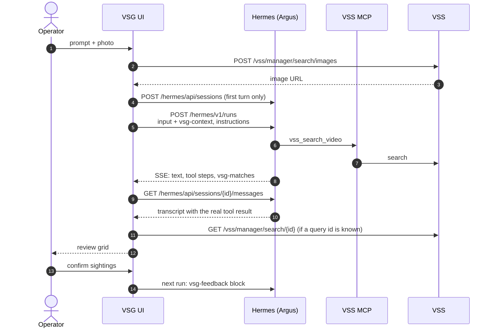
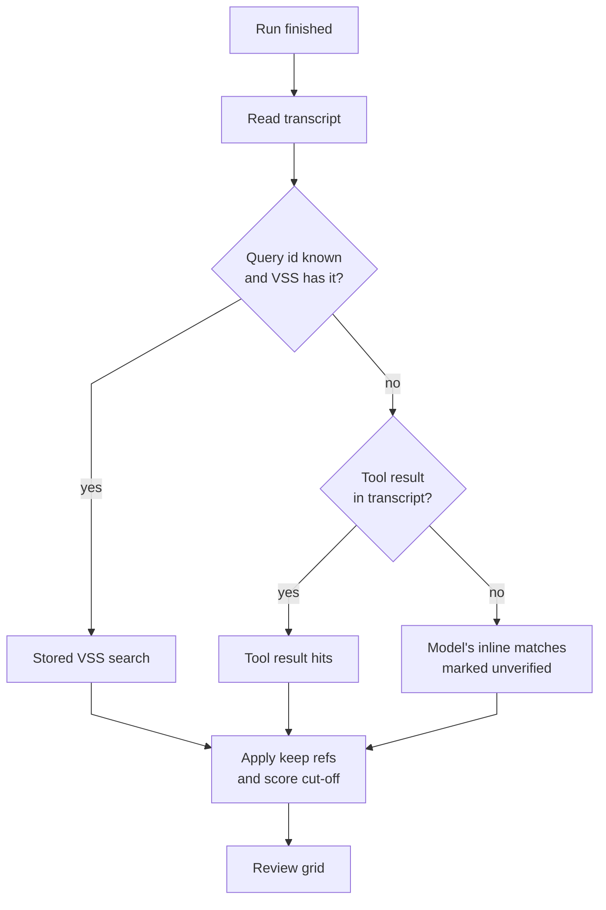
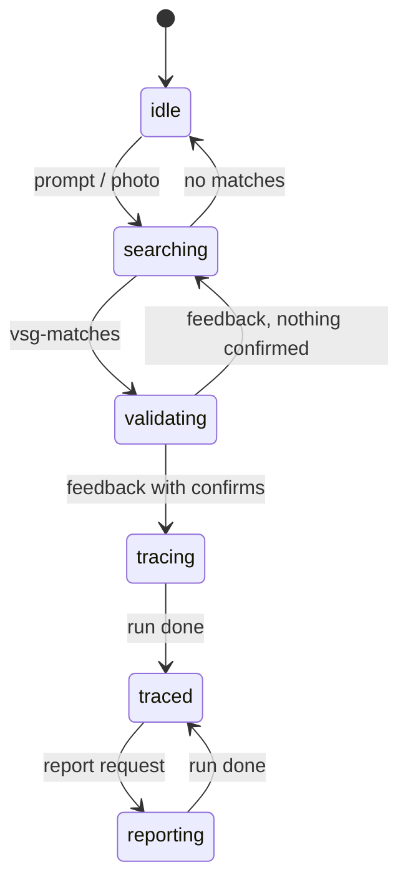

<!--
SPDX-FileCopyrightText: (C) 2026 Intel Corporation
SPDX-License-Identifier: Apache-2.0
-->

# Virtual Security Guard Agent: Design

Developer reference for the Virtual Security Guard Agent (VSG) console. Read
[How it Works](./how-it-works.md) first for the components and the
investigation flow; this page does not repeat them. Hermes endpoints, SSE
events and reconnect rules are in
[Hermes API Flow](../Hermes_API_Flow.md). Hermes configuration (MCP server,
model, API key) is in
[Install the Hermes Skills](./get-started/install-hermes-skills.md).

## 1. One Operator Turn

Every turn is one Hermes run in the investigation's session. Session titles
start with `VSG · ` so past investigations can be listed
(`ui/src/config/env.ts`).

## 2. Directive Protocol (v1)

Argus replies in prose plus at most one fenced JSON block of each type.
Schemas: `ui/src/protocol/directives.ts` (kept in sync with
`hermes-skills/virtual-security-guard/references/directive-protocol.md`).

| Block | Direction | Fields | UI |
|---|---|---|---|
| `vsg-context` | UI → Argus | `image_url`, `tags`, `start`, `end`, `limit` | Appended to the operator prompt (`protocol/feedback.ts`). |
| `vsg-feedback` | UI → Argus | `vss_query_id`, `confirm`, `reject`, `anchor_image_url` | Review verdicts; preceded by a prose summary. |
| `vsg-matches` | Argus → UI | `vss_query_id`?, `keep`, `note`, `notes`, `matches`? | Review grid. |
| `vsg-report` | Argus → UI | `title`, `preset` (`handover`, `escalation`, `brief`), `summary`, `subject`, `timeline[{ref, note}]`, `observations`, `actions`, `confidence` | Editable report and PDF. |
| `vsg-status` | Argus → UI | `phase` (`search`, `validate`, `trace`, `report`, `idle`), `message` | Progress line. |
| `vsg-track` | Argus → UI | `vss_query_id`, `anchor`, `keep`, `matches` | Legacy route block; Argus is told not to send it. |

- Refs are `m<N>`: the Nth entry of the search result (or its `match_id`).
  A video id or `video_id@start` is tolerated; unresolvable refs are ignored.
- `matches` is a fallback copy of hits written by the model (least trusted).
- `vsg-tick` is reserved and ignored.

### Per-run instructions

Each run carries a short `instructions` text (`protocol/instructions.ts`). It
restates the block grammar, because a small model forgets it, and adds session
context: phase, live cameras, whether live search is available, the running
watch, the current query id, verdicts so far, and every confirmed sighting as
a numbered timeline. The procedures themselves live in the
`virtual-security-guard` Hermes skill. When the protocol changes, update
`directives.ts`, `instructions.ts` and `hermes-skills/*` together, then
reinstall the skills.

Argus uses these VSS MCP tools, called through Hermes `tool_call` with the
full name (for example `mcp__video_search_mcp__vss_list_streams`):

| Tool | Use |
|---|---|
| `vss_search_video` | Search by text or image. |
| `vss_list_tags` | Map camera names to VSS tags. |
| `vss_watch_search` | Start or stop a live watch, only on explicit operator request. |
| `vss_list_streams`, `vss_add_stream`, `vss_update_stream`, `vss_remove_stream` | Manage live RTSP cameras the operator names. |

A camera is a VSS tag. For "search the X, Y and Z cameras", Argus maps each
name to tags (case-insensitive, `_` = space) and searches with those `tags`.

## 3. Grounding

After each run the UI reads the session transcript and takes the latest
`vss_search_video` result of that run (`protocol/grounding.ts`). The tool
output is untrusted: only typed fields are read, at most 200 hits, and media
URLs are reduced to same-origin datastore paths.

Order, most trusted first: **stored VSS search → transcript tool result →
model's inline copy** (`features/agent/useDirectiveHits.ts`). The query id
comes from the tool result, else the directive, and is used only after VSS
confirms it, so invented ids never reach review keys or feedback.

## 4. Review and Confirmed Sightings

- **Score cut-off**: a hit is eligible when its score is at least
  *minimum score* (Settings, default 0.6) × the peak score of that search
  (`lib/hits.ts`). Argus applies the same rule to `keep`.
- **Grid**: six at a time, up to 20 per search
  (`features/agent/ValidationGrid.tsx`). Shown but unconfirmed matches are
  sent as `reject`.
- **Re-review**: every grid stays confirmable. A new `vsg-feedback` for the
  same `vss_query_id` replaces that grid's earlier verdicts.
- **Confirmed sightings** (`stores/hitl.ts` `confirmedSightings`): the union of
  confirms across all grids, de-duplicated by segment (`video_id@start`) and
  sorted by when the sighting happened. VSS and browser clocks can differ, so
  VSS times are only compared with each other.
- **Crop**: a crop from the clip player is uploaded with
  `POST /vss/manager/search/images` and becomes the subject image
  (`stores/investigation.ts` `setSubject`), the report photo and the
  live-watch anchor.

Confirmed sightings feed the instructions timeline, the floorplan route, the
live-watch seed and the report. The PDF lists them in time order, then a
**Movement** section with each leg between cameras and its elapsed time
(`stores/trace.ts` `movementLegs`).

## 5. Live Watch

`stores/watch.ts`. After a confirm the UI offers a live search; the start
button appears only while a live camera is connected. A watch starts only on
an operator action:

- **UI start**: `POST /vss/manager/search` (image or description, 5-minute
  window, tags) then `PATCH /vss/manager/search/{id}/watch`.
- **Chat request** ("watch the live cameras"): if Argus calls
  `vss_watch_search`, the UI adopts that query id from the transcript;
  otherwise the UI starts the watch itself after the run.

The UI then polls `GET /vss/manager/search/{id}` every 10 s, without LLM
calls. New live hits are de-duplicated by camera and frame time; the panel
shows the 4 nearest. The watch stops on **Stop**, after the watch duration
(default 30 min), or after the idle limit with no new sighting (default
10 min).

## 6. Investigation Phases

`InvestigationPhase` in `stores/investigation.logic.ts`. The phase is shown
in the UI and sent in the instructions.

**Stop** cancels the run and returns to the phase before it. Camera and
watch requests run in the `idle` phase.

## 7. Floorplan

`stores/floorplan.ts`, `features/map/`. A floorplan is JSON
(`features/map/schema.ts`): `cameras` keyed by plan key, each with `x`, `y`
and optional `zone`, `fov_angle`, `heading`, `range`, `camera_id`, `label`;
plus optional `canvas`, `zones`, `walls` and a same-origin or `data:`
`background`. The sample is `ui/src/fixtures/level4.floorplan.json`.

A key map links plan keys to VSS camera tags. A camera is mapped
automatically only when its `camera_id` (or key) is exactly a known tag;
others are mapped by the operator. Plan and key map persist in browser
storage (`vsg.floorplan.v1`). The route draws confirmed and live sightings
in time order, collapsing consecutive stops on the same camera. Authoring
steps: [Configure the Floorplan](./how-to-guides/configure-floorplan.md).

## 8. State Stores

Zustand stores in `ui/src/stores/`:

| Store | Holds |
|---|---|
| `investigation` | Session, turns, phase, subject image; runs and grounds each turn. |
| `hitl` | Hits and verdicts per grid; `confirmedSightings`. |
| `watch` | Live watch query, polling, live sightings and their verdicts. |
| `trace` | Route building, movement legs, timeline lines. |
| `cameras` | VSS live streams and their status. |
| `floorplan` | Active plan and key map (persisted). |
| `reports` | PDFs generated in this tab (memory only, lost on reload). |
| `settings` | Minimum score (0.6), search limit (24), watch duration (30 min), idle stop (10 min). |

Selectors must return stable references; see
[`.github/copilot-instructions.md`](../../.github/copilot-instructions.md).

## 9. nginx Gateway (BFF)

`ui/nginx/templates/`; the Vite dev proxy (`ui/vite.config.ts`) mirrors it.

- **Allowlist**: one `location` per route with a method limit and strict id
  regex; any other `/hermes/` or `/vss/` path returns `403`. Routes:
  [API Reference](./api-reference.md).
- **Hermes key**: nginx strips `/hermes` and sets
  `Authorization: Bearer ${HERMES_API_KEY}`. It clears `Origin`, `Referer`
  and `Cookie`, and hides `Set-Cookie` and CORS headers.
- **CSRF guard**: because `Origin` is stripped, nginx itself rejects
  cross-site requests (`Sec-Fetch-Site`, or an `Origin` for another host).
- **Limits**: `POST /hermes/v1/runs` is rate limited (20/min, burst 10). The
  SSE stream is unbuffered with a 1 h read timeout. Image uploads are capped
  at 3 MB (the UI re-encodes to 2 MB or less); other bodies at 1 MB or less.
- **Media**: datastore clips and images are streamed unbuffered and given a
  `Content-Type` by extension, because VSS serves them as
  `application/octet-stream` with `nosniff`.
- **Container**: `deploy/compose.yaml` runs it read-only, as UID 101, with
  `cap_drop: ALL`, `no-new-privileges` and tmpfs for `/tmp` and the rendered
  config.
