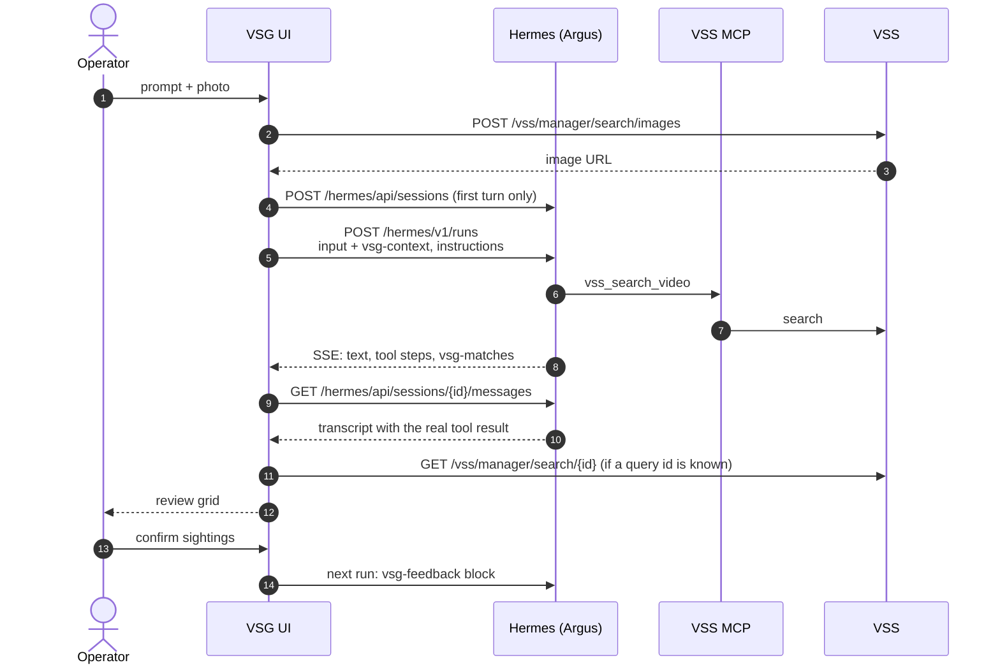
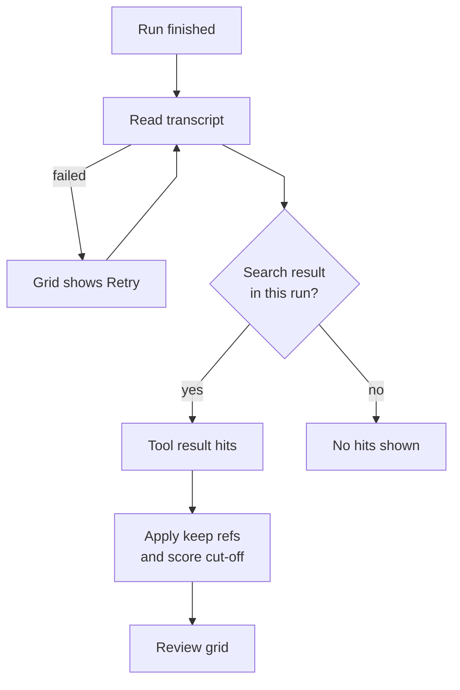
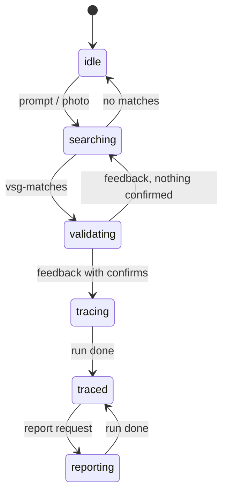

<!--
SPDX-FileCopyrightText: (C) 2026 Intel Corporation
SPDX-License-Identifier: Apache-2.0
-->

# Virtual Security Guard Agent: Design

Developer reference for the Virtual Security Guard Agent (VSG) console. Read
[How it Works](./how-it-works.md) first for the components and the
investigation flow; this page does not repeat them. Hermes endpoints, SSE
events and reconnect rules are in
[Hermes API Flow](../Hermes_API_Flow.md). Hermes configuration (MCP server,
model, API key) is in
[Install the Hermes Skills](./get-started/install-hermes-skills.md).

## 1. One Operator Turn

Every turn is one Hermes run in the investigation's session. Session titles
start with `VSG · ` so past investigations can be listed
(`ui/src/config/env.ts`).

## 2. Directive Protocol (v1)

Argus replies in prose plus at most one fenced JSON block of each type.
Schemas: `ui/src/protocol/directives.ts` (kept in sync with
`hermes-skills/virtual-security-guard/references/directive-protocol.md`).

| Block | Direction | Fields | UI |
|---|---|---|---|
| `vsg-context` | UI → Argus | `image_url`, `limit` | Appended to the operator prompt (`protocol/feedback.ts`). |
| `vsg-feedback` | UI → Argus | `vss_query_id`, `confirm`, `reject`, `anchor_image_url` | Review verdicts; preceded by a prose summary. |
| `vsg-matches` | Argus → UI | `keep`, `note`, `notes` | Review grid; hits come from the same reply's `vss_search_video` result. |
| `vsg-report` | Argus → UI | `title`, `preset` (`handover`, `escalation`, `brief`), `summary`, `subject`, `timeline[{ref, note}]`, `observations`, `actions`, `confidence` | Editable report and PDF. |
| `vsg-status` | Argus → UI | `phase` (`search`, `validate`, `trace`, `report`, `idle`), `message` | Progress line. |

- Refs are `m<N>`: the Nth entry of the search result (or its `match_id`).
  A video id or `video_id@start` is tolerated; unresolvable refs are ignored.
- Other `vsg-*` fences (for example the retired `vsg-track`) are ignored.

### Per-run instructions

Each run carries a short `instructions` text (`protocol/instructions.ts`). It
restates the block grammar, because a small model forgets it, and adds session
context: phase, live cameras, whether live search is available, the running
watch, the current query id, verdicts so far, and every confirmed sighting as
a numbered timeline. The procedures themselves live in the
`virtual-security-guard` Hermes skill. When the protocol changes, update
`directives.ts`, `instructions.ts` and `hermes-skills/*` together, then
reinstall the skills.

Argus uses these VSS MCP tools, called through Hermes `tool_call` with the
full name (for example `mcp__video_search_mcp__vss_list_streams`):

| Tool | Use |
|---|---|
| `vss_search_video` | Search by text or image. |
| `vss_list_tags` | Map camera names to VSS tags. |
| `vss_list_streams`, `vss_add_stream`, `vss_update_stream`, `vss_remove_stream` | Manage live RTSP cameras the operator names. |

A camera is a VSS tag. For "search the X, Y and Z cameras", Argus maps each
name to tags (case-insensitive, `_` = space) and searches with those `tags`.
The composer has no camera or time pickers: cameras and time ranges come only
from the prompt text, and `vsg-context` carries just `image_url` and `limit`.

## 3. Grounding

After each run the UI reads the session transcript and takes the latest
`vss_search_video` result of that run: the messages after the run's own
prompt (`groundingForRun` in `protocol/grounding.ts`). The tool
output is untrusted: only typed fields are read, at most 200 hits, and media
URLs are reduced to same-origin datastore paths.

The transcript is the only source of hits (`features/agent/useDirectiveHits.ts`):
nothing the model writes into a block is shown, and the query id comes only
from the tool result. If the transcript cannot be read, the grid shows a
**Retry** button that reads it again.

## 4. Review and Confirmed Sightings

- **Score cut-off**: a hit is eligible when its score is at least
  *minimum score* (Settings, default 0.6) × the peak score of that search
  (`lib/hits.ts`). Argus applies the same rule to `keep`.
- **Grid**: six at a time, up to 20 per search
  (`features/agent/ValidationGrid.tsx`). Shown but unconfirmed matches are
  sent as `reject`.
- **Latest grid only**: only the newest grid can be changed; re-sending
  replaces its verdicts. Earlier grids are read-only. A new grid starts with
  the sightings already on the route confirmed. Reviews are keyed by the
  agent turn id (`useInvestigationStore.reviews`).
- **Confirmed sightings** (`stores/case.ts` `confirmedSightings`): the sent
  verdicts of every grid in turn order (a later grid's verdict on the same
  segment `video_id@start` wins), plus confirmed live sightings, sorted by
  when the sighting happened. VSS and browser clocks can differ, so
  VSS times are only compared with each other.
- **Crop**: a crop from the clip player is uploaded with
  `POST /vss/manager/search/images` and sent as a new image search (a new
  grid). The subject is derived from the turns: the latest searched image
  (a crop included), else the latest search prompt (`subjectImageOf`,
  `subjectTextOf`). It is the case-file and report photo and what a live
  search watches for, taken when Start is pressed.

Confirmed sightings are the route (`useRoute()`), derived on demand: they feed
the instructions timeline, the floorplan and the report. The PDF lists them in time order, then a
**Movement** section with each leg between cameras and its elapsed time
(`stores/case.ts` `movementLegs`).

## 5. Live Watch

`stores/watch.ts`. The route card (`LiveWatch.tsx`) shows once the session
has a confirmed sighting; its start button appears only while a live camera is
connected. A watch starts only on an operator action:

**Start live camera search** sends `POST /vss/manager/search` (image or
description, 5-minute window, all live cameras) then `PATCH /vss/manager/search/{id}/watch`.
Argus never calls `vss_watch_search`; asked in chat, it points the operator to
the button.

The UI then polls `GET /vss/manager/search/{id}` every 10 s, without LLM
calls. The watched query only ranks a rolling 5-minute window and keeps no
history, so the UI keeps the **live timeline** (`stores/liveTimeline.ts`):
`addHits` folds each poll's live hits into sightings, one per camera while
detections are at most 60 s apart (start, end, best frame, count), skipping
hits already counted and never extending a sighting from an earlier watch. The
timeline is persisted in browser storage per Hermes session (last 20) and
restored when the session is reopened. **Confirm** on a sighting adds it to
the route as one stop at its start, spanning to its end; there is no reject.
After the watch the timeline stays, read-only. The watch stops on **Stop**, after the watch duration (default
30 min), after the idle limit with no new sighting (default 10 min), or when
VSS reports the query failed. Stop pressed while the query is still being
created unwatches it as soon as VSS returns its id. If VSS refuses to unwatch,
the card shows **Retry stop** (a toast with Retry after a reset).

## 6. Investigation Phases

`InvestigationPhase` in `stores/investigation.logic.ts`. The phase picks the
composer placeholder and is sent in the instructions.

**Stop** cancels the run and returns to the phase before it. Camera and
watch requests run in the `idle` phase.

## 7. Floorplan

`stores/floorplan.ts`, `features/map/`. A floorplan is JSON
(`features/map/schema.ts`): `cameras` keyed by plan key, each with `x`, `y`
and optional `zone`, `fov_angle`, `heading`, `range`;
plus optional `canvas`, `zones`, `walls` and a same-origin or `data:`
`background`. The default plan is `deploy/floorplans/$VSG_FLOORPLAN.json`
(`simple` or `level4` ship), mounted read-only at `/etc/vsg/floorplans` and
served by nginx (or the Vite dev server) as `GET /floorplan.json`. The store
fetches it once at startup (`loadDefaultFloorplan`) and validates it; Argus
runs wait for it so free positions are listed. Only an uploaded plan is
persisted in the browser.

A plan camera's key is its name and its VSS tag (`features/map/tags.ts`);
tags are set only in the plan file. The UI shows the tag wherever a camera
appears; VSS stream names are not used. VSS tags that are not a plan key are
listed on the Floorplan page. A live camera is added at a plan camera
(`features/cameras/CameraFormDialog.tsx`): the key becomes the stream's name
and only VSS tag and its zone the description. A stream's name and tag never
change (`StreamPatch` has no name or tags); to move a camera, remove it and
add it again. Each run's instructions list the free floorplan cameras
(`freeFloorplanCameras`), and Argus must tag a camera added from chat to one
of them (name and tag both that key), asking the operator when the prompt
names none; Argus never renames or retags a camera. Report sightings and the timeline sent to Argus carry the
camera's zone (`cameraZone`). The plan persists in browser
storage (`vsg.floorplan.v1`). The route draws confirmed and live sightings
in time order, collapsing consecutive stops on the same camera. Authoring
steps: [Configure the Floorplan](./how-to-guides/configure-floorplan.md).

## 8. State Stores

Zustand stores in `ui/src/stores/`:

| Store | Holds |
|---|---|
| `investigation` | The case: session, turns, phase, review verdicts per grid; runs and grounds each turn. The subject and the route are derived (`subjectImageOf`, `useRoute()`). |
| `watch` | Live watch runtime: query, status, polling, stop handling. |
| `liveTimeline` | Live sightings per Hermes session, with their confirmed state (persisted in this browser). |
| `cameras` | VSS live streams and their status. |
| `floorplan` | Active plan (persisted). |
| `reports` | PDFs generated in this tab (memory only, lost on reload). |
| `settings` | Minimum score (0.6), search limit (24), watch duration (30 min), idle stop (10 min). |

Pure route helpers (`confirmedSightings`, `movementLegs`, `timelineLines`)
live in `stores/case.ts`.

Selectors must return stable references; see
[`.github/copilot-instructions.md`](../../.github/copilot-instructions.md).

## 9. nginx Gateway (BFF)

`ui/nginx/templates/`; the Vite dev proxy (`ui/vite.config.ts`) mirrors it.

- **Allowlist**: one `location` per route with a method limit and strict id
  regex; any other `/hermes/` or `/vss/` path returns `403`. Routes:
  [API Reference](./api-reference.md).
- **Hermes key**: nginx strips `/hermes` and sets
  `Authorization: Bearer ${HERMES_API_KEY}`. It clears `Origin`, `Referer`
  and `Cookie`, and hides `Set-Cookie` and CORS headers.
- **CSRF guard**: because `Origin` is stripped, nginx itself rejects
  cross-site requests (`Sec-Fetch-Site`, or an `Origin` for another host).
- **Limits**: `POST /hermes/v1/runs` is rate limited (20/min, burst 10). The
  SSE stream is unbuffered with a 1 h read timeout. Image uploads are capped
  at 3 MB (the UI re-encodes to 2 MB or less); other bodies at 1 MB or less.
- **Media**: datastore clips and images are streamed unbuffered and given a
  `Content-Type` by extension, because VSS serves them as
  `application/octet-stream` with `nosniff`.
- **Container**: `deploy/compose.yaml` runs it read-only, as UID 101, with
  `cap_drop: ALL`, `no-new-privileges` and tmpfs for `/tmp` and the rendered
  config.
