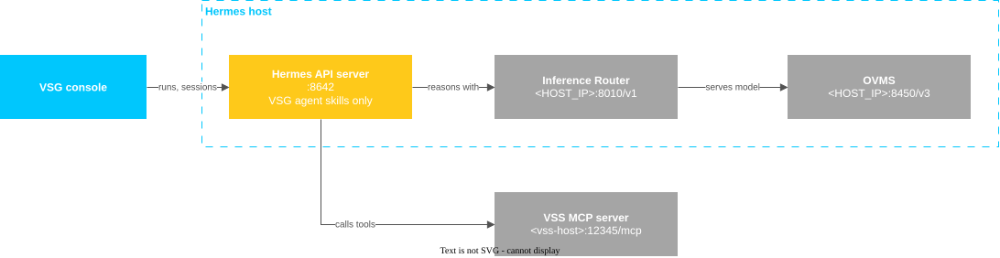

```{eval-rst}
.. meta::
    :description: Set up VSS, the Hermes agent server, and the Virtual Security Guard Agent prerequisite stack.
    :keywords: Virtual Security Guard Agent, VSS, Hermes agent server, OpenVINO model server, prerequisite stack
```

<!--
SPDX-FileCopyrightText: (C) 2026 Intel Corporation
SPDX-License-Identifier: Apache-2.0
-->

# Set Up the Prerequisite Stack

The VSG agent needs two services: VSS in search mode, which indexes and searches camera footage,
and a **Hermes** agent server, where the VSG agent runs with a model served by the
OpenVINO™ model server. Set up both on one host, with VSS first. If VSS
runs on another host, replace `<vss-host>` with the host address, in the **Set Up VSS in Search Mode** step.



## 1. Get the Sources

VSS and the Hermes installer are both in `edge-ai-libraries`. Step 5 installs
the VSG agent skills from the VSG source in `metro-ai-suite`. Clone both into
the same directory:

```bash
git clone --filter=blob:none --sparse --branch main https://github.com/open-edge-platform/edge-ai-libraries.git
git -C edge-ai-libraries sparse-checkout set sample-applications/video-search-and-summarization frameworks/agent-harness-install
git clone --filter=blob:none --sparse --branch main https://github.com/open-edge-platform/metro-ai-suite.git
git -C metro-ai-suite sparse-checkout set virtual-security-guard-agent
```

The later steps start from this directory.

## 2. Set Up VSS in Search Mode

Choose the service credentials and start VSS:

```bash
cd edge-ai-libraries/sample-applications/video-search-and-summarization
export REGISTRY_URL=intel TAG=latest
export MINIO_ROOT_USER=<user> MINIO_ROOT_PASSWORD=<password>
export POSTGRES_USER=<user> POSTGRES_PASSWORD=<password>
export RABBITMQ_USER=<user> RABBITMQ_PASSWORD=<password>
export MULTIMODAL_EMBEDDING_MODEL="MarketaJu/siglip2-person-description-reid"
export DATAPREP_DETECTION_MODEL="OpenVINO/yolox_s-int8-ov"
source setup.sh --search
```

Open `http://<vss-host>:12345/` to check that VSS is up. VSG and the VSS MCP
server both use this address. For GPU embedding, the Milvus vector database
backend, proxy settings, and other options, see the VSS
[Get Started](https://github.com/open-edge-platform/edge-ai-libraries/blob/main/sample-applications/video-search-and-summarization/docs/user-guide/get-started.md)
guide.

## 3. Install the Hermes Agent Server and OpenVINO Model Server

The [agent-harness-install](https://github.com/open-edge-platform/edge-ai-libraries/tree/main/frameworks/agent-harness-install)
installer starts the OpenVINO model server and the **Inference Router** in Docker,
installs the Hermes agent server, and connects the agent server to the router.
Follow steps 4 through 7 to configure the Hermes agent server for VSG.

Install the Hermes agent server and serve the model:

```bash
cd edge-ai-libraries/frameworks/agent-harness-install
export MODEL=OpenVINO/Qwen3.6-35B-A3B-int4-ov
export SERVED_MODEL="${MODEL##*/}"
export HARNESS_OVMS_REST_PORT=8450 && ./install.sh --harness hermes --model "$MODEL"
```

> **Note:** The VSG agent needs a model that follows a strict reply format and
> calls tools correctly. `Qwen3.6-35B-A3B` is a mixture-of-experts model with
> about 3 billion active parameters, so it is quick but still reliable. Smaller
> models often break the reply format or misuse tools. Dense models such as
> `OpenVINO/Qwen3.8-27B-int4-ov` are more accurate but run slowly.

- When the installer prompts for **Runtime [host/openshell]**, press Enter to
  keep `host`. `openshell` runs the Hermes agent server in an OpenShell sandbox.
- When the installer prompts for **Host/IP to advertise in printed endpoint
  URLs**, enter the host's IP address (`<HOST_IP>`) so the printed URLs work
  from other machines.
- The installer installs Docker Engine, Node.js runtime, and the Python interpreter
  if they are missing, and checks the Intel® GPU. See
  [Get Started](https://github.com/open-edge-platform/edge-ai-libraries/blob/main/frameworks/agent-harness-install/docs/user-guide/get-started.md)
  for all options.
- The model is already in OpenVINO IR format, so OpenVINO model server downloads
  it without
  converting it. The GPU, or system memory for an integrated GPU, must hold the
  model weights, KV cache, and VSS models together.
- Behind a proxy, export `HTTP_PROXY`, `HTTPS_PROXY` and `NO_PROXY` first.
  `NO_PROXY` (and `no_proxy`) must include `localhost`, `127.0.0.1`,
  `<HOST_IP>`, and `<vss-host>` so that the Hermes agent server reaches the
  Inference Router and the VSS MCP server directly instead of through the proxy.

Point the Hermes agent server at the router and the model, then check the
installation:

```bash
hermes config set model.provider custom
hermes config set model.base_url http://<HOST_IP>:8010/v1
hermes config set model.default "$SERVED_MODEL"
./install.sh status
```

## 4. Register the VSS MCP Server

From the installer directory:

```bash
./install.sh mcp register vss http://<vss-host>:12345/mcp hermes
```

This adds `mcp_servers.vss` to `~/.hermes/config.yaml`. The VSS MCP server
must be the only entry under `mcp_servers`. Remove any other entries.

> **Note:** Behind a proxy, the Hermes agent server can reach the VSS MCP
> server only if the
> `<vss-host>` is in `NO_PROXY` and `no_proxy` (see step 3). Otherwise, its
> requests go to the proxy, and the VSG agent cannot search.

## 5. Install the VSG Agent Skills

The VSG agent, named Argus, is defined by the files in `hermes-skills/`:

| File | Purpose |
|---|---|
| `SOUL.md` | The VSG agent's identity (the Argus persona) and boundaries. Installed as `~/.hermes/SOUL.md`, which applies to **every** agent on the Hermes host. |
| `virtual-security-guard` | The search, validate, trace, and report workflow; the VSS tool playbook, reply format, and guardrails. |
| `vsg-incident-report` | Turns confirmed sightings into a report draft. |

The Hermes installer also adds bundled skills to `~/.hermes/skills`. The Hermes
gateway loads every skill in that directory, and the skills compete with the
VSG agent for the model's attention. From the directory you cloned into in
step 1, install the VSG agent skills and move all other skills aside:

```bash
cd metro-ai-suite/virtual-security-guard-agent
make install-skills INSTALL_ARGS="--exclusive --no-restart"
hermes skills list
```

The list must show only `virtual-security-guard` and `vsg-incident-report`.

- `--exclusive` does not delete the other skills. It moves them to
  `~/.hermes/skills.removed.<timestamp>`; move a skill back to restore it.
- If a different `SOUL.md` already exists, the installer backs it up as
  `SOUL.md.bak.<timestamp>`.
- `--no-restart` skips the gateway restart, because the gateway is not
  running yet. The Hermes gateway loads the skills when you start it in step 7.

Later, run the command again without `--no-restart` whenever `hermes-skills/`
changes, and after `hermes update` if the list shows the bundled skills again.
The command restarts the gateway, so start a new console session afterward.

## 6. Limit the Tools (Optional)

The console has no login, so anyone who can open it can make the VSG agent use
its tools. To give the agent only the tools it needs, run `hermes tools`,
select the API server platform, and keep only `skills` and the `vss` MCP tools.
Turn off the other toolsets, such as terminal, file, code execution, browser,
and web.

## 7. Enable the API Server and Start the Gateway

The VSG console connects to the Hermes agent server through the Hermes **API
server**, which runs inside the Hermes **gateway**. Both are switched off after
the installer finishes.

Generate and save the API server key:

```bash
openssl rand -hex 32
```

> [!IMPORTANT]
> This key protects the Hermes API server. Use it again as
> `HERMES_API_KEY` in VSG's `deploy/.env`.

Add these lines to `~/.hermes/.env`. Set `API_SERVER_KEY` to the generated key
and `API_SERVER_HOST` to the Hermes host IP that the VSG host can reach:

```bash
API_SERVER_ENABLED=true
API_SERVER_KEY=<the generated key>
API_SERVER_HOST=<hermes-host-ip>
```

Install the gateway as a user service and start it. It loads the skills from
step 5:

```bash
hermes gateway install
hermes gateway start
hermes gateway status
```

Check the API server and the key:

```bash
KEY=<the generated key>
curl -s -o /dev/null -w '%{http_code}\n' http://<hermes-host-ip>:8642/health                    # 200
curl -s -o /dev/null -w '%{http_code}\n' http://<hermes-host-ip>:8642/api/sessions?limit=1      # 401
curl -s -o /dev/null -w '%{http_code}\n' -H "Authorization: Bearer $KEY" \
  "http://<hermes-host-ip>:8642/api/sessions?limit=1"                                          # 200
```

## Next Step

Continue with [Get Started](../get-started.md#2-create-deployenv). Set
`HERMES_BASE_URL=http://<hermes-host-ip>:8642` and use the key from step 7 as
`HERMES_API_KEY`.

## Remove

From the VSS directory:

```bash
source setup.sh --stop          # stops VSS
source setup.sh --clean-data    # also deletes the VSS data volumes (indexed videos, database); keeps the model caches
```

From the installer directory:

```bash
./uninstall.sh --harness hermes                    # keeps the downloaded model
./uninstall.sh --harness hermes --delete-models    # also deletes the model
```

This removes the Hermes agent server and its `~/.hermes` directory,
OpenVINO model server, and the router. Add `--keep-agent-data` to keep `~/.hermes`.