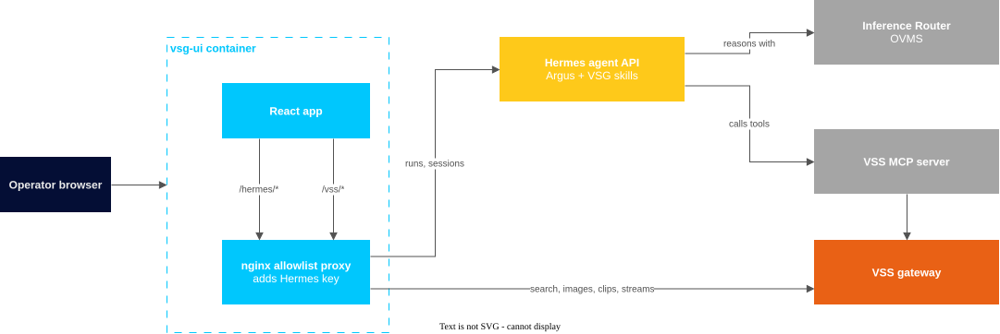
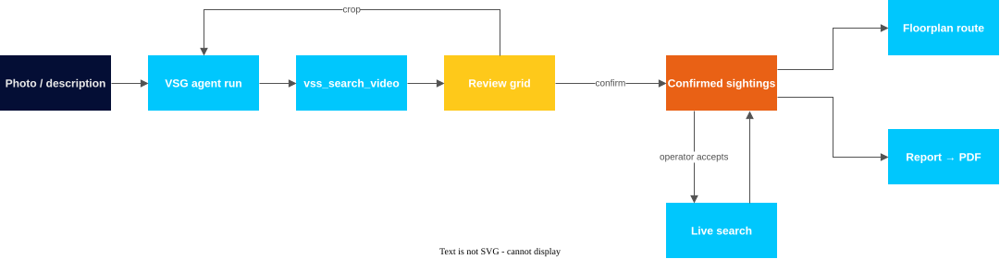

<!--
SPDX-FileCopyrightText: (C) 2026 Intel Corporation
SPDX-License-Identifier: Apache-2.0
-->

# How it Works

The operator talks to the **VSG agent** (named **Argus**) in the browser. The
VSG agent runs on a Hermes agent server, reasons with a local model, and calls
VSS tools through the VSS MCP server. The VSG UI renders the VSG agent's
results and lets
the operator review them.

## Architecture

| Component | Role |
|---|---|
| vsg-ui | Serves the React app and proxies an allowlist of Hermes and VSS paths |
| Hermes agent server | Runs the VSG agent, keeps one session per investigation, streams run events over SSE. |
| VSG Hermes skills | `virtual-security-guard` and `vsg-incident-report`, installed on the Hermes host. |
| VSS MCP server | Gives the agent VSS tools. |
| VSS | Stores and indexes footage, runs searches, serves clips and frames. |
| Model server | The LLM the VSG agent reasons with, for example OVMS. |

## Investigation Flow

1. **Search**: the UI uploads the photo to VSS and starts a VSG agent run. The
   VSG agent calls `vss_search_video`.
2. **Review**: the UI shows the VSS results as a grid. The operator confirms
   the right sightings; the rest count as false positives.
3. **Crop and re-search** (optional): a person cropped from a clip is sent
   as a new image search, and becomes the subject image.
4. **Route**: confirmed sightings from all grids, in time order, become the
   route on the floorplan.
5. **Live search** (optional): available on the route card while a live
   camera is connected. It starts only when the operator clicks it, and the
   UI polls VSS every 10 s.
6. **Report**: chosen from the route card; the VSG agent drafts the report and the
   browser builds the PDF.

## Learn More

- [System Requirements](./get-started/system-requirements.md)
- [Get Started](./get-started.md)
- [Known Issues](./known-issues.md)
- [Release Notes](./release-notes.md)

