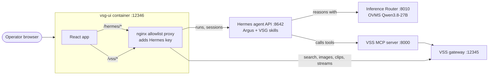
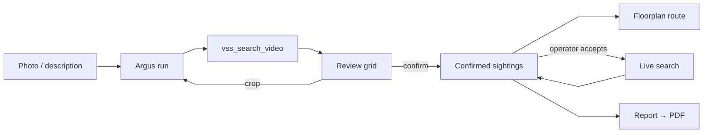

<!--
SPDX-FileCopyrightText: (C) 2026 Intel Corporation
SPDX-License-Identifier: Apache-2.0
-->

# How it Works

The operator talks to **Argus** in the browser. Argus runs on a Hermes agent
server, reasons with a local model, and calls VSS tools through the VSS MCP
server. Virtual Security Guard Agent (VSG) renders Argus's results and lets
the operator review them.

## Architecture

| Component | Role |
|---|---|
| vsg-ui | One unprivileged, read-only nginx container. Serves the React app and proxies an allowlist of Hermes and VSS paths; everything else gets `403`. |
| Hermes agent server | Runs Argus, keeps one session per investigation, streams run events over SSE. |
| VSG Hermes skills | `virtual-security-guard` and `vsg-incident-report`, installed on the Hermes host. |
| VSS MCP server | Gives Argus VSS search, live-watch and camera tools. |
| VSS | Stores and indexes footage, runs searches, serves clips and frames. |
| Model server | The LLM Argus reasons with, for example OVMS. |

## Investigation Flow

1. **Search**: the UI uploads the photo to VSS and starts an Argus run. Argus
   calls `vss_search_video`.
2. **Review**: the UI shows the VSS results as a grid. The operator confirms
   the right sightings; the rest count as false positives.
3. **Crop and re-search** (optional): a person cropped from a clip is sent
   as a new image search, and becomes the subject image.
4. **Route**: confirmed sightings from all grids, in time order, become the
   route on the floorplan.
5. **Live search** (optional): available on the route card while a live
   camera is connected. It starts only when the operator clicks it, and the
   UI polls VSS every 10 s.
6. **Report**: chosen from the route card; Argus drafts the report and the
   browser builds the PDF.

## Trust the Tool, Not the Model

Small models can mistype ids. The grid shows what VSS returned, read from the
Hermes session transcript, not clips the model typed. Argus only chooses
*which* results to highlight. If the transcript cannot be read, the grid
offers **Retry**; it never shows clips the model wrote.

## Security

- The Hermes API key lives only in `deploy/.env` and nginx; the browser never
  sees it.
- Only the routes in the [API Reference](./api-reference.md) are proxied.
- The container runs read-only, as non-root, with all capabilities dropped.
- The console has no login. Run it on a trusted network.
- Argus describes clothing and movement only; it never identifies people.

For the protocol, grounding, proxy and state details, see
[Design](./design.md).

## Learn More

- [System Requirements](./get-started/system-requirements.md)
- [Get Started](./get-started.md)
- [API Reference](./api-reference.md)
- [Known Issues](./known-issues.md)
- [Release Notes](./release-notes.md)

<!--hide_directive
:::{toctree}
:hidden:

design.md

:::
hide_directive-->
