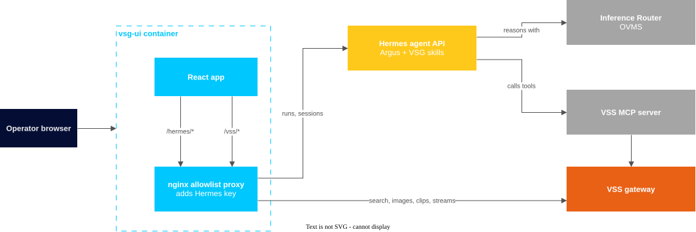
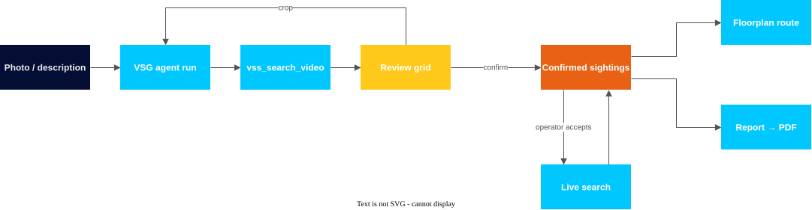

```{eval-rst}
.. meta::
   :description: Explains the Virtual Security Guard agent architecture and investigation flow.
   :keywords: Virtual Security Guard, VSS, agent architecture, investigation flow.
```

<!--
SPDX-FileCopyrightText: (C) 2026 Intel Corporation
SPDX-License-Identifier: Apache-2.0
-->

# How It Works

The operator interacts with the VSG agent, named **Argus**, in the browser. The
agent runs on a Hermes agent server, reasons with a local model, and calls VSS
tools through the VSS server, which exposes them using the Model Context Protocol (MCP). The VSG UI renders the agent's results and lets operators review them.

## Architecture



| Component | Role |
|---|---|
| vsg-ui | Serves the React application and proxies an allowlist of Hermes and VSS paths. |
| Hermes agent server | Runs the VSG agent, keeps one session per investigation, and streams run events over Server-Sent Events (SSE). |
| VSG Hermes skills | Provide the `virtual-security-guard` and `vsg-incident-report` skills installed on the Hermes host. |
| VSS MCP server | Provides the agent with VSS tools. |
| VSS gateway | Stores and indexes footage, runs searches, and serves clips and frames. |
| Model server | Provides the LLM used by the VSG agent, such as OpenVINO™ model server. |

## Investigation Flow



1. **Search**: The UI uploads the photo to VSS and starts a VSG agent run. The VSG agent
   calls `vss_search_video`.
2. **Review**: The UI displays VSS results in a grid. The operator confirms the right
   sightings; the others count as false positives.
3. **Crop and search again** (optional): The operator can crop a person from a clip and
   submit the crop as a new image search. The crop becomes the subject image.
4. **Route**: Confirmed sightings from all grids appear in chronological order as a route
   on the floor plan.
5. **Live search** (optional): When a live camera is connected, the operator can start
   live search from the route card by clicking the live-search control. The UI polls VSS
   every 10 seconds.
6. **Report**: The operator can generate a report from the route card. The VSG agent
   drafts the report, and the browser builds the PDF.

## Learn More

- [System Requirements](./get-started/system-requirements.md)
- [Get Started](./get-started.md)
- [Known Issues](./known-issues.md)
- [Release Notes](./release-notes.md)

