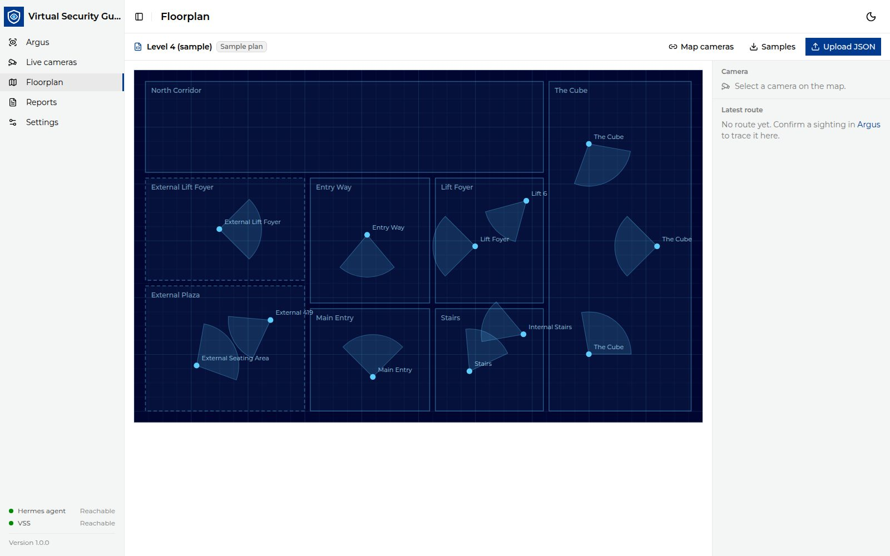

<!--
SPDX-FileCopyrightText: (C) 2026 Intel Corporation
SPDX-License-Identifier: Apache-2.0
-->

# Configure the Floorplan

The **Floorplan** page draws your cameras, their fields of view and the
subject's route.

The default plan is a file on the host, in `deploy/floorplans/`. It is mounted
read-only into the container and served as `/floorplan.json`. Two plans ship
there:

- `simple.json`: **Simple (4 cameras)**, one camera per zone, keyed
  `camera_1` to `camera_4`. This is the default.
- `level4.json`: **Level 4 (sample)**, a full floor with Level 4 VSS camera
  tags.

To use your own plan, put it in `deploy/floorplans/` (for example
`site-a.json`), set `VSG_FLOORPLAN=site-a` in `deploy/.env` and run `make up`.
No rebuild is needed. After you edit the file, refresh the browser. The
container does not start if the file is missing. `npm run dev` serves the same
folder (set `VSG_FLOORPLAN` in `ui/.env.local`).

You can also upload a plan on the **Floorplan** page. It is stored in that
browser and replaces the default there; **Use default** goes back.



## 1. Get a template

Copy `deploy/floorplans/simple.json`, or click **Download JSON** on the
**Floorplan** page to save the plan you are viewing.

## 2. Write the plan

The minimal plan only needs camera positions:

```json
{
  "cameras": {
    "entry_cam_1": { "x": 120, "y": 450, "zone": "Lobby", "fov_angle": 90 }
  }
}
```

Coordinates are SVG units, origin top-left, `y` pointing down.

| Field | Required | Meaning |
|---|---|---|
| `cameras.<key>` | yes | One entry per camera. The key is the camera's name and its VSS tag, for example `P_Lev_4_Main_Entry_ip_54`. Use only letters, digits, `_` and `-` (at most 128 characters). |
| `cameras.<key>.x`, `.y` | yes | Camera position. Must not be negative, and must lie on the canvas when `canvas` is set. |
| `cameras.<key>.zone` | no | Zone name shown on the map and in reports. |
| `cameras.<key>.fov_angle` | no | Field-of-view width in degrees (1–360). |
| `cameras.<key>.heading` | no | Viewing direction in degrees: `0` = right/east, `90` = down/south. |
| `cameras.<key>.range` | no | Length of the field-of-view wedge. |
| `name` | no | Plan name. |
| `canvas` | no | `{ "width": …, "height": … }`. |
| `background` | no | `data:image/…` URI or a same-origin path. Remote URLs are rejected. |
| `zones` | no | `[{ "name": …, "rect": {x,y,w,h} }]` or `points` polygons; `outdoor: true` draws a dashed outline. Zone names must be unique. |
| `walls` | no | List of polylines `[[x,y], [x,y], …]`. |

Plans are limited to 5 MB.

## 3. Upload the plan

1. Click **Upload JSON** and choose the file.
2. Each plan camera's key is its VSS tag. Nothing is matched by similar
   names. The map shows each camera as:

   | Look | State |
   |---|---|
   | Green, pulsing | **Live**: a live camera on this tag is sending frames. |
   | Solid blue | **Mapped**: VSS has footage under this tag. |
   | Hollow ring | **Empty**: nothing in VSS yet. Not an error; use **Add live camera here**. |

3. The header counts VSS cameras that are not a camera key on the plan; click
   it to list them, with **Copy** next to each name. To draw one, add it to
   the file as a camera key and upload the file again. Camera names are set
   only in the file.
4. Click a camera on the map to see its zone and name, or to add a live
   camera there. The legend below the map shows live, recorded and no-footage
   cameras and the route. Click **Use default** to go back to the plan set by
   `VSG_FLOORPLAN`; **Undo** in the notice brings the upload back.
5. A plan must use plain JSON numbers for positions, and each zone needs
   exactly one of `points` or `rect`. A saved upload that no longer validates
   is dropped with a notice, and the default plan is used.

A removed live camera's key stays on the plan, so its recorded footage is
still drawn at the same place.

Camera tags come from VSS video tags (for example
`P_Lev_4_Entry_Way_ip_107`). A sighting is drawn only if its camera is on the
plan. Live cameras take their tag from the plan: see
[Manage Live Cameras](./manage-live-cameras.md). Every camera's location
(reports, match cards, the **Live cameras** page) is the zone from the plan;
VSS is not changed.
