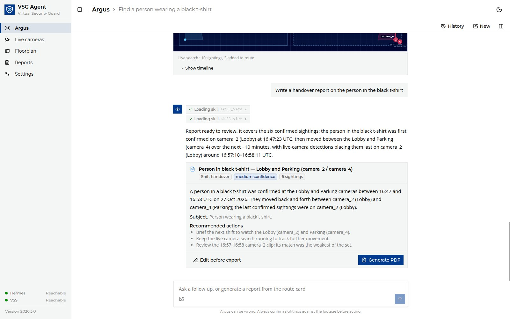
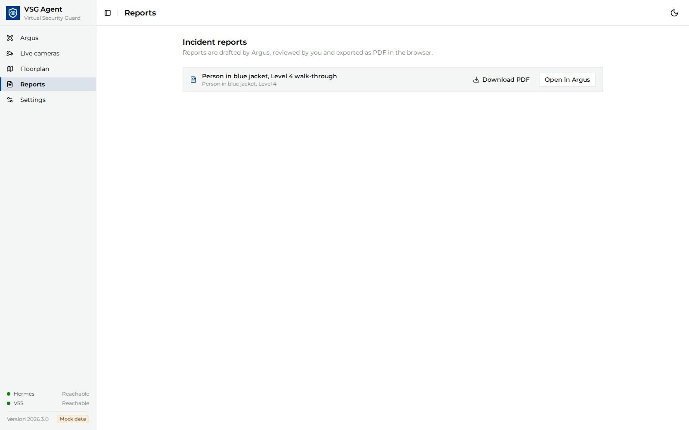
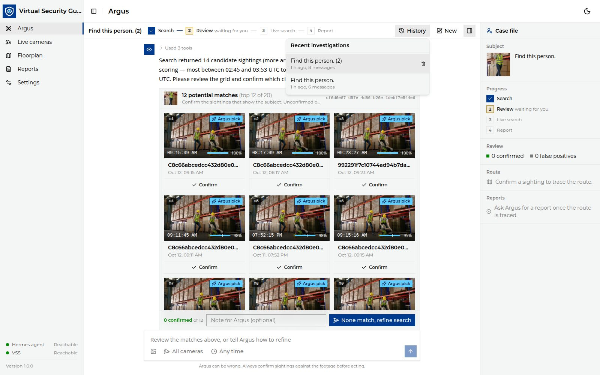
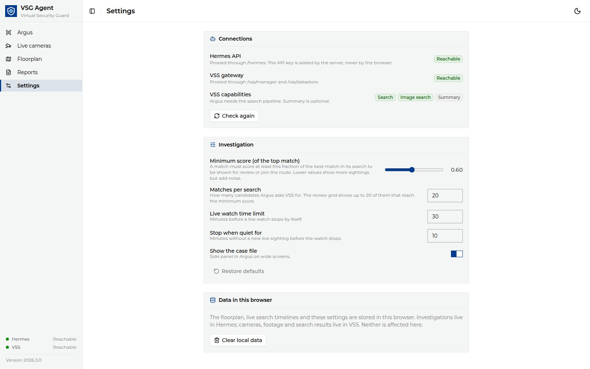

```{eval-rst}
.. meta::
  :description: Search footage, review sightings, trace routes, run live searches, and create reports with the Virtual Security Guard Agent.
  :keywords: Virtual Security Guard Agent, VSG, investigation, person search, cameras, reports
```

<!--
SPDX-FileCopyrightText: (C) 2026 Intel Corporation
SPDX-License-Identifier: Apache-2.0
-->

# Investigate a Person

This guide shows how to investigate a person with Argus, the Virtual Security
Guard Agent (VSG). On the **Argus** page, you can search, review matches, crop
an image and search again, trace a route, start a live camera search, and
generate a report. The **Case file** panel on the right displays the subject,
review counts, and route.

## 1. Start a Search

1. Open `http://<HOST_IP>:12346/argus`. Click **New** to start a fresh
   investigation.
2. Describe the person in your message, attach a photo, or do both. To attach a
   photo, use the image button or drag and drop the photo.
3. Press **Enter** or click the send button.

VSG uploads the photo to VSS, creates a Hermes session for the investigation,
and starts a VSG agent run. The VSG agent calls the VSS search tool and replies
with a short summary and a grid of potential matches. The search covers all
footage indexed by VSS, including uploaded videos and footage already recorded
by live cameras. Each match names its camera by tag, for example, `camera_1`.

Your message appears on the right, with a photo above it. The VSG agent's reply
appears on the left, next to its eye icon. It contains a short summary of what
the agent searched and found, followed by the review grid. The **Case file**
panel on the right shows the subject and review counts.

Above each reply, the chips (small buttons above an agent reply that represent
individual tool calls) show what the VSG agent did during that turn: which
skills it loaded and which VSS tools it called. If there are three or more
chips, they are collapsed under **Used N tools**. Click the label to expand the
list, or click a chip to see the beginning of that tool's result.

## 2. Review the Matches

The grid shows the **top six** matches, three per row. Each card shows a frame
from the clip with the match reference (`m1`, `m2`, ...), the clip time, and the
VSS relevance score. It also shows the camera, its zone, the date, and a
**Confirm** button. A confirmed card turns green; a false positive turns gray.
The VSG agent may mark recommended cards as **Argus pick**.

- Click **Show N more findings** to reveal six more at a time, up to **20**.
- Click a thumbnail to open the clip player.
- Click **Confirm** on every card that shows the subject. Anything shown but
  left unconfirmed is sent to the VSG agent as a false positive.
- Click **Save N confirmed**. If nothing matches, click **None match**. If
  matches are still hidden, the button reads **None match, show N more** and
  shows them first. This sends nothing and starts no new search. The footer
  offers **Try another photo** and **Refine in chat**, where you can describe
  clothing, name cameras, or give a time range.
- If some VSS results could not be read, the grid says how many were left out.
  If none could be read, it shows **Retry**.

The footer counts what you confirmed, for example, **3 confirmed of 9**, and
shows how many sightings the investigation already has.

You can change only the latest grid. Update its review before searching again;
the button then reads **Update review** and replaces that grid's earlier
verdicts. Earlier grids remain visible and read-only with the verdicts you sent.
Each new grid starts with sightings already on the route confirmed.

> [!NOTE]
> Argus can be wrong. Always confirm sightings against the footage before
> acting.

## 3. Play a Clip

The clip player opens nearly full-screen at the matching segment. Below the
video, it shows the match reference, camera, time, segment range, relevance
score, and zone. The footer has **Pause & crop person** and **Confirm**.
**Confirm** works the same as it does on the card. Press **Esc** to close the
player.

## 4. Crop the Person and Search Again

When a clip shows the subject clearly, use it as a better reference image:

1. In the clip player, click **Pause & crop person**. The frame freezes and
  dims, and a toolbar appears at the bottom of the frame.
2. Drag a rectangle around the person. Its size in video pixels appears above
  it. Drag inside it to move it, or click **Redo** to draw again. Use **Frame**
  ‹ › to move to a sharper frame. Press **Esc** or click **Cancel** to leave
  crop mode.
3. Click **Save crop** (or press **Enter**).

The crop is taken at the video's native resolution and uploaded to VSS. The VSG
agent searches with that image, and a new grid appears. The crop becomes the
**Subject**. The subject is always the latest image used for a search, or your
latest search prompt if you did not use an image. It is the photo shown in the
case file and report, and the image used for a live search.

## 5. Trace the Route

After you confirm at least one sighting, a **Route** card appears in the chat,
and the case file lists the stops. Confirmed sightings from all grids are
deduplicated and sorted by time. The card stays in the chat for the rest of the
investigation and draws the route on a small floorplan. **Replay** animates the
route from camera to camera, and **Open floorplan** opens the **Floorplan**
page. See [Configure the Floorplan](./configure-floorplan.md) to map VSS
cameras onto your plan.

## 6. Live Camera Search (Optional)

The Route card offers **Start live camera search** when at least one live
camera is connected. The text beside the button shows how many cameras it will
watch and for how long. It does not watch them until you click the button. If
no live camera is connected, neither the console nor the VSG agent offers a
live search.

- VSS watches live cameras for the subject, and the UI polls every 10 seconds.
  The eye in the Argus logo scans while the search runs.
- Sightings appear in a **live timeline**, newest first. Detections on one
  camera that occur less than a minute apart are grouped into one sighting. It
  has a start time, an end time (**now** while the person is still there), and
  a detection count. A new sighting is highlighted with a **New** badge for a
  few seconds.
- Click **Confirm** on a sighting to add it to the route as one stop. The map
  changes only when you confirm.
- **Stop live search** is always visible. When the search ends, the card shows
  how many sightings it found and how many you added. **Show timeline** opens
  the timeline in read-only mode, and **Search again** adds sightings to the
  same timeline. If VSS does not stop the search, the card shows **Retry stop**.
- VSS keeps no history of a live search, so this browser saves the timeline
  with the investigation. Reopening the investigation from **History** restores
  the timeline and its confirmed stops. Another browser cannot see this data.
- The search also stops automatically when it reaches the **Live watch time
  limit** (default: 30 minutes) or when there has been no new sighting for the
  **Stop when quiet for** duration (default: 10 minutes). You can change both
  settings on the **Settings** page.

Each timeline row shows a frame of the sighting, the camera, the start and end
times, the zone, the detection count, and **Confirm** (**Confirmed** once added).

## 7. Write the Report

On the Route card, click **Generate report** and choose **Handover report**,
**Escalation report**, or **Short brief** (or ask the VSG agent in chat). Your
message appears on one line; the sighting list sent to the VSG agent appears
under **Details**. The agent receives time-ordered sightings and movement
between cameras, then replies with a draft:

- Read the draft in the chat. Use **Edit before export** to change it.
- Click **Generate PDF**, then **Download**. The exported PDF lists every
  confirmed sighting in time order, followed by a **Movement** section.

To guide the draft, type your own request. For example: "Write a handover
report on the person in the black t-shirt."



The browser creates the report files. The **Reports** page lists the latest
report for each past investigation.



## 8. Reopen an Investigation

Each investigation is a Hermes session. Click **History** to reopen or delete
an investigation.



## Investigation Settings

The **Settings** page shows the connection status and investigation parameters.
The browser stores these parameters.



| Setting | Default | Effect |
|---|---|---|
| Minimum score (of the top match) | `0.60` | Fraction of the best match's score a match needs to be shown for review, appear as a live sighting, and join the route. Lower shows more sightings but adds noise. |
| Matches per search | `20` | Candidates the VSG agent asks VSS for. The grid shows up to 20 of them that reach the minimum score. |
| Live watch time limit | `30` minutes | Live search stops by itself after this. |
| Stop when quiet for | `10` minutes | Live search stops after this long without a new sighting. |
| Show the case file | on | Side panel on wide screens. |

**Clear local data** removes what this browser stores: the floorplan, live
search timelines, and the investigation settings listed in the table.
Hermes sessions and VSS data are not affected.