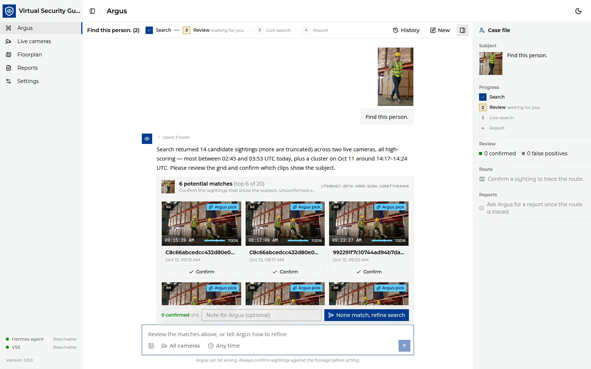
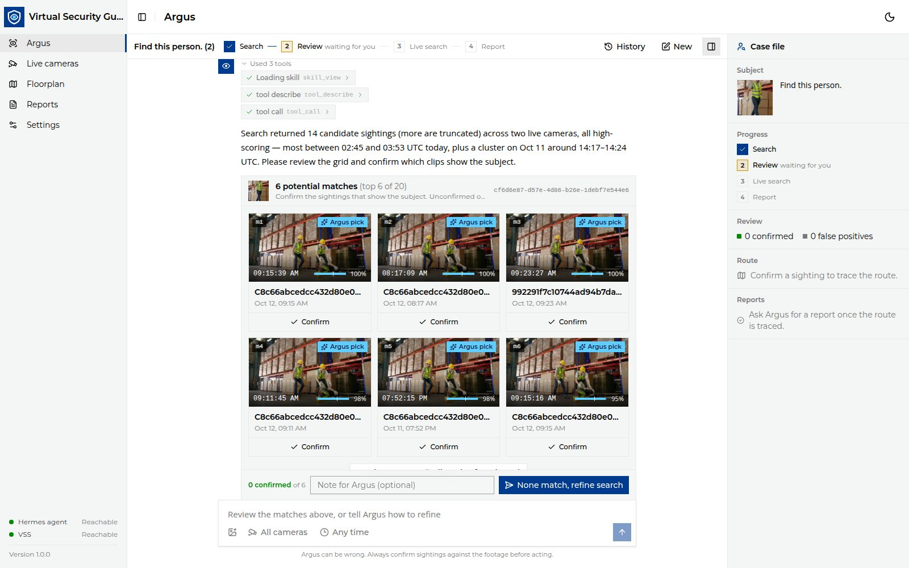
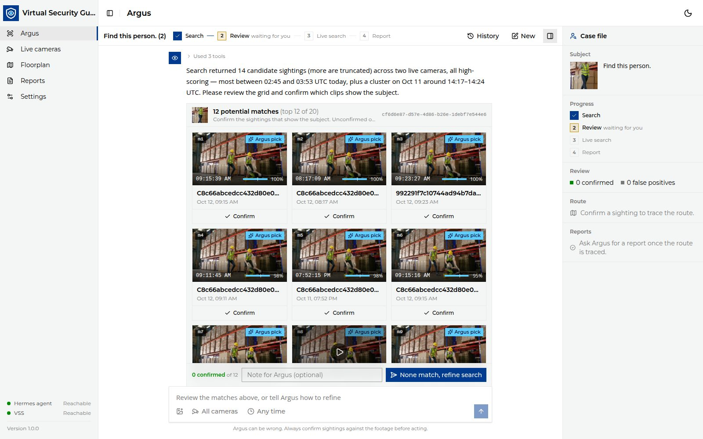
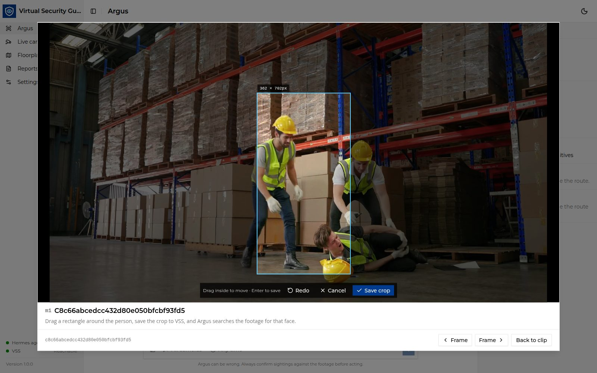
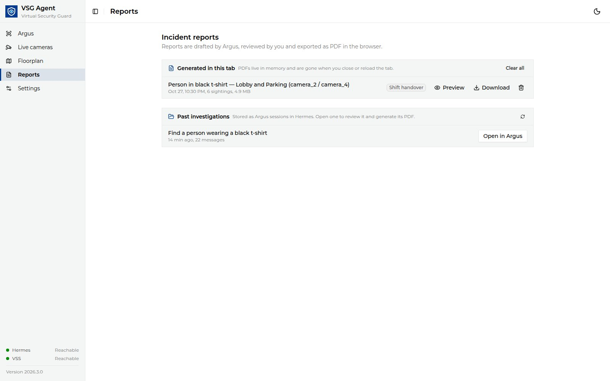
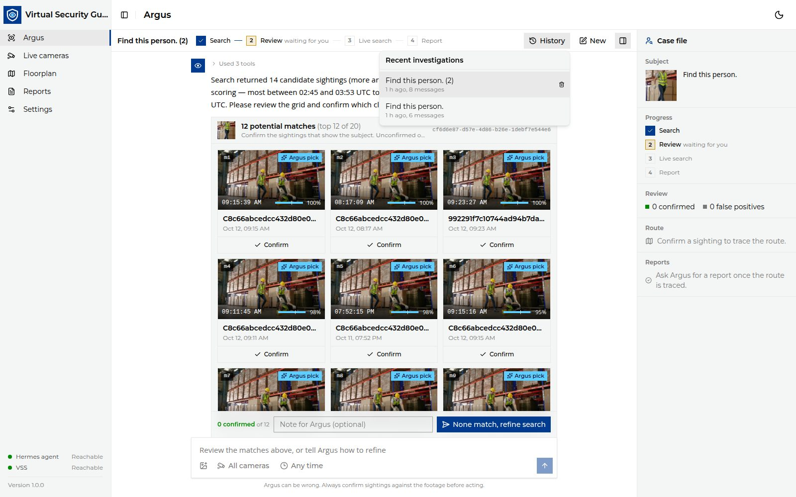
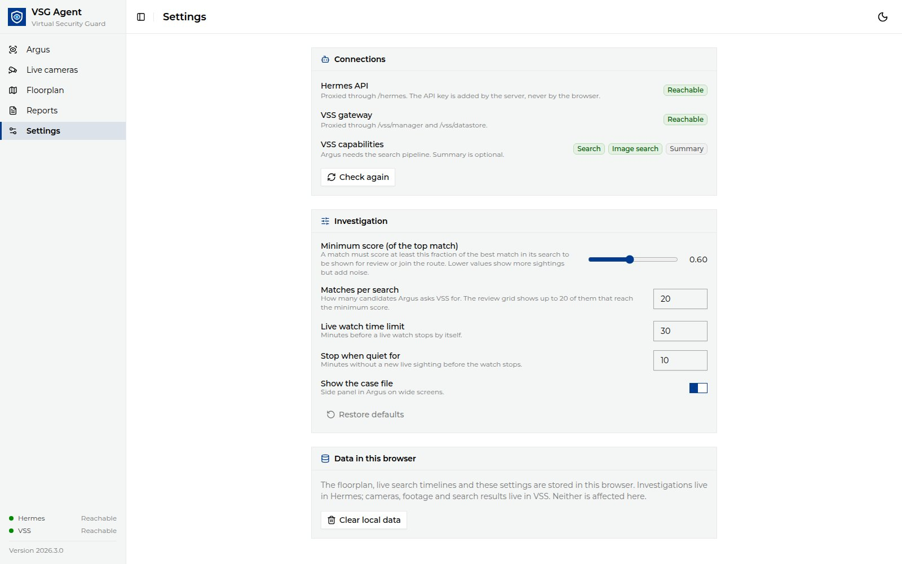

<!--
SPDX-FileCopyrightText: (C) 2026 Intel Corporation
SPDX-License-Identifier: Apache-2.0
-->

# Investigate a Person

This guide walks through a full investigation on the **Argus** page: search,
review, crop and re-search, route, live search and report. The **Case file**
panel on the right shows the subject, the review counts and the route.

## 1. Start a search

1. Open `http://<HOST_IP>:12346/argus`. Click **New** to start a fresh
   investigation.
2. Describe the person, attach a photo with the image button (or drag and
   drop it), or both.
3. Optionally name cameras or a time range in the text, for example
   "search camera_1 and camera_3 between 2 and 3 pm". Argus maps camera
   names to VSS tags and says which cameras it searched. Time ranges match
   when footage was ingested into VSS, not the camera clock.
4. Press **Enter** or the send button.

VSG uploads the photo to VSS, creates a Hermes session for the investigation
and starts an Argus run. Argus calls the VSS search tool and replies with a
short summary and a grid of potential matches. The search covers everything
VSS has indexed: uploaded videos and what the live cameras have already
recorded. Each match names its camera by tag (for example `camera_1`). Nothing
watches the cameras going forward until you start a live search (step 6).

Expand **Used N tools** to see what Argus did (skills loaded and VSS tools
called) for this turn.

## 2. Review the matches

The grid shows the **top six** matches. Each card has the match ref (`m1`,
`m2` …), the clip time, the VSS relevance score, the camera and date. Cards
marked **Argus pick** are the ones Argus recommends.

- Click **Show N more findings** to reveal six more at a time, up to **20**.
- Click a thumbnail to open the clip player.
- Click **Confirm** on every card that shows the subject. Anything shown but
  left unconfirmed is sent to Argus as a false positive.
- Click **Save N confirmed**. If nothing matches, click **None match** (after
  any hidden matches are shown). Nothing is sent and no new search runs; the
  footer offers **Try another photo** and **Refine in chat** (describe
  clothing, name cameras or give a time range).
- If some VSS results could not be read, the grid says how many were left out.
  If none could be read, it shows **Retry**.

Only the latest grid can be changed. Until you search again you can update it;
the button then reads **Update review** and replaces that grid's earlier
verdicts. Earlier grids stay visible, read-only, with the verdicts you sent.
A new grid starts with the sightings already on the route confirmed.

> [!NOTE]
> Argus can be wrong. Always confirm sightings against the footage before
> acting.

## 3. Play a clip

The clip player opens near full-screen at the matching segment and shows the
camera, time, segment range and relevance. **Confirm** in the player works the
same as on the card.

## 4. Crop the person and search again

When a clip shows the subject clearly, use it as a better reference image:

1. In the clip player, click **Pause & crop person**. The frame freezes and is
   dimmed.
2. Drag a rectangle around the person. Drag inside it to move it, **Redo** to
   draw again. Use **Frame** ‹ › to step to a sharper frame. **Esc** or
   **Cancel** leaves crop mode.
3. Click **Save crop** (or press **Enter**).

The crop is cut at the video's native resolution and uploaded to VSS. Argus
runs an image search for it and a new grid appears. The crop becomes the
**Subject**: the subject is always the latest image you searched with (or, with
no image, your latest search prompt). It is the case file photo, the report
photo and what a live search looks for.

## 5. Trace the route

Once at least one sighting is confirmed, a **Route** card appears in the chat
and the case file lists the stops. The confirmed sightings from all grids are
de-duplicated and sorted by when they happened. The card stays in place for
the rest of the investigation. Open **Floorplan** to see the route drawn camera-to-camera. See
[Configure the Floorplan](./configure-floorplan.md) to map VSS cameras onto
your plan.

## 6. Live camera search (optional)

The Route card has **Start live camera search** while at least one live camera
is connected; the line beside it says how many cameras it watches and for how
long. Nothing is watched until you click it. With no live camera connected,
neither VSG nor Argus offers a live search.

- VSS watches live cameras for the subject and the UI polls every 10 seconds.
  The Argus logo's eye scans while the search runs.
- Sightings appear in a **live timeline**, newest first. Detections on one
  camera less than a minute apart are one sighting, with a start and end time
  (**now** while the person is still there) and a detection count. A new
  sighting is highlighted with a **New** badge for a few seconds.
- Click **Confirm** on a sighting to add it to the route as one stop. The map
  changes only when you confirm.
- **Stop live search** is always visible. When the search ends, the card
  shows how many sightings it found and how many you added; **Show timeline**
  opens the timeline read-only, and **Search again** adds to the same
  timeline. If VSS refuses to stop the search, the card shows **Retry stop**.
- VSS keeps no history of a live search, so this browser saves the timeline
  with the investigation: reopening it from **History** brings the timeline and
  its confirmed stops back. Another browser doesn't see it.
- The watch also stops itself after the **Live watch time limit** (default
  30 min) or when there has been no new sighting for **Stop when quiet for**
  (default 10 min). Change both on the **Settings** page.

## 7. Write the report

On the Route card, click **Generate report** and choose **Handover report**,
**Escalation report** or **Short brief** (or ask Argus in chat). Your message
shows one line; the sighting list sent to Argus is under **Details**. Argus
receives the time-ordered sightings with the movement between cameras and
replies with a draft:

- Read the draft in the chat. Use **Edit before export** to change it.
- Click **Generate PDF**, then **Download**. The PDF lists every confirmed
  sighting in time order, followed by a **Movement** section.

PDFs are built in the browser and kept only for the open tab. The **Reports**
page lists them and links to past investigations: open one in Argus to
generate its PDF again.

## 8. Reopen an investigation

Each investigation is a Hermes session. Click **History** to reopen or delete
one; deleting asks for confirmation because it removes the Hermes session. The URL `…/argus?session=<id>` opens a session directly.

## Investigation settings

The **Settings** page shows the connection status and the investigation
parameters. They are stored in the browser.

| Setting | Default | Effect |
|---|---|---|
| Minimum score (of the top match) | `0.60` | Fraction of the best match's score a match needs to be shown for review and join the route. Lower shows more sightings but adds noise. |
| Matches per search | `24` | Candidates Argus asks VSS for. The grid shows up to 20. |
| Live watch time limit | `30` min | Live search stops by itself after this. |
| Stop when quiet for | `10` min | Live search stops after this long without a new sighting. |
| Show the case file | on | Side panel on wide screens. |
