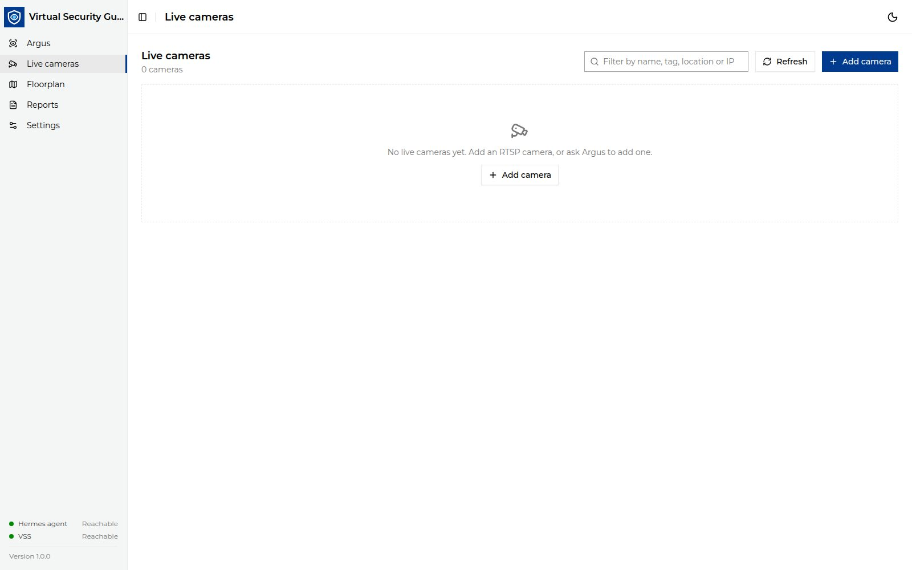
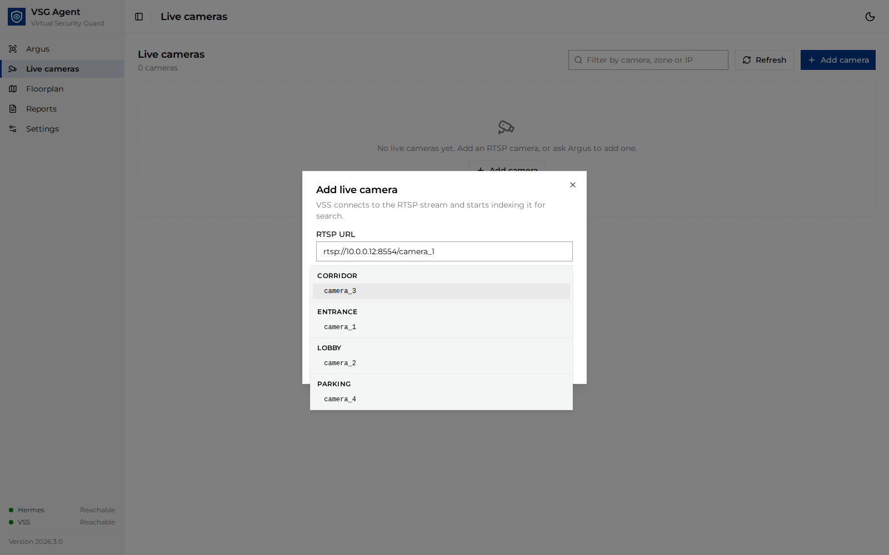

<!--
SPDX-FileCopyrightText: (C) 2026 Intel Corporation
SPDX-License-Identifier: Apache-2.0
-->

# Manage Live Cameras

The **Live cameras** page lists the live RTSP streams registered in VSS
(`/manager/streams`). Live search is available only for
cameras listed here.

## Add a Camera

1. Click **Add camera**, or select a camera on the **Floorplan** and click
   **Add live camera here**. The **Add live camera** dialog opens.
2. Fill in:
   - **RTSP URL**, for example `rtsp://10.0.0.12:8554/lobby` (must be
     reachable from the VSS host);
   - **Camera**: the floorplan camera associated with this stream. The list is grouped by
     zone; cameras that already have a live stream are disabled. The camera
     name (for example `P_Lev_4_Main_Entry_ip_54`) becomes the stream's name
     and its only VSS tag; the camera's zone becomes the stream description. A
     camera that has recorded footage from an earlier stream can be reused; the
     new stream keeps the same tag, so old and new footage are drawn at the
     same place;
   - **Index every N frames** and **Object detection** to tune indexing.
3. Click **Add camera**. VSS starts ingesting the stream and the camera appears
   on the plan. Allow a minute or two before footage from the new camera
   appears in search results.

VSS tags determine which cameras are included in a search. Each live camera has exactly one
tag, unique to its floorplan camera. **Edit** changes only the indexing
settings. To move a stream to another floorplan camera, remove it and add it
again at the new floorplan camera. Confirm the removal when prompted.

## Edit, Pause, or Remove

- Use the pause or resume button on a camera card to pause the ingestion or resume it.
- Open the card's actions menu to **Edit** or **Remove** the camera.
- Use the filter box to find cameras by camera name, zone, or IP, and
  select **Refresh** to reload the list.

If your network uses a proxy, add the RTSP hosts to `no_proxy` on the VSS
host.
