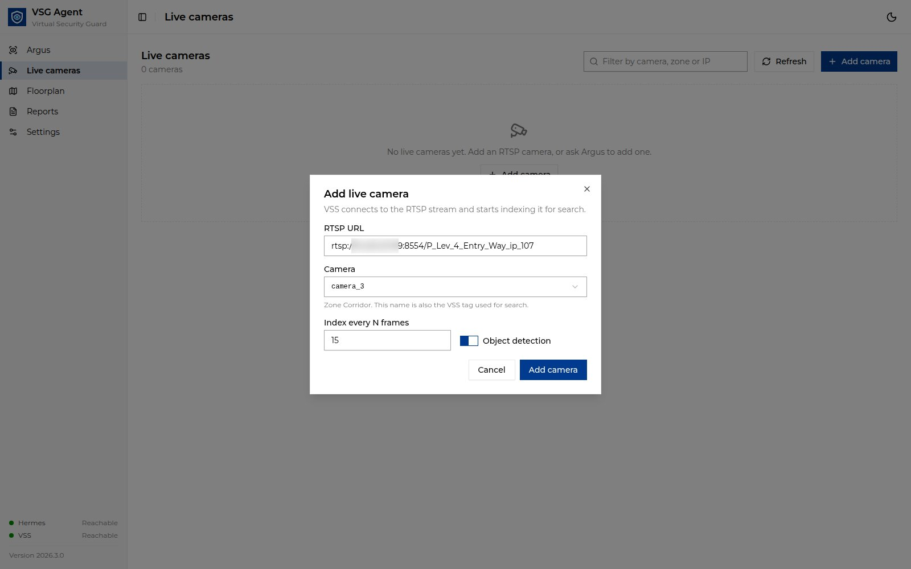

<!--
SPDX-FileCopyrightText: (C) 2026 Intel Corporation
SPDX-License-Identifier: Apache-2.0
-->

# Manage Live Cameras

The **Live cameras** page lists the live RTSP streams registered in VSS
(`/manager/streams`). Live search can only watch cameras listed here.

## Add a camera

1. Click **Add camera**, or select a camera on the **Floorplan** and click
   **Add live camera here**. The **Add live camera** dialog opens.
2. Fill in:
   - **RTSP URL**, for example `rtsp://10.0.0.12:8554/lobby` (must be
     reachable from the VSS host);
   - **Camera**: the floorplan camera this stream is. The list is grouped by
     zone; cameras that already have a live stream are disabled. The camera
     name (for example `P_Lev_4_Main_Entry_ip_54`) becomes the stream's name
     and its only VSS tag, and its zone the stream description. A camera that
     has recorded footage from an earlier stream can be reused; the new
     stream keeps the same tag, so old and new footage are drawn at the same
     place;
   - **Index every N frames** and **Object detection** to tune indexing.
3. Click **Add camera**. VSS starts ingesting the stream and the camera shows
   on the plan. Allow a minute or two before footage from the new camera
   appears in search results.

Searches are scoped to cameras by VSS tag, so each live camera has exactly one
tag, unique to its floorplan camera. **Edit** changes only the indexing
settings. To move a camera, remove it and add it at the new floorplan
camera. **Remove** asks for confirmation.

You can also ask Argus, for example "add rtsp://10.0.0.12:8554/stairs as the
Cube Stairs camera". Argus uses the VSS stream tools and tags the stream to a
floorplan camera that has no live camera yet. If your prompt doesn't say which
one, Argus lists the free floorplan cameras and asks before adding. The new
camera shows on the plan when the camera list next refreshes.

## Edit, pause or remove

- Use the pause/resume button on a camera card to pause ingestion.
- Open the card's actions menu to **Edit** or **Remove** the camera.
- Use the filter box to find cameras by camera, zone or IP, and
  **Refresh** to reload the list.

If your network uses a proxy, add the RTSP hosts to `no_proxy` on the VSS
host.
