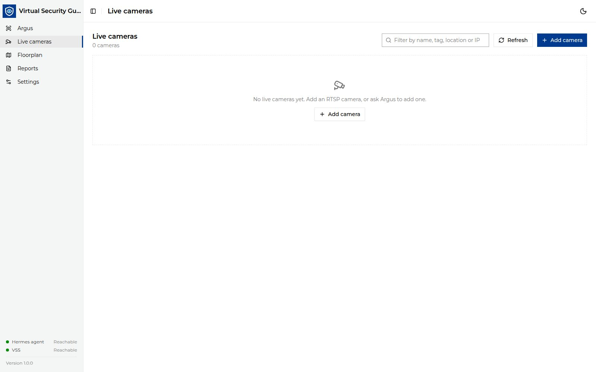

<!--
SPDX-FileCopyrightText: (C) 2026 Intel Corporation
SPDX-License-Identifier: Apache-2.0
-->

# Manage Live Cameras

The **Live cameras** page lists the live RTSP streams registered in VSS
(`/manager/streams`). Live search can only watch cameras listed here.

## Add a camera

1. Click **Add camera**.
2. Fill in:
   - **RTSP URL**, for example `rtsp://10.0.0.12:8554/lobby` (must be
     reachable from the VSS host);
   - **Name** and **Location**;
   - **Tags**, comma-separated. Use the tag that matches the camera key on the
     floorplan;
   - **Index every N frames** and **Object detection** to tune indexing.
3. Save. VSS starts ingesting the stream.

You can also ask Argus, for example "add the lobby camera at
rtsp://10.0.0.12:8554/lobby". Argus uses the VSS stream tools.

## Edit, pause or remove

- Use the pause/resume button on a camera card to pause ingestion.
- Open the card's actions menu to **Edit** or **Delete** the camera.
- Use the filter box to find cameras by name, tag, location or IP, and
  **Refresh** to reload the list.

If your network uses a proxy, add the RTSP hosts to `no_proxy` on the VSS
host.
