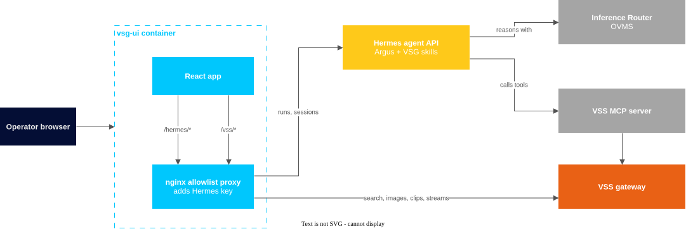

```{eval-rst}
.. meta::
    :description: Overview of Virtual Security Guard Agent features and use cases.
    :keywords: Virtual Security Guard Agent, video search, security, camera monitoring
```

<!--
SPDX-FileCopyrightText: (C) 2026 Intel Corporation
SPDX-License-Identifier: Apache-2.0
-->

# Virtual Security Guard Agent

**Virtual Security Guard Agent (VSG)** is an operator console for the **VSG
agent**, an AI security agent named **Argus** that runs on a **Hermes** agent
server. The VSG agent searches recorded and live camera footage through Intel®
**Video Search and Summarization (VSS)**. Hermes cannot show video or images,
so VSG renders what the VSG agent finds: match grids for human review, a floorplan
route, live camera matches, and PDF incident reports.



## Key Features

| Feature | What it does |
|---|---|
| Chat-driven search | Describe a person, attach a photo, or both. The VSG agent calls `vss_search_video` and returns ranked sightings. |
| Human-in-the-loop review | The console presents top matches in a 3×2 grid. Each search can return up to 20 matches. The operator confirms matches, and unconfirmed matches go back to the VSG agent as false positives. |
| Crop and re-search | Crop the person from a clip frame; the VSG agent searches again with that image. |
| Floorplan route | The console draws confirmed sightings in time order from camera to camera on an uploaded floorplan. |
| Live camera search | After the operator consents, VSS watches live cameras, and the console maintains a live timeline of sightings for each camera. |
| Incident reports | The VSG agent drafts a report from confirmed sightings; the operator edits it and exports a PDF in the browser. |
| Grounded results | Grid clips come from actual VSS tool results, not text generated by the model. |
| Secure by default | The console runs in one read-only, non-root NGINX container with a route allowlist. The Hermes API key never reaches the browser. |

## Use Cases

- **Lost or missing person**: find where a person was last seen, from a photo
  or a description.
- **Incident follow-up**: reconstruct a subject's route and hand over a
  time-ordered PDF report.
- **Live watch**: after confirming a subject, watch live cameras for new
  sightings for a bounded time.
- **Privacy-aware search**: the VSG agent describes clothing and movement only. It
  does not identify people or infer age, gender, or ethnicity.

<!--hide_directive
:::{toctree}
:hidden:

get-started.md
how-to-guides.md
how-it-works.md
known-issues.md
Release Notes <release-notes.md>

:::
hide_directive-->