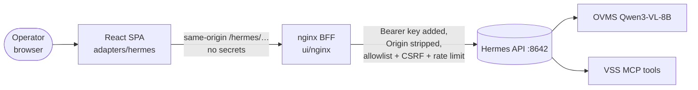
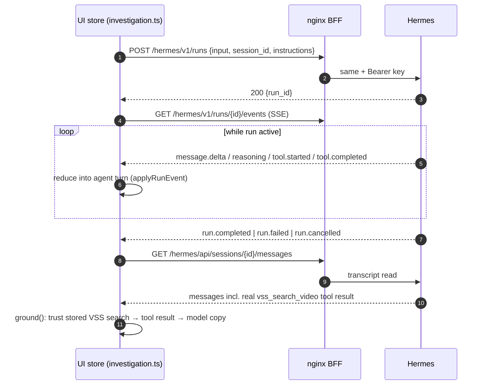

<!--
SPDX-FileCopyrightText: (C) 2026 Intel Corporation
SPDX-License-Identifier: Apache-2.0
-->

# Hermes API Flow — Virtual Security Guard

Reference for how VSG talks to the Hermes Agent API, which endpoints are in
use today, and which available endpoints would make the product better.
Hermes docs move fast — treat `GET /v1/capabilities` on the installed
instance as the source of truth (see §8.1).

## 1. TL;DR

VSG uses the **Hermes-native REST surface: Sessions + Runs** (the "rich UI"
path). It does **not** use any OpenAI-compatible endpoint
(`/v1/chat/completions`, `/v1/responses`, `/v1/models`), jobs, approvals,
steer, browser control, or any `X-Hermes-*` header.

Per investigation the UI:

1. `POST /api/sessions` — one session per investigation (title = `VSG · …`).
2. `POST /v1/runs` — one run per operator turn, with `session_id` for
   transcript continuity.
3. `GET /v1/runs/{id}/events` — SSE stream into the chat UI.
4. `GET /v1/runs/{id}` — status poll only when the SSE stream drops.
5. `POST /v1/runs/{id}/stop` — Stop button.
6. `GET /api/sessions/{id}/messages` — transcript read for "trust the tool,
   not the model" grounding (see design.md §4).
7. `GET /api/sessions?limit=N` / `DELETE /api/sessions/{id}` / `GET /health`
   — history list, cleanup, liveness.

All traffic goes Browser → nginx BFF → Hermes. The BFF injects the bearer
key and allowlists exactly the paths above; anything else under `/hermes/`
is 403.

## 2. Architecture

| Layer | File | Role |
|---|---|---|
| UI client | `ui/src/adapters/hermes/http.ts` | typed `HermesAdapter`: request, SSE read, reconnect |
| Event contract | `ui/src/adapters/hermes/sse.ts` | SSE frame parser + `toRunEvent()` mapping |
| Types | `ui/src/adapters/hermes/types.ts` | `HermesSession`, `HermesMessage`, `RunEvent`, `StartRunRequest` |
| Mock | `ui/src/adapters/hermes/mock.ts` | same interface, offline dev |
| BFF allowlist | `ui/nginx/templates/default.conf.template` | per-path method allow, 403 catch-all |
| BFF key + headers | `ui/nginx/templates/hermes-proxy.inc.template` | `Authorization`, CORS/CSF hygiene |
| Per-turn rules | `ui/src/protocol/instructions.ts` | the `instructions` field sent with each run |

## 3. Endpoints in use today

| # | Endpoint (after BFF strips `/hermes`) | HTTP | Request body / params | Response used | Code |
|---|---|---|---|---|---|
| 1 | `/health` | GET | — | just `res.ok` | `http.ts` `health()` |
| 2 | `/api/sessions` | POST | `{ "title": "VSG · …" }` | `session` object | `createSession()` |
| 3 | `/api/sessions?limit=N` | GET | `limit` query | `data[]` → id, title, `started_at`, `last_active`, `preview`, `message_count` | `listSessions()` |
| 4 | `/api/sessions/{id}/messages?inline_images=false` | GET | — | `data[]` → role, content, `tool_calls`, `tool_name`, `tool_call_id` | `getMessages()` |
| 5 | `/api/sessions/{id}` | DELETE | — | — (smoke-test teardown only) | `deleteSession()` |
| 6 | `/v1/runs` | POST | `{ input, session_id?, instructions? }` | `run_id` | `startRun()` |
| 7 | `/v1/runs/{id}` | GET | — | `status` (`completed\|cancelled\|failed`), `output`, `error` — only on stream reconnect | `streamRun()` |
| 8 | `/v1/runs/{id}/events` | GET (SSE) | optional `Last-Event-ID` header on reconnect | event frames, see §5 | `readStream()` |
| 9 | `/v1/runs/{id}/stop` | POST | — | — | `stopRun()` |

### Behavioural details worth knowing

- **Session title retry loop** — Hermes requires unique titles;
  `createSession()` retries up to 20× with `title`, `title (2)`, … when it
  sees "already in use".
- **`instructions`** — not in the generic Hermes docs' field list, but the
  VSG run body always carries a ~400-token rules stub restating the fenced
  block grammar, because the small local model forgets it. The actual
  procedures live in the `virtual-security-guard` skill.
- **Continuity** — done via `session_id` in the run body. VSG does *not* use
  `X-Hermes-Session-Id` or `X-Hermes-Session-Key`.
- **429 can come from two places** — nginx limits `POST /v1/runs` to
  20 req/min per IP (`limit_req zone=vsg_runs burst=10`), and Hermes itself
  caps 10 concurrent runs. The client does not yet special-case 429 with
  backoff (§8.9).
- **No file uploads** — subject photos are first uploaded to VSS
  (`POST /vss/manager/search/images`); the run input references the image by
  URL. Consistent with Hermes' inline-images-only limit.

## 4. Request lifecycle (one operator turn)

- The agent turn is built **purely** from SSE events
  (`investigation.logic.ts` reducer); the transcript read afterwards is only
  for grounding the match grid and the report rebuild.
- If the SSE stream dies before a terminal event, the client polls
  `GET /v1/runs/{id}` and, if still unknown, reconnects with
  `Last-Event-ID` (max 3 attempts, 500 ms · n backoff). Only if the status
  says `completed` does it synthesize a `completed` event from the poll.
- Stop: `POST …/stop` + local `AbortController` fallback after 4 s if
  Hermes never confirms the cancel.

## 5. SSE event contract (as consumed)

Frames: blank-line-terminated, `:`-prefixed lines are keepalive comments and
are skipped. The client tracks the SSE `id:` field and resumes with
`Last-Event-ID`.

| Hermes event (in frame `event` / JSON `event`) | UI `RunEvent` | Rendered as |
|---|---|---|
| `message.delta` | `delta` | assistant text (streamed) |
| `reasoning.available`, `reasoning.delta` | `reasoning` | reasoning line |
| `tool.started` | `tool.started` | tool chip (name shortened: `mcp__video_search_mcp__vss_search_video` → `vss_search_video`) |
| `tool.completed` | `tool.completed` (`error` if `error`/`is_error` true) | chip resolved |
| `run.completed` | `completed` | final output |
| `run.cancelled`, `run.stopped` | `cancelled` | — |
| `run.failed`, `run.error`, `error` | `failed` | error line |
| anything else | `other` | ignored (forward-compat) |

Terminal events: `completed` / `failed` / `cancelled` — the reader stops on
the first.

## 6. BFF / security envelope

From `ui/nginx/templates/default.conf.template` + `hermes-proxy.inc.template`:

- **Allowlist (path + method)**, everything else under `/hermes/` → 403:
  - `GET  /health`
  - `POST /v1/runs` (rate-limited 20 r/m, burst 10)
  - `GET  /v1/runs/{id}`
  - `GET  /v1/runs/{id}/events` (no buffering, `proxy_read_timeout 1h`)
  - `POST /v1/runs/{id}/stop`
  - `GET|POST /api/sessions`
  - `GET|DELETE /api/sessions/{id}`
  - `GET  /api/sessions/{id}/messages`
- **Key handling** — `Authorization: Bearer ${HERMES_API_KEY}` set in nginx;
  key lives only in `deploy/.env` and the container env.
- **CORS-off workaround** — request is same-origin at nginx; BFF strips
  `Origin`, `Referer`, `Cookie`, hides `Set-Cookie` and all
  `Access-Control-*`.
- **CSRF guard** — because the proxy strips `Origin`, it enforces same-origin
  itself via `Sec-Fetch-Site` / `Origin` maps → 403 on cross-site.

**Rule for any new Hermes endpoint:** the UI call and the nginx allowlist
location must be added together, or the call 403s.

## 7. Current gaps (honest status)

| Area | Status |
|---|---|
| Feature detection | None — event names and endpoints are hardcoded; a Hermes upgrade that renames events silently degrades the UI. |
| Run creation retries | No `Idempotency-Key`; a network timeout on `POST /v1/runs` can't be retried safely (store-level retry starts a *new* run). |
| Mid-run interaction | Stop only. No steer, no approval. |
| 429 handling | No status-specific backoff in the client (nginx and Hermes can both 429). |
| Multi-operator | None — single session title prefix, single key, single Hermes profile. |
| Scheduling | None — reports are on-demand only. |
| Health depth | Unauthenticated `/health` only; no `/health/detailed`. |
| Model control | None — model/provider fixed in Hermes config; no per-run override, no picker. |
| Session metadata | No `PATCH /api/sessions/{id}` (rename/archive); no `fork`. |

## 8. Improvement roadmap — which available APIs to adopt

Ordered by value-to-effort. Each item lists the Hermes API, the product
benefit, the touch points in this repo, and caveats.

### 8.1 `GET /v1/capabilities` — startup feature probe  *(do first)*

- **What**: feature flags for the installed Hermes version.
- **Benefit**: kill the "docs move fast" risk. Probe at startup; enable or
  disable UI features (steer box, approval dialog, model picker) based on
  what this build actually supports, instead of hardcoding assumptions in
  `sse.ts`/`http.ts`. Also a better startup gate than `health()` alone.
- **Touch points**: `HermesAdapter.health()` → `capabilities()`;
  `hooks/queries.ts` `useHealth` query; cache result for the session;
  `location = /hermes/v1/capabilities { GET }` in nginx.
- **Caveat**: cheap, no side effects. Make it the first call on app boot.

### 8.2 `Idempotency-Key` header on `POST /v1/runs`

- **What**: makes run creation retries safe.
- **Benefit**: today, if `POST /v1/runs` times out but Hermes started the
  run anyway, the store's retry creates a *second* run for the same operator
  message (double tool calls, double VSS search, confused transcript). With a
  client-generated key per operator turn, retries converge on the same run.
- **Touch points**: `startRun()` in `http.ts` (accept an idempotency key),
  `run()` in `stores/investigation.ts` (generate once per turn, reuse on
  retry).
- **Caveat**: none known; key is client-chosen.

### 8.3 `POST /v1/runs/{id}/steer` — mid-run operator guidance

- **What**: inject guidance at the next tool boundary.
- **Benefit**: the highest-value UX gap. Operators today must wait for a
  (sometimes long) run to finish, then send a new turn, to say things like
  "only look after 14:00" or "skip the lobby camera". Steer corrects a
  directionally-wrong run *in place* — especially useful with the 8B model
  that occasionally re-searches badly. UI: a small "steer" input under the
  streaming turn, enabled while a run is active and the endpoint is
  advertised by `/v1/capabilities`.
- **Touch points**: `HermesAdapter.steer(runId, text)`; `patchAgent` on the
  steering turn; `location …/steer { POST }` in nginx.
- **Caveat**: applies at the *next tool boundary* — if the model is mid-
  reasoning with no tool pending, steer is deferred. Set that expectation in
  the UI copy.

### 8.4 `POST /v1/runs/{id}/approval` — approval dialogs

- **What**: approve/deny tool invocations from the UI.
- **Benefit**: structured human-in-the-loop for the few irreversible-ish
  actions: starting a **live watch** (`vss_watch_search start`), adding RTSP
  streams, report generation. Today these are gated by *prompting* ("never
  start a live watch on your own") — a small model can drift. An approval
  gate is a hard control and lets the UI show a real confirm card instead of
  trusting prose.
- **Touch points**: `HermesAdapter.approve(runId, decision)`; new run-event
  handling in `sse.ts` (approval-request event) and `investigation.logic.ts`;
  approval card component; `location …/approval { POST }` in nginx.
- **Caveat**: Hermes approval semantics on `/v1/runs` events must be
  verified against the installed build via `/v1/capabilities` and raw frame
  logging first (the docs list event names but not all payload shapes).
  If approval is too heavy, a cheaper win is keeping `terminal` toolset
  off and just gating watch-start via steer/feedback.

### 8.5 `X-Hermes-Session-Key` — stable per-operator memory scope

- **What**: stable per-user scope for long-term memory.
- **Benefit**: today every operator is indistinguishable; Argus has no way to
  remember "this building's front entrance camera tag" across investigations.
  When a second operator joins, each gets a distinct memory scope with a
  constant header on all calls.
- **Touch points**: header in `request()`/`readStream()` (BFF injects it per
  auth context, like the bearer key — **never** from the browser), BFF
  config.
- **Caveat**: only meaningful with a login (VSG currently has none); pairs
  with §8.10.

### 8.6 `POST /api/sessions/{id}/fork` — "redo" without polluting history

- **What**: fork a session into a new branch.
- **Benefit**: the natural "try the same search with a different description"
  feature. Today every retry/variation appends to the same transcript, and
  `getMessages()` + grounding must cope with a noisy history. A fork gives the
  operator a clean parallel investigation; the original stays intact for the
  report rebuild.
- **Touch points**: `HermesAdapter.fork(sessionId)`; a "Redo this search
  differently" action on a validated grid; allowlist `POST
  /api/sessions/{id}/fork` in nginx.
- **Caveat**: forks multiply sessions — keep the `VSG ·` title-prefix filter
  in `hooks/queries.ts` aware of fork naming, or forked sessions vanish from
  the history list.

### 8.7 `PATCH /api/sessions/{id}` — rename / pin / archive

- **What**: update session metadata.
- **Benefit**: let operators rename investigations ("Shoplifter 14 Jun") and
  pin/archive the messy test sessions that currently clutter the history list.
  Cheap, immediate quality-of-life win; no new UI surface beyond the history
  dropdown.
- **Touch points**: `HermesAdapter.updateSession(id, patch)`; history row
  context menu; allowlist `PATCH` on the existing session location.

### 8.8 `GET /api/model/options` (+ per-run `model`/`provider`) — model picker

- **What**: provider/model picker data with pricing; per-request model
  override (note: on OpenAI endpoints a bare `model` is ignored unless
  `direct_model_requests: true` — on `/v1/runs` the override field works per
  the docs).
- **Benefit**: a "fast / careful" mode switch. Qwen3-VL-8B is fine for
  streaming search runs; a bigger model for planning/reporting would reduce
  garbled ids and block-format slips that the `instructions` stub currently
  paper over. UI reads `/api/model/options` to populate a settings picker;
  the selection goes into the `POST /v1/runs` body per run (report runs vs.
  search runs can differ).
- **Touch points**: `HermesAdapter.modelOptions()`; settings store;
  `StartRunRequest.model?`; allowlist `GET /api/model/options`.
- **Caveat**: only useful if the Hermes instance actually has >1 provider
  configured; hide the picker when the list has one entry.

### 8.9 429-aware retry/backoff in the client  *(no new endpoint, but pairs with 8.2)*

- **What**: `HermesError` already carries `status`.
- **Benefit**: today a 429 (nginx burst *or* Hermes' 10-run cap) surfaces as
  a generic failure and the store may start a second run. Add: on 429,
  exponential backoff (e.g. 1 s/3 s/9 s) before retrying `startRun` with the
  same idempotency key, and a friendly "another run is in flight" message when
  the run list is saturated.
- **Touch points**: `request()`/`startRun()` in `http.ts`, `run()` in
  `investigation.ts`.

### 8.10 `GET /v1/skills`, `GET /v1/toolsets` — admin/verification view

- **What**: list installed skills and toolsets.
- **Benefit**: two concrete wins. (1) **Deployment verification**: the UI
  should verify the `virtual-security-guard` and `vsg-incident-report` skills
  are actually installed on the agent — today a missing skill silently degrades
  to a generic assistant, and the operator only notices when blocks stop
  rendering. (2) **Security audit**: design.md §8 says "turn off the Hermes
  `terminal` toolset for this agent" — `/v1/toolsets` lets the UI *check*
  that, and flag it in the health banner.
- **Touch points**: startup check (next to `/v1/capabilities`); warning
  banner component; allowlist the two GET paths.
- **Caveat**: admin-ish endpoints — keep them on the GET-only allowlist, no
  secrets involved, but consider restricting to an "admin mode" UI toggle.

### 8.11 `GET /health/detailed` — authenticated deep health

- **What**: the unauthenticated `/health` only says "alive".
- **Benefit**: the startup banner can distinguish "Hermes up" from "Hermes up
  but model provider down / tool backend down", which is the actual failure
  mode operators hit (OVMS or MCP unreachable). One richer query replaces the
  today's blind `res.ok`.
- **Touch points**: `health()` in `http.ts` (two calls or a flag);
  `hooks/queries.ts`; allowlist `GET /health/detailed` (this one *requires*
  the key — it's covered by the existing `hermes-proxy.inc`).

### 8.12 `/api/jobs` (cron over REST) — scheduled reports & patrols

- **What**: create/manage scheduled agent runs (`POST /api/jobs`,
  `pause/resume/run`, list/update/delete).
- **Benefit**: the biggest new-feature candidate. Concrete VSG use cases:
  - **Nightly incident summary** — a job that runs the report skill over the
    day's confirmed sightings and files a PDF.
  - **Periodic area check** — every N minutes, "was the loading dock
    touched?" (a `vss_search_video` job) that lands in the history list.
  - **Watch hygiene** — auto-stop any live watch older than X hours.
  The jobs UI is a small settings page: list, create (prompt + schedule),
  pause/resume, delete.
- **Touch points**: new `HermesAdapter` methods (`listJobs`, `createJob`,
  …); `features/jobs` page; allowlist all six job paths; history list already
  shows sessions, so job-produced sessions appear automatically.
- **Caveat**: jobs are single-tenant on one profile — fine for the current
  single-operator deployment; re-think with §8.10/multi-user.

### 8.13 Multi-operator: one Hermes profile per user *(future)*

- **What**: the docs' multi-user recipe — one profile per user, each with its
  own port and key.
- **Benefit**: true per-operator memory (§8.5), per-operator audit trail, no
  session-name collisions. The BFF becomes the multiplexer: operator login →
  profile → `HERMES_BASE_URL`/key pair → same SPA, zero client changes.
- **Touch points**: BFF config (multiple `proxy_pass` upstreams + per-user
  auth), `deploy/compose.yaml` (multiple Hermes instances or profiles),
  `auth` in front of the SPA (currently "no login — trusted network").
- **Caveat**: multiplexed `/p/<profile>/` routes need a separate key per
  profile; this is the item to tackle last, after the login story exists.

## 9. Available but deliberately **not** used

| API | Why not |
|---|---|
| `POST /v1/chat/completions` | Stateless; would lose transcript continuity and the session-based grounding that the whole "trust the tool" design relies on. |
| `POST /v1/responses` (+ `GET/DELETE`) | Stateful alternative to sessions, but only the latest 100 responses are stored — sessions are the durable store VSG's history and report rebuild need. |
| `POST /api/sessions/{id}/chat` / `chat/stream` | Simpler, but the docs don't document approval semantics there, and it bypasses the run lifecycle (stop/steer/status) the UI is built around. |
| `POST /v1/browser-control/register` + WS | The agent's browser tool is not part of VSG; the operator's own browser is the UI. Keeping this off also shrinks the attack surface. |
| `X-Hermes-Session-Id` | `session_id` in the run body already provides transcript continuity; the header adds nothing until §8.13. |
| OpenAI `model` bare field | Ignored unless `direct_model_requests: true`; use the run-level override instead (§8.8). |

## 10. Recommended adoption order

1. **§8.1 capabilities probe** — everything else in §8 should key off it.
2. **§8.2 idempotency + §8.9 429 backoff** — correctness fixes, small diff.
3. **§8.11 detailed health + §8.10 skill/toolset verification** — operator trust.
4. **§8.3 steer** — biggest UX win for the existing flow.
5. **§8.7 session rename + §8.6 fork** — history quality.
6. **§8.4 approval** — once steer exists, as a hard control for watch-start.
7. **§8.8 model picker, §8.12 jobs** — feature expansion.
8. **§8.5 + §8.13 multi-operator** — only with a login story.

For every item: add the nginx allowlist location in the same change as the
UI call, and verify the event/payload shape against the live instance
(log raw SSE frames first — the docs list event names but not every payload
shape).

## 11. Live instance audit (2026-10-09, `10.223.22.70:8642`, v0.21.5)

Probed with the deploy key: `/health`, `/health/detailed`, `/v1/capabilities`,
`/v1/toolsets`, `/v1/models`, `/api/model/options`.

### 11.1 What this build supports (from `/v1/capabilities`)

| Capability | Value | Implication for the roadmap |
|---|---|---|
| `runs_idempotency` | supported, **durable, 86400 s** | §8.2 is safe to adopt — keys survive 24 h |
| `run_steer` | true | §8.3 available on this build |
| `run_approval_response` + `approval_events` | true | §8.4 available on this build |
| `session_fork`, `session_update` (PATCH) | true | §8.6 / §8.7 available |
| `model_options` | true | §8.8 available |
| `health_detailed` | true (authenticated) | §8.11 available |
| `session_continuity_header` | `X-Hermes-Session-Id` | supported but VSG uses `session_id` in the run body — fine |
| `browser_extension_control.enabled` | **false** | already off — keep it |
| `jobs_admin`, `memory_write_api`, `admin_config_rw`, `audio_api` | all false | attack surface already closed at the API level |

### 11.2 Toolsets on the running instance (`/v1/toolsets`)

**Enabled (4):**

| Toolset | Tools | Verdict for the VSG agent |
|---|---|---|
| `terminal` | `terminal`, `process_manage` | **REMOVE.** Arbitrary shell on the Hermes host. design.md §8 explicitly says to turn it off; the skill only *asks* the model not to use it (line 48), which is a prompt-level, not a hard, control. The API key already gives terminal access — the main "gotcha" from the Hermes docs. |
| `file` | `read_file`, `write_file`, `patch`, `search_files` | **REMOVE.** The VSG skill prohibits it ("Do not use terminal, file or browser tools"); VSS data only flows through MCP. No legitimate use in this workflow; pure exfiltration/prompt-injection surface. |
| `skills` | `skill_view`, `skills_list`, `skill_manage` | **KEEP (required).** Both skills are loaded via `skill_view` on the first turn (`instructions.ts`, `SKILL.md` line 133). Toolsets are all-or-nothing, so `skill_manage` stays exposed as a side effect — minor. |
| `vision` | `vision_analyze` | **Optional removal.** Not referenced by any VSG skill or the per-run instructions; the brain is already a VLM (Qwen3-VL) that gets image URLs in the prompt. Remove unless a "describe this photo" feature is wanted. Zero impact on the search/trace/report flow. |

**Already disabled (no action):** `web`, `browser`, `code_execution`, `video`,
`image_gen`, `video_gen`, `x_search`, `tts`, `stt`, `todo`, `kanban`, `memory`,
`context_engine`, `session_search`, `connections`, `clarify`, `delegation`,
`cronjob`, `computer_use`, `a2a`, `spotify`, `discord`, `discord_admin`,
yuanbao. `homeassistant` not configured.

### 11.3 Other live findings

- **Model providers:** only the local OVMS is authenticated; every cloud
  provider (Nous Portal, OpenAI, Anthropic, …) is unconfigured. Good for the
  air-gapped deployment — nothing to trim, and it means the §8.8 model picker
  would have nothing to pick until a second provider is added.
- **Gateway platforms:** exactly one connected (`api_server`). No messaging
  platforms attached — good.
- **Bug on this instance:** `GET /v1/skills` returns
  `{"error": {"message": "Failed to enumerate skills"}}` (500). The skills
  themselves load fine through the `skill_view` tool (file-based), so the app
  is unaffected today — but it means the §8.10 "verify skills installed" check
  cannot rely on that endpoint until it is fixed on the Hermes host.
- **Disk:** 76.9 % used (~88 GB free) — fine, worth keeping an eye on since
  VSS stores live there too.
- **Load:** idle at probe time (0 active runs). `last_request_at` same day —
  the instance is in active use.

### 11.4 Concrete removal list (apply on the Hermes host)

1. Disable the `terminal` toolset for the VSG agent/profile.
2. Disable the `file` toolset.
3. Optionally disable `vision` (only if no photo-description feature is
   wanted).
4. Keep `skills`; keep the `video_search_mcp` MCP connection (MCP tools are
   configured separately from built-in toolsets and do not appear in
   `/v1/toolsets`).
5. Keep the API server as-is — the OpenAI-compatible and other endpoints
   cannot be un-registered, but the nginx BFF already 403s everything outside
   the allowlist, so their only real exposure is loopback on the Hermes host.
   The toolset changes in step 1–2 are what actually shrink what the key can
   do.
6. Fix the `/v1/skills` 500 on the Hermes host (check the skills directory
   permissions / skill front-matter).

After steps 1–2, re-run `GET /v1/toolsets` and confirm `terminal` and
`file` report `enabled: false`; the UI's health check should then also verify
this (roadmap §8.10).