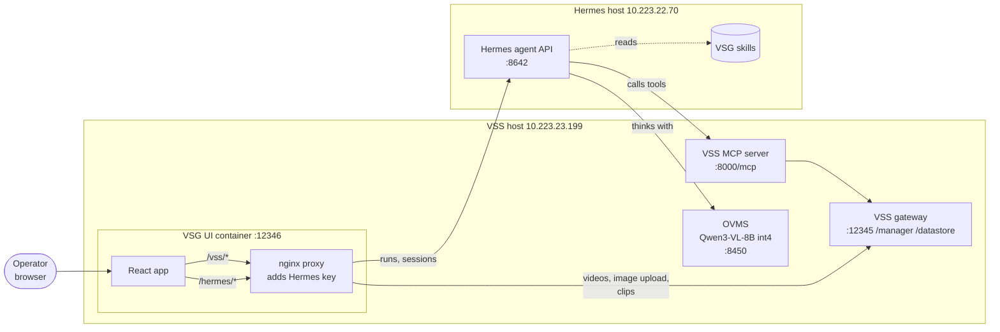
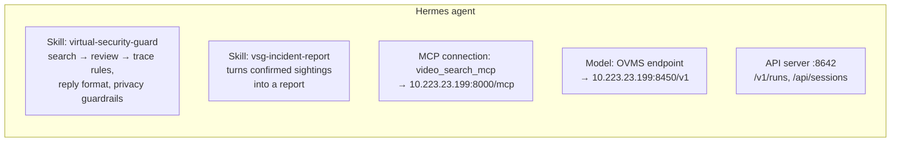
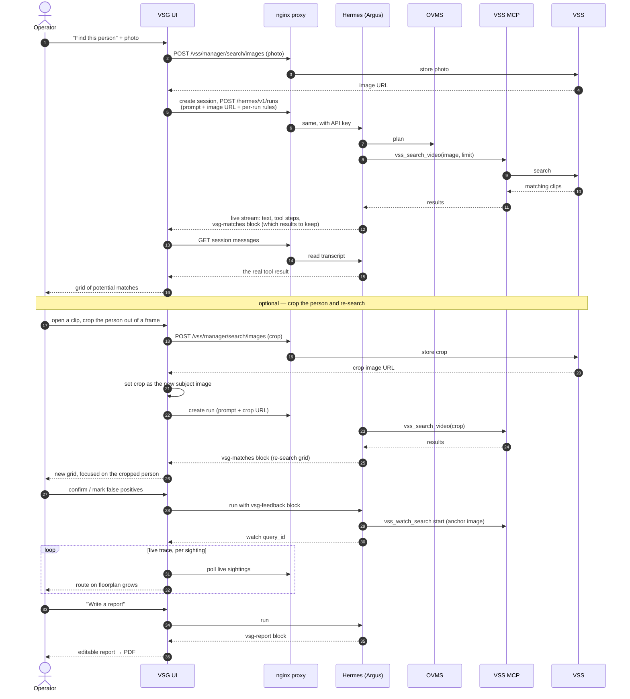
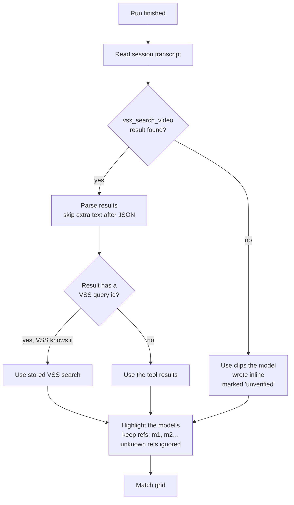
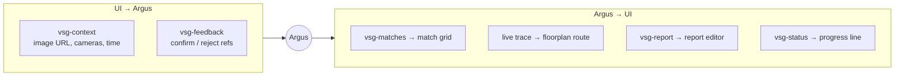
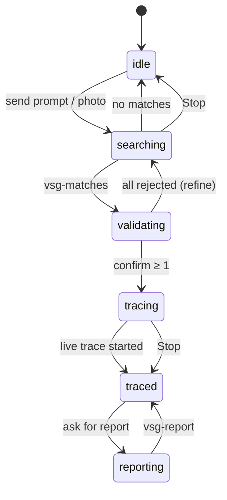
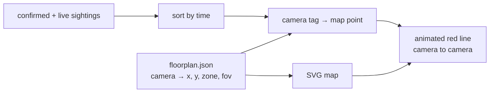
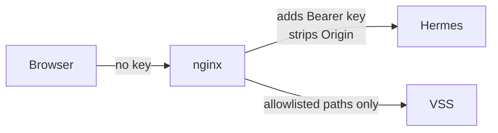

<!--
SPDX-FileCopyrightText: (C) 2026 Intel Corporation
SPDX-License-Identifier: Apache-2.0
-->

# Virtual Security Guard: how it works

Virtual Security Guard (VSG) is a web app. An operator asks **Argus** (a
Hermes agent) to find a person in recorded camera footage. Argus searches the
footage through VSS. The operator then confirms the right sightings, and VSG
draws the person's route on a floorplan and writes a report.

## 1. Components

| Part | Job |
|---|---|
| React app | Chat, match review, floorplan, reports. No secrets. |
| nginx proxy | Single entry point. Adds the Hermes key, allows only known paths. |
| Hermes | Runs Argus: plans, calls tools, keeps the chat history. |
| OVMS | The model Argus thinks with (local, no cloud). |
| VSS MCP server | Gives Argus VSS tools such as `vss_search_video`. |
| VSS | Stores videos, embeddings and searches. Serves clips. |

## 2. What was added to Hermes

| Change | Where | Why |
|---|---|---|
| `virtual-security-guard` skill | `~/.hermes/skills/security/` (`make install-skills`) | Teaches the workflow and the reply format the UI reads. |
| `vsg-incident-report` skill | same | Writes reports from confirmed sightings only. |
| VSS MCP server | Hermes MCP config | Lets Argus search and inspect VSS. |
| OVMS model | Hermes model config | Local Qwen3-VL-8B (int4) as the brain. |
| API server + key | Hermes config | Lets the UI start runs and read sessions. |

Tools Argus uses from VSS MCP:

| Tool | Use |
|---|---|
| `vss_search_video` | Search by text or image. The main tool. |
| `vss_list_tags` / `vss_list_streams` | Know which cameras exist. |
| `vss_add_stream` / `vss_update_stream` / `vss_remove_stream` | Manage live RTSP cameras on request. |
| `vss_watch_search` | Stage 2 live watch; only after the operator confirms. |
| `vss_get_search`, `vss_resolve_video` | Look up a past search or a video. |

## 3. Main flow: find, review, trace, report

### Review grid and crop-and-re-search

The match grid shows the **top six** matches in a 3×2 grid. **Show N more
findings** reveals six more at a time, up to **20** per search. The operator
only confirms; any shown match left unconfirmed is sent back as a false
positive.

Every grid in the session stays open for review. The operator can confirm
sightings in any grid at any time, including an earlier grid after a crop
re-search. A segment confirmed in one grid shows as confirmed wherever it
appears again. Once verdicts change, the grid's button becomes **Update
review**. It sends a new `vsg-feedback` for the same `vss_query_id`, which
replaces that grid's earlier verdicts.

The **confirmed sightings** of a session are the union of confirms across all
grids, de-duplicated by video segment (`video_id@start`) and sorted by when
each sighting happened (VSS ingest time plus offset, or the live observation
time). That list:

- is sent to Argus with every run as a numbered timeline, with the camera,
  time, ref and the movement from the previous sighting (for example "moved
  from Lobby in 3 min 05 s");
- seeds the floorplan route and the live search;
- drives the report. The PDF lists every confirmed sighting in time order,
  with its date and time, followed by a **Movement** section with each leg
  between cameras, its elapsed time, and the first-seen to last-seen span.

While reviewing, the operator can open any clip (the player opens near
full-screen) and use **Pause & crop person**: the clip freezes on the frame
on screen and a snipping-tool overlay dims it. The operator drags a rectangle
around the person (drag inside it to move it, **Redo** to draw again), and can
step a frame back or forward to pick a sharper frame. **Esc** leaves the
crop. Saving cuts the rectangle out of the current frame at the video's native
resolution, uploads it to VSS (`POST
/vss/manager/search/images`) and makes it the new **subject image** (each crop
replaces the previous subject). Argus then runs a follow-up image search for
that person, so a fresh grid appears focused on the cropped face. Earlier
grids stay open, so the operator can keep confirming there too. The clip
player's **Confirm** button works in every grid. The cropped image becomes the
report photo and the live-watch anchor.

## 4. Key design choice: trust the tool, not the model

The 8B model sometimes invents or garbles ids. So the UI never shows clips
the model typed. It shows what VSS actually returned, read from the Hermes
transcript. The model only says *which* results to highlight (`m1`, `m2`…).

Lookup order, most trusted first: **stored VSS search → tool result →
model's inline copy**.

## 5. Chat protocol: fenced blocks

Argus replies in plain text plus small JSON blocks. The UI turns each block
into a widget.

Each run also carries a short rules text (`instructions`) restating this
format, because a small model forgets it otherwise.

## 6. Investigation states

## 7. Floorplan and route

Camera tags come from VSS video tags (e.g. `P_Lev_4_Entry_Way_ip_107`) and
must match the keys in `floorplan.json`.

One tag is one camera. When the operator asks Argus to "search the X, Y and Z
cameras", Argus maps each name to its tags (`vss_list_tags`, case-insensitive,
`_` = space) and searches with exactly those `tags`.

## 8. Security choices

- The Hermes key lives only in `deploy/.env` and nginx. The browser never sees it.
- nginx forwards only the paths the UI needs; everything else is refused (403).
- Container runs read-only, as non-root, with all capabilities dropped.
- Argus describes clothing and movement only. It never names people or
  guesses age, gender or ethnicity.
- The UI has no login. Run it on a trusted network, and turn off the
  Hermes `terminal` toolset for this agent.

## 9. Where the code lives

| Path | Contents |
|---|---|
| `ui/src/adapters/` | Hermes and VSS clients (plus mocks). |
| `ui/src/protocol/` | Block parser, per-run rules, tool-result reading. |
| `ui/src/stores/` | Investigation, review, trace, cameras, reports state. |
| `ui/src/features/` | Argus chat, match grid, floorplan, reports pages. |
| `ui/nginx/` | Proxy config and security headers. |
| `hermes-skills/` | The two Hermes skills. |
| `deploy/` | Docker Compose and `.env` template. |
