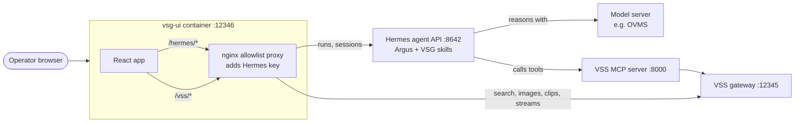
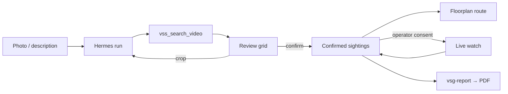

<!--
SPDX-FileCopyrightText: (C) 2026 Intel Corporation
SPDX-License-Identifier: Apache-2.0
-->

# How it Works

The operator talks to **Argus** in the browser. Argus runs on a Hermes agent
server, reasons with a local model, and calls VSS tools through the VSS MCP
server. VSG renders Argus's results and lets the operator review them.

## Architecture

## Data Flow

1. **Search**: the UI uploads the photo to VSS, creates a Hermes session and
   starts a run. Argus calls `vss_search_video` and replies with a
   `vsg-matches` block.
2. **Review**: the UI reads the real tool result from the Hermes transcript
   and shows it as a grid. The operator's verdicts go back as `vsg-feedback`.
3. **Crop and re-search**: a crop from a clip becomes the new subject image
   and triggers a follow-up image search.
4. **Route**: confirmed sightings from all grids, de-duplicated and in time
   order, become the route.
5. **Live search**: on operator request only, a VSS watched query
   (`PATCH /search/:id/watch`) is polled every 10 s.
6. **Report**: Argus drafts a `vsg-report`; the browser builds the PDF.

## System Components

- **vsg-ui**: one unprivileged, read-only nginx container. Serves the React
  bundle and proxies an allowlist of Hermes and VSS paths. Everything else is
  refused with `403`.
- **Hermes agent server**: runs Argus, keeps one session per investigation,
  streams run events over SSE.
- **VSG Hermes skills**: `virtual-security-guard` and `vsg-incident-report`,
  installed on the Hermes host.
- **VSS MCP server**: exposes VSS search, watch and stream tools to Argus.
- **VSS**: stores and indexes footage, runs searches, serves clips and frames.
- **Model server**: the LLM that Argus reasons with (for example OVMS with
  Qwen3-VL-8B int4).

## Trust the tool, not the model

Small models can mistype ids. The grid never shows clips the model typed; it
shows what VSS returned, read from the Hermes transcript. Argus only chooses
*which* results to highlight (`m1`, `m2` …). If no tool result is found, the
model's inline copy is shown and marked unverified.

## Security

- The Hermes API key lives only in `deploy/.env` and nginx; the browser never
  sees it.
- Only the paths in the [API Reference](./api-reference.md) are proxied.
- The container runs read-only, as non-root, with all capabilities dropped.
- The console has no login. Run it on a trusted network.
- Argus describes clothing and movement only; it never identifies people.

For the full design, protocol and state diagrams, see
[Design](./design.md).

## Learn More

- [System Requirements](./get-started/system-requirements.md)
- [Get Started](./get-started.md)
- [API Reference](./api-reference.md)
- [Known Issues](./known-issues.md)
- [Release Notes](./release-notes.md)

<!--hide_directive
:::{toctree}
:hidden:

design.md

:::
hide_directive-->
