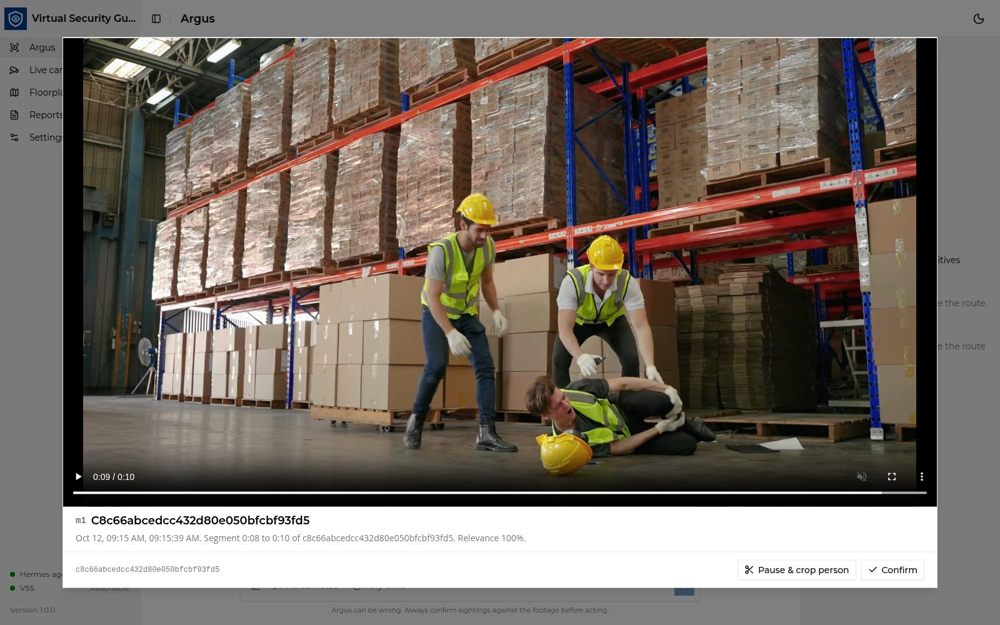
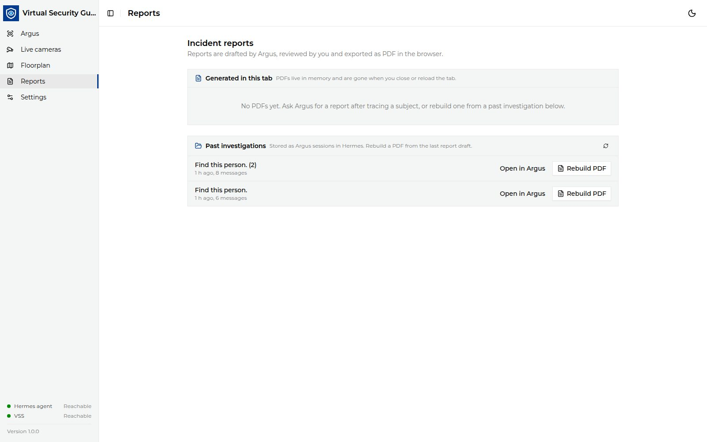
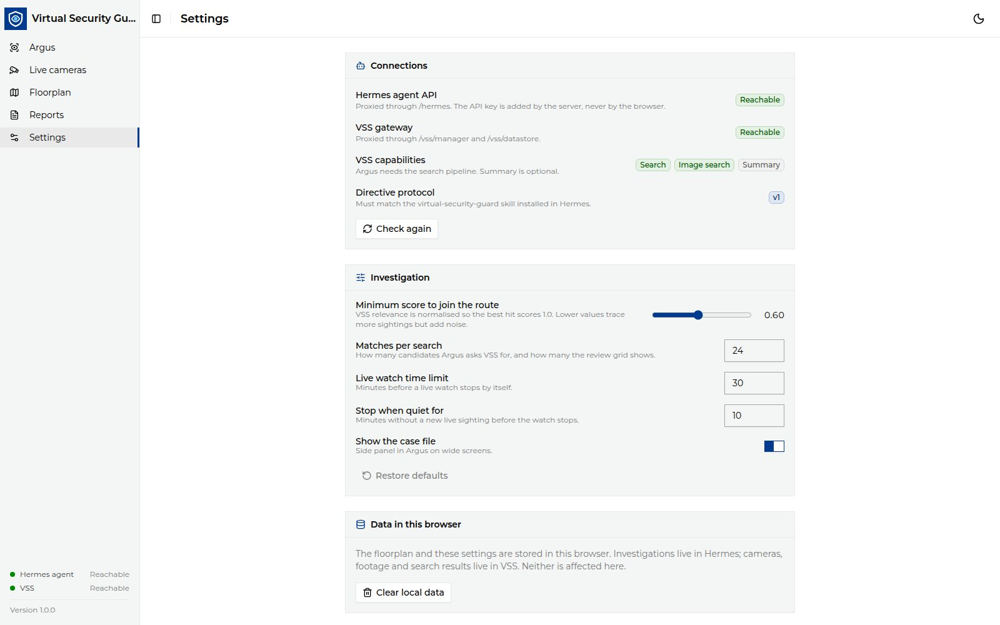

<!--
SPDX-FileCopyrightText: (C) 2026 Intel Corporation
SPDX-License-Identifier: Apache-2.0
-->

# Investigate a Person

This guide walks through a full investigation on the **Argus** page: search,
review, crop and re-search, route, live search and report. The progress bar at
the top (**Search → Review → Live search → Report**) and the **Case file**
panel on the right always show where the investigation stands.

## 1. Start a search

1. Open `http://<HOST_IP>:12346/argus`. Click **New** to start a fresh
   investigation.
2. Describe the person, attach a photo with the image button (or drag and
   drop it), or both.
3. Optionally narrow the search with **All cameras** (pick cameras) and
   **Any time** (pick a time window).
4. Press **Enter** or the send button.

VSG uploads the photo to VSS, creates a Hermes session for the investigation
and starts an Argus run. Argus calls the VSS search tool and replies with a
short summary and a grid of potential matches.

Expand **Used N tools** to see what Argus did (skills loaded and VSS tools
called) for this turn.

## 2. Review the matches

The grid shows the **top six** matches. Each card has the match ref (`m1`,
`m2` …), the clip time, the VSS relevance score, the camera and date. Cards
marked **Argus pick** are the ones Argus recommends.

- Click **Show N more findings** to reveal six more at a time, up to **20**.
- Click a thumbnail to open the clip player.
- Click **Confirm** on every card that shows the subject. Anything shown but
  left unconfirmed is sent to Argus as a false positive.
- Add an optional **Note for Argus** and click **Save N confirmed**. If
  nothing matches, the button reads **None match, refine search** and Argus
  searches again.

Every grid in the session stays open. You can confirm sightings in an earlier
grid later; the button then reads **Update review** and replaces that grid's
earlier verdicts.

> [!NOTE]
> Argus can be wrong. Always confirm sightings against the footage before
> acting.

## 3. Play a clip

The clip player opens near full-screen at the matching segment and shows the
camera, time, segment range and relevance. **Confirm** in the player works the
same as on the card.

## 4. Crop the person and search again

When a clip shows the subject clearly, use it as a better reference image:

1. In the clip player, click **Pause & crop person**. The frame freezes and is
   dimmed.
2. Drag a rectangle around the person. Drag inside it to move it, **Redo** to
   draw again. Use **Frame** ‹ › to step to a sharper frame. **Esc** or
   **Cancel** leaves crop mode.
3. Click **Save crop** (or press **Enter**).

The crop is cut at the video's native resolution, uploaded to VSS and becomes
the new **Subject** in the case file. Argus runs a follow-up image search and a
new grid appears. The latest crop is also the report photo and the live search
reference.

## 5. Trace the route

Once at least one sighting is confirmed, the case file shows the **Route**. The
confirmed sightings from all grids are de-duplicated and sorted by when they
happened. Open **Floorplan** to see the route drawn camera-to-camera. See
[Configure the Floorplan](./configure-floorplan.md) to map VSS cameras onto
your plan.

## 6. Live camera search (optional)

After a review, VSG offers **Start live camera search**. Nothing is watched
until you click it.

- VSS watches live cameras for the subject; the UI polls every 10 seconds and
  shows the four nearest live matches. New live sightings raise a
  notification and extend the route.
- **Stop live search** is always visible.
- The watch also stops itself after the **Live watch time limit** (default
  30 min) or when there has been no new sighting for **Stop when quiet for**
  (default 10 min). Change both on the **Settings** page.

## 7. Write the report

Click **Generate report** (or ask Argus for one). Argus receives the
time-ordered sightings with the movement between cameras and replies with a
draft:

- Read the draft in the chat. Use **Edit before export** to change it.
- Click **Generate PDF**, then **Download**. The PDF lists every confirmed
  sighting in time order, followed by a **Movement** section.

PDFs are built in the browser and kept only for the open tab. The **Reports**
page lists them and can **Rebuild PDF** from any past investigation.

## 8. Reopen an investigation

Each investigation is a Hermes session. Click **History** to reopen or delete
one. The URL `…/argus?session=<id>` opens a session directly.

## Investigation settings

The **Settings** page shows the connection status and the investigation
parameters. They are stored in the browser.

| Setting | Default | Effect |
|---|---|---|
| Minimum score to join the route | `0.60` | Lower traces more sightings but adds noise. |
| Matches per search | `24` | Candidates Argus asks VSS for. The grid shows up to 20. |
| Live watch time limit | `30` min | Live search stops by itself after this. |
| Stop when quiet for | `10` min | Live search stops after this long without a new sighting. |
| Show the case file | on | Side panel on wide screens. |
