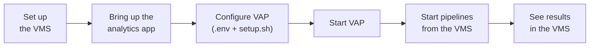

# Get Started

The **VMS Adapter Plugin (VAP)** connects Video Management Systems (VMS) to AI analytics
applications. It starts analytics pipelines on the VMS cameras, and writes the results, such as
detection boxes, events and captions, back into the VMS.

| Supported | |
| --- | --- |
| VMS | Nx Witness, Milestone XProtect |
| Analytics applications | Loitering Detection (DL Streamer vision), Live Video Captioning (LVC) |

This page explains how a deployment works, routes you to the integration guide for your VMS
and application, and describes the VAP configuration and commands that every deployment
shares.

## How a Deployment Works

Every integration guide follows the same flow:



1. **Set up the VMS**: install it, add cameras, and allow VAP to connect.
2. **Bring up the analytics app**: VAP starts its pipelines, so the app must be running first.
3. **Configure VAP**: set `.env`, and generate `config/config.yaml` for your VMS and apps; see
   [Configure VAP](#configure-vap).
4. **Start VAP**: on startup, VAP registers with the VMS; see [Manage VAP](#manage-vap).
5. **Start pipelines from the VMS**: an operator turns analytics on for a camera.
6. **See results in the VMS**: detections on the video, and events or captions in the VMS.

## Choose Your Integration

Follow the guides for your VMS and application, in order:

| VMS | Analytics application | Follow |
| --- | --- | --- |
| Nx Witness | Loitering Detection | [Set Up Nx Witness](./how-to-guides/integrations/nx-witness/set-up-nx-witness.md) → [Run Loitering Detection](./how-to-guides/integrations/nx-witness/run-loitering-detection.md) |
| Nx Witness | Live Video Captioning | [Set Up Nx Witness](./how-to-guides/integrations/nx-witness/set-up-nx-witness.md) → [Run Live Video Captioning](./how-to-guides/integrations/nx-witness/run-live-video-captioning.md) |
| Nx Witness | Both | The two rows above, then [Run Both Applications](./how-to-guides/integrations/nx-witness/run-both-applications.md) |
| Milestone XProtect | Loitering Detection | [Set Up XProtect and AI Bridge](./how-to-guides/integrations/milestone/set-up-xprotect-and-ai-bridge.md) → [Run Loitering Detection with XProtect](./how-to-guides/integrations/milestone/get-started.md) → [Loitering Events and Alarms](./how-to-guides/integrations/milestone/events-and-alarms.md) |

Each integration also has an overview, with concepts and architecture, and a reference with
troubleshooting: [Nx Witness](./how-to-guides/integrations/nx-witness/index.md) and
[Milestone XProtect](./how-to-guides/integrations/milestone/index.md).

## Prerequisites

- A host that meets the [system requirements](./get-started/system-requirements.md).
- [Docker](https://docs.docker.com/get-docker/) and
  [Docker Compose](https://docs.docker.com/compose/install/).
- The `metro-ai-suite` repository, which contains VAP and the analytics applications:

  ```bash
  git clone --filter=blob:none --branch main https://github.com/open-edge-platform/metro-ai-suite.git
  cd metro-ai-suite
  ```

## Configure VAP

VAP reads two files in `metro-ai-suite/vms-adapter-plugin`: `.env`, with the addresses and
credentials of your VMS and applications, and `config/config.yaml`, which `setup.sh` generates
for the VMS and applications you select. The integration guides give the values for each
setup.

### Environment File

Create `.env` from the example:

```bash
cd metro-ai-suite/vms-adapter-plugin
cp .env.example .env
```

`.env.example` lists the variables of every supported VMS and application, in three sections:
VAP itself, then each VMS, then each analytics application. Set the VAP section, for example
`PG_PASSWORD`, and the sections of the VMS and applications you use. The variables of the
others are not used.

For certificate verification and TLS settings, see
[TLS and Certificate Configuration](./how-to-guides/tls-and-certificates.md).

### Generate `config/config.yaml`

Generate the configuration for your VMS and applications. Both `--vms` and `--apps` are
required:

```bash
./setup.sh --vms nx --apps ld,lvc
```

| **Option** | **Values**                                                                 |
| ---------- | -------------------------------------------------------------------------- |
| `--vms`    | Comma-separated list of `nx` (Nx Witness) and `milestone` (Milestone XProtect) |
| `--apps`   | Comma-separated list of `ld` (Loitering Detection) and `lvc` (Live Video Captioning) |

Run `./setup.sh --list` to see the available VMS and apps, and `./setup.sh --help` for all
options. The script warns about variables of the selected VMS and apps that are not set in
`.env`.

The generated file references `.env` variables as `${ENV_VAR}` placeholders, which VAP resolves
at startup, so you do not need to run `setup.sh` again after editing `.env`. Run it again when
you change the selected VMS or apps.

> [!NOTE]
> Do not edit `config/config.yaml` directly; `setup.sh` overwrites it. To change a VMS or app
> setting, edit its fragment and run `setup.sh` again:
>
> | **Fragment**                                           | **Content**                     |
> | ------------------------------------------------------ | ------------------------------- |
> | `config/base.yaml`                                     | API, database, logging          |
> | `vms_shim/nxwitness/vap-config.yaml`                   | Nx Witness instance             |
> | `vms_shim/milestone/vap-config.yaml`                   | Milestone XProtect instance     |
> | `analytics_app_shim/object_detection/vap-config.yaml`  | Loitering Detection app         |
> | `analytics_app_shim/lvc/vap-config.yaml`               | Live Video Captioning app and its MQTT broker |

## Manage VAP

Run these commands in `metro-ai-suite/vms-adapter-plugin`.

| Task | Command |
| --- | --- |
| Start VAP | `docker compose up -d` |
| Check the services | `docker compose ps` |
| Follow the backend log | `docker compose logs -f backend` |
| Apply a new `config/config.yaml` | `docker compose restart backend` |
| Apply a changed `.env` | `docker compose up -d --force-recreate backend` |
| Stop VAP | `docker compose down` |

`docker compose up -d` pulls the published images. To build them from source, see
[Build from Source](./get-started/build-from-source.md).

After starting, all services should be up, and the backend `healthy`:

```text
NAME                          STATUS
vms-adapter-backend           Up (healthy)
vms-adapter-ui                Up
vms-adapter-postgres          Up (healthy)
```

The VAP dashboard is at `https://<vap-host>:3443`.

> [!CAUTION]
> `docker compose down -v` also deletes the database volume, with the cameras VAP discovered
> and the credentials of its VMS integration. With Nx Witness, the integration must then be
> registered again; see the
> [Nx Witness troubleshooting](./how-to-guides/integrations/nx-witness/reference.md#register-the-integration-again).

## Folder Layout

```text
vms-adapter/
├── plugin/                         # Backend Python package
│   ├── base/
│   │   └── interfaces.py           #  IVmsShim + IAnalyticsAppShim abstract interfaces
│   ├── common/
│   │   └── schema_builder.py       #  Dynamic Pydantic model builder from JSON Schema
│   └── Analytics/
│       ├── api/
│       │   ├── routes/
│       │   │   ├── cameras.py      #   Camera discovery + enable/disable
│       │   │   ├── analytics_apps.py    #   Generic Analytics App API (discover, runs, stream, options)
│       │   │   ├── events.py       #   Event timeline
│       │   │   ├── analysis.py     #   Analysis result callback
│       │   │   ├── sessions.py     #   Session tracking
│       │   │   ├── vms.py          #   VMS register
│       │   │   ├── health.py       #   Health + readiness
│       │   │   └── config.py       #   Config status
│       │   └── deps.py             #   FastAPI dependency injection
│       ├── db/
│       │   └── repository.py       #   Async SQLAlchemy CRUD
│       ├── models/
│       │   ├── db.py               #   ORM models (Camera, Event, Session, …)
│       │   └── domain.py           #   Domain dataclasses
│       ├── pipeline/
│       │   └── orchestrator.py     #   Background camera sync + event processing
│       ├── config.py               #   Pydantic settings (YAML + env)
│       ├── factory.py              #   Shim factory
│       └── main.py                 #   FastAPI application entry point
│
├── vms_shim/                       # Concrete VMS shims
│   ├── frigate/
│   │   ├── shim.py                 #  FrigateVmsShim — discovers cameras via local config
│   │   └── config/                 #  Frigate config.yml (cameras, go2rtc, etc.)
│   ├── milestone/
│   │   ├── shim.py                 #  MilestoneVmsShim — Milestone AI Bridge GraphQL API
│   │   └── vap-config.yaml         #  Milestone instance config fragment
│   └── nxwitness/
│       ├── shim.py                 #  NxWitnessVmsShim — Nx Witness REST API v4
│       └── vap-config.yaml         #  Nx Witness instance config fragment
│
├── analytics_app_shim/                  # Concrete Analytics App shims
│   ├── object_detection/
│   │   ├── shim.py                 #  ObjectDetectionAnalyticsAppShim — DL Streamer vision apps
│   │   └── vap-config.yaml         #  Loitering Detection app config fragment
│   └── lvc/
│       ├── api_client.py           #  LvcApiClient — all HTTP calls to LVC backend
│       ├── schema.py               #  LvcSchemaManager — OpenAPI fetch, $ref resolution,
│       │                           #    UI annotations, Pydantic model building
│       ├── shim.py                 #  LiveCaptioningAnalyticsAppShim — composes api_client + schema
│       └── vap-config.yaml         #  Live Video Captioning app config fragment
│
├── ui/                             # React 19 / Vite frontend served by nginx
│   ├── src/
│   │   ├── App.jsx                 #  Root component + state
│   │   ├── components/MainPage/
│   │   │   ├── CameraDiscoveryPanel.jsx
│   │   │   ├── AnalyticsEnginePanel.jsx   # Dynamic schema form + run lifecycle
│   │   │   ├── SchemaForm.jsx             # Generic JSON Schema → form renderer
│   │   │   ├── LiveStreamTab.jsx          # WebRTC player + caption overlay
│   │   │   └── AnalysisResultsPanel.jsx
│   │   ├── hooks/
│   │   │   └── useLvcStream.js     #  SSE caption stream hook
│   │   └── services/
│   │       └── api.js              #  Generic API client functions
│   └── nginx.conf                  #  Reverse proxy: /v1 → backend, /whep → MediaMTX
│
├── config/
│   ├── base.yaml                   # Shared config sections (API, database, logging)
│   └── config.yaml                 # Runtime config generated by setup.sh (not tracked in git)
├── setup.sh                        # Generates config/config.yaml for the selected VMS and apps
├── tests/                          # pytest unit + integration tests
├── Dockerfile                      # Backend image
├── docker-compose.yml              # backend + ui + postgres
├── pyproject.toml                  # Python deps + package config
└── .env.example                    # Environment variable reference
```

## Next Steps

1. **Explore the Architecture**: Learn how VAP components interact in the
   [How It Works](./how-it-works.md) guide.
2. **Follow an Integration Guide**: Pick your VMS and application in
   [Choose Your Integration](#choose-your-integration), or browse the
   [How-To Guides](./how-to-guides.md).
3. **Browse the API**: Explore all available endpoints in the
   [API Reference](./api-reference.md).
4. **Troubleshooting**: If you encounter issues, check the
   [Troubleshooting Guide](./troubleshooting.md).

<!--hide_directive
:::{toctree}
:hidden:

get-started/system-requirements.md
get-started/build-from-source.md
get-started/deploy-with-helm.md

:::
hide_directive-->
