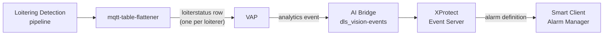
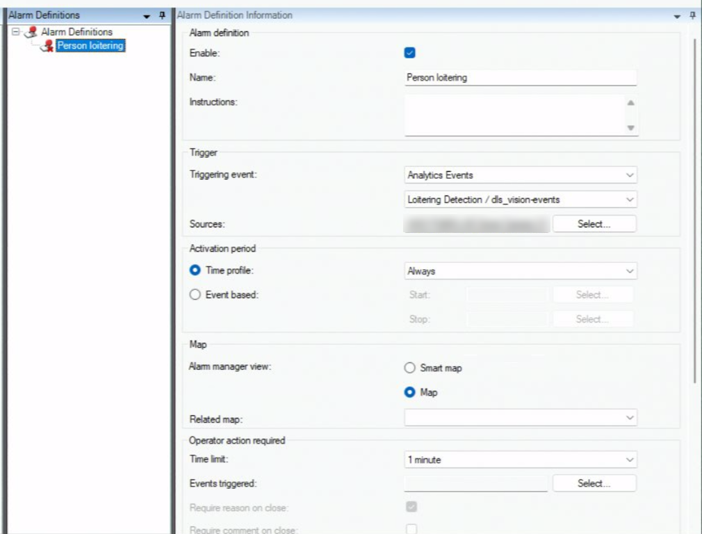
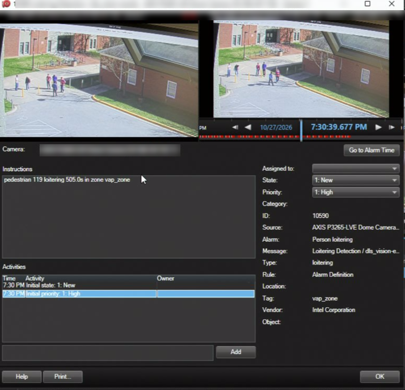

# Loitering Events and Alarms

This page turns Loitering Detection's loitering occurrences into XProtect **analytics
events**, and raises an **alarm** for each one in Smart Client's Alarm Manager.

## Prerequisites

- Loitering Detection running on an XProtect camera through VAP, as in
  [Run Loitering Detection with XProtect](./get-started.md).
- Analytics events enabled in XProtect
  ([Set Up XProtect and AI Bridge, Step 5](./set-up-xprotect-and-ai-bridge.md#step-5-enable-analytics-events-in-xprotect)).
- Administrator access to Management Client.

## How it works



1. The `mqtt-table-flattener` sidecar publishes a row for each person who has stayed in
   the zone longer than `LOITERING_THRESHOLD_SEC`. It repeats the row about once a
   second while the person stays.
2. VAP turns each row into an analytics event and posts it to the app's event topic,
   `dls_vision-events`. VAP sends at most one event every `event_min_interval_s` seconds
   (default 10) for each person on each camera.
3. AI Bridge forwards the event to the XProtect Event Server.
4. An alarm definition that triggers on the event raises an alarm.

Each event carries:

| Field | Value | Shown in the alarm as |
| --- | --- | --- |
| Name | `Loitering detected` | Event data |
| Class | `VAP event` (fixed for every VAP event) | Event data |
| Subclass | `loitering` | **Type** |
| Description | e.g. `pedestrian 119 loitering 505.0s in zone vap_zone` | **Instructions** |
| Source | The camera the pipeline runs on | **Source** |
| Zone | The zone the person is in | **Tag** |
| Vendor | `Intel Corporation` | **Vendor** |
| Object | The loiterer's box and class, when VAP has seen the box in the last 5 seconds | Outline on the alarm video |

XProtect does not use the event name or class to decide whether to raise an alarm; the
alarm definition triggers on the analytics event that AI Bridge creates for the topic.

## Step 1: Check that events are enabled in VAP

In `config/config.yaml`, under the `object_detection` app:

```yaml
analytics_apps:
  - type: object_detection
    app_id: "dls_vision"
    events_enabled: true
    # Must match DEST_TOPIC_SUFFIX in the recipe .env.
    event_topic_suffix: "${DLS_EVENT_TOPIC_SUFFIX:-loiterstatus}"
```

And under the Milestone instance:

```yaml
vms_instances:
  - name: milestone
    vendor_options:
      # Minimum seconds between events for the same person on the same camera.
      # 0 sends every row, about one event per second per loiterer.
      event_min_interval_s: 10
```

If you change either, recreate the backend:

```bash
docker compose up -d --force-recreate backend
```


## Step 2: Find the analytics event in Management Client

1. In Management Client, go to **Rules and Events → Analytics Events**.
2. Find the entry named `<app name> / <topic>`, which is
   **Loitering Detection / dls_vision-events**. AI Bridge created it; you do not add it
   yourself.

If it is missing, restart the VAP backend to register the app again, then check again.

<!-- SCREENSHOT TODO: ../../../_assets/milestone-mc-analytics-events.png
     Management Client > Rules and Events > Analytics Events, with "Loitering Detection / dls_vision-events" selected. -->

## Step 3: Create the alarm definition

1. Go to **Alarms → Alarm Definitions**, right-click, and choose **Add New**.
2. Fill in:

   | Field | Value |
   | --- | --- |
   | Name | Any name, for example `Person loitering` |
   | Triggering event | **Analytics Events**, then **Loitering Detection / dls_vision-events** |
   | Sources | The cameras running Loitering Detection |
   | Time profile | **Always**, or your own schedule |
   | Related cameras | The same cameras, so the alarm opens with video |
   | Priority, category | As you need |

3. Click **Save**.



## Step 4: View alarms in Smart Client

1. Open Smart Client and go to the **Alarm Manager** tab.
2. When someone loiters in the zone, an alarm appears in the list.
3. Double-click it to see the alarm details and the video around the alarm time.



The alarm shows the alarm definition's name, the event description under
**Instructions**, `loitering` as **Type**, and the zone as **Tag**.

<!-- SCREENSHOT TODO: ../../../_assets/milestone-sc-alarm-list.png
     Smart Client > Alarm Manager tab, with several loitering alarms in the list. -->

AI Bridge creates the analytics event in XProtect when VAP registers the app. The Event
Server does not always pick up a newly created or recreated event until it restarts;
until then, events reach XProtect without raising alarms.
If you do not see the alarms in this step, restart the **Milestone XProtect Event Server** service. Use the Event Server tray icon, or Windows **Services**.

<!-- SCREENSHOT TODO: ../../../_assets/milestone-event-server-restart.png
     Windows tray: Milestone XProtect Event Server icon menu with "Restart Event Server Service". -->

## Check the flow

Each step logs what it does. Follow an event from VAP to XProtect:

1. VAP publishes the event:

   ```bash
   docker compose logs -f backend | grep loitering_event_published
   # loitering_event_published camera_id=milestone:<deviceId>/<streamId> result=True track_id=12 with_box=True
   ```

   The line is also logged for events skipped by `event_min_interval_s`, so it can
   appear more often than events reach XProtect.

2. AI Bridge delivers it to the Event Server:

   ```bash
   docker logs -f <aibridge-proxy-container> 2>&1 | grep "analytics event"
   # Sending analytics event to 'http://<management-server>:22331/Central/AlarmServiceToken' succeeded.
   ```

If AI Bridge logs `succeeded` and no alarm appears, see
[Troubleshooting](./reference.md#troubleshooting).

## Change the loitering threshold

The threshold is set in two places, which should hold the same value:

| Where | Setting | What it does |
| --- | --- | --- |
| Recipe `.env` | `LOITERING_THRESHOLD_SEC` | Decides when the sidecar publishes a row, and so when an event is sent. |
| VAP `.env` | `LOITERING_THRESHOLD_SEC`, read by `loitering_threshold_s` | Sent to the pipeline at run start; turns the on-video dwell text red. |

After changing the recipe value, recreate the sidecar from `metro-vision-ai-app-recipe`:

```bash
docker compose up -d --no-deps --force-recreate mqtt-table-flattener
```

After changing the VAP value, recreate the backend and restart the pipeline.
