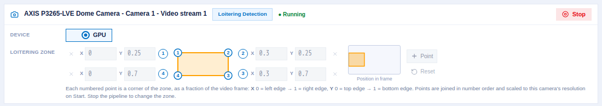

# Run Loitering Detection with XProtect

This page brings up Loitering Detection and VAP, connects VAP to AI Bridge, and runs
Loitering Detection on an XProtect camera. When you finish, Smart Client shows the
detection boxes and the loitering zone on the camera's live video.

## Prerequisites

- XProtect and AI Bridge set up and checked, as in
  [Set Up XProtect and AI Bridge](./set-up-xprotect-and-ai-bridge.md).
- An analytics host with Ubuntu 22.04 or 24.04, Docker and Docker Compose.
- The `metro-ai-suite` repository cloned on the analytics host:

  ```bash
  git clone --filter=blob:none --branch main https://github.com/open-edge-platform/metro-ai-suite.git
  cd metro-ai-suite
  ```

## Part 1: Bring up Loitering Detection

### 1.1 Install the application

Install Loitering Detection as described in its
[Get Started Guide](https://docs.openedgeplatform.intel.com/dev/edge-ai-suites/loitering-detection/get-started.html).
In short:

```bash
cd metro-vision-ai-app-recipe
./install.sh loitering-detection
```

Do not run `sample_start.sh`. It starts pipelines on the bundled sample videos; VAP
starts the pipelines on your XProtect cameras instead.

### 1.2 Set the loitering threshold

In `metro-vision-ai-app-recipe/.env`, set how many seconds a person must stay in the zone
to count as loitering:

```bash
LOITERING_THRESHOLD_SEC=5.0
```

The `mqtt-table-flattener` sidecar uses this value to decide when to publish a loitering
row, and so when VAP raises an event. Use the same value for VAP in
[Part 2](#22-configure-the-environment).

### 1.3 Start the application

```bash
docker compose up -d
docker compose ps
```

Check that `dlstreamer-pipeline-server`, `broker` and `mqtt-table-flattener` are running,
and that the broker publishes port `1883` on the host. VAP connects to the broker from
outside the application's Docker network.

## Part 2: Configure VAP

### 2.1 Open the VAP directory

```bash
cd ../vms-adapter-plugin
cp .env.example .env
```

### 2.2 Configure the environment

Edit `.env`. The values below are the ones this integration needs; leave the rest as they
are.

```bash
# PostgreSQL
PG_PASSWORD=<choose-a-password>

# Milestone AI Bridge
AIB_HOST=<aib-host>
AIB_GRAPHQL_PORT=4000
AIB_TLS_VERIFY=false
# This host's name or address, as the XProtect host reaches it for rending VAP url to
# start/stop analytics.
AIB_APP_HOSTNAME=<vap-host>

# Loitering Detection (DL Streamer Pipeline Server)
DLS_VISION_HOST=host.docker.internal
DLS_VISION_PORT=443
DLS_VISION_TLS_VERIFY=false
DLS_PIPELINE_GPU=loiter_detect_roi_gpu
# Same value as LOITERING_THRESHOLD_SEC in the recipe .env (Part 1.2).
LOITERING_THRESHOLD_SEC=5.0

# Loitering Detection MQTT broker, as VAP reaches it
MQTT_HOST=host.docker.internal
MQTT_PORT=1883
```

Set at least one of `DLS_PIPELINE_CPU`, `DLS_PIPELINE_GPU` and `DLS_PIPELINE_NPU`. The pipeline names you provide much be available in Loitering detection application. Only
the devices you set can be chosen when you start a pipeline. `host.docker.internal`
works when Loitering Detection runs on the same host as VAP; otherwise use its address.

### 2.3 Check `config/config.yaml`

The default `config/config.yaml` already has a Milestone instance and the Loitering
Detection app; the values come from `.env`. Check these parts.

**The Milestone instance:**

```yaml
vms_instances:
  - name: milestone
    vendor: milestone
    base_url: "http://${AIB_HOST}:${AIB_GRAPHQL_PORT:-4000}"
    vendor_options:
      graphql_url: "http://${AIB_HOST}:${AIB_GRAPHQL_PORT:-4000}/api/bridge/graphql"
      dashboard_url: "https://${AIB_APP_HOSTNAME}:${UI_HTTPS_PORT:-3443}"
      metadata_format: ONVIF_ANALYTICS_FRAME
      event_min_interval_s: 10
```

`dashboard_url` is the VAP page Management Client shows for the app, so the XProtect
host must be able to open it.

**The loitering zone, threshold and events** in the `object_detection` app:

```yaml
analytics_apps:
  - type: object_detection
    app_id: "dls_vision"
    display_name: "Loitering Detection"
    zones:
      region1:
        label: "Loitering Zone"
        bounding_box: [0.0, 0.25, 0.3, 0.7]
    default_zone_polygon: [[0.0, 0.25], [0.3, 0.25], [0.3, 0.7], [0.0, 0.7]]
    loitering_threshold_s: "${LOITERING_THRESHOLD_SEC:-5.0}"
    events_enabled: true
```

- `default_zone_polygon` is the zone the pipeline measures loitering in, as fractions of
  the frame (0 to 1). Place it where people stand in your camera view. You can change it
  for each run when you start the pipeline.
- `zones` is the box drawn on the video in Smart Client. Keep `bounding_box` equal to the
  rectangle of `default_zone_polygon`, so the drawn box matches the measured zone.
- `events_enabled` sends loitering events to XProtect; see
  [Loitering Events and Alarms](./events-and-alarms.md).

Every setting is described in the [Reference](./reference.md#configuration-reference).

## Part 3: Start VAP

```bash
docker compose up -d
docker compose ps
```

Expect `vms-adapter-backend`, `vms-adapter-ui` and `vms-adapter-postgres` to be up.

On startup VAP connects to AI Bridge and registers Loitering Detection. Check the log:

```bash
docker compose logs backend | grep -E "milestone_(connected|iva_registered|autoregister)"
```

Expected:

```text
milestone_connected            discovered=1 graphql_url=http://<aib-host>:4000/api/bridge/graphql vms_ids=['<vms-id>']
milestone_iva_registered       app_ids=['<app-guid>'] apps=['Loitering Detection'] vms_id=<vms-id>
milestone_autoregister_complete app_ids=['<app-guid>'] vms=milestone vms_ids=['<vms-id>']
```

You can also ask AI Bridge for the topics VAP registered:

```bash
curl -s http://<aib-host>:4000/api/bridge/graphql \
  -H 'Content-Type: application/json' \
  -d '{"query":"{ metadataTopics { appID topicName } eventTopics { appID topicName } }"}'
```

Expect `dls_vision-metadata` and `dls_vision-events`.

## Part 4: Turn on the metadata topic in Management Client

XProtect accepts detection metadata for a camera only after you turn on the app's
metadata topic for that camera.

> [!IMPORTANT]
> If you skip this step, AI Bridge accepts VAP's metadata and discards it without an
> error, and Smart Client shows no boxes.

1. In Management Client, go to **Recording Servers**, expand your recording server, and
   select the camera.
2. Open the camera's **Processing server** tab.
3. Under **Loitering Detection**, tick **dls_vision-metadata**.
4. Click **Save**.

<!-- SCREENSHOT TODO: ../../../_assets/milestone-mc-processing-server-tab.png
     Management Client > camera > Processing server tab, with Loitering Detection expanded and dls_vision-metadata ticked. -->

The events topic, `dls_vision-events`, does not need ticking.

> [!NOTE]
> When you select the app or a topic, Management Client also shows VAP's page for it.
> start and stop pipelines from the VAP dashboard as shown below.

## Part 5: Start a pipeline

### 5.1 Start from the camera page

VAP also has a compact page for one camera, with a zone editor:

```text
https://<vap-host>:3443/<deviceId>/<deviceId>/<streamId>
```

Pick the device, adjust the zone corners if needed, and click **Start**. While the
pipeline runs, the page shows **Running** and a **Stop** button, and the zone is locked.



Each numbered corner of the zone has its own X and Y box, as a fraction of the frame.
**+ Point** adds a corner, and **Reset** restores `default_zone_polygon`.


### 5.2 Check that the pipeline runs

```bash
docker compose logs backend | grep od_run_started
# od_run_started  pipeline=user_defined_pipelines/object_tracking_gpu run_id=<run-id>
curl -sk https://localhost:3443/v1/analytics-apps/dls_vision/runs
```

The run list shows the run as `RUNNING`, with its `camera_id`, `device` and `zone`.

When it starts a run, VAP scales the zone to the camera's resolution and sends it to the
pipeline, together with the threshold. If the log shows `od_zone_resolution_unavailable`,
AI Bridge has no resolution for this camera and the pipeline uses its own default zone;
see [Use a simulated camera](./set-up-xprotect-and-ai-bridge.md#use-a-simulated-camera).

## Part 6: See the results in Smart Client

1. Open Smart Client and show the camera in a live view.
2. Within a few seconds, boxes appear around detected people, labelled with their class
   (for example `Human`), and the loitering zone is drawn as an amber box labelled
   **Loitering Zone**.
3. Switch to playback: the boxes are recorded with the video.

<!-- SCREENSHOT TODO: ../../../_assets/milestone-sc-live-overlay.png
     Smart Client live view: person boxes and the amber "Loitering Zone" box. -->

Boxes are colored by class: people blue, vehicles red, zones amber.

You might need to reopen the Smart Client if it was already open for the boxes to render for the first time.

## Part 7: Stop the pipeline

Click **Stop** on the camera page, or use the API:

## Part 8: Stop VAP

To stop VAP, run `docker compose down`. Do not add `-v`: it deletes the database volume
with the discovered cameras.

## Next step

[Loitering Events and Alarms](./events-and-alarms.md): raise an XProtect alarm when
someone loiters.
