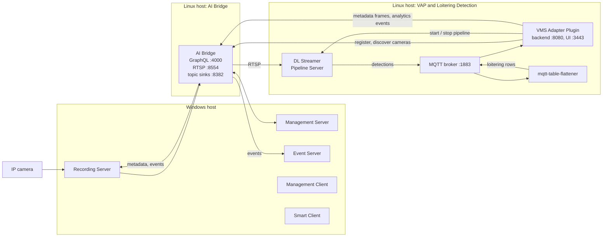
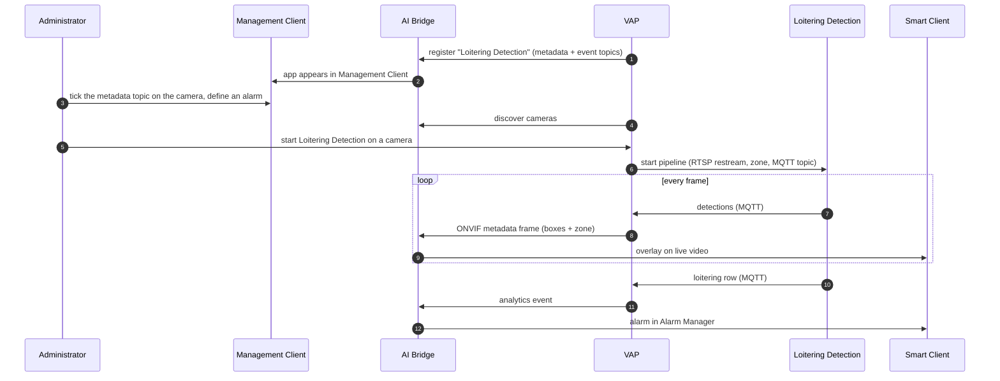

# Milestone XProtect Integration

This guide set shows how **Loitering Detection** application can be run on cameras on **Milestone XProtect** VMS. 
Using Milestone's **AI Bridge** as the API interface, **VMS Adapter Plugin** plays a key role to interface the VMS 
and the Loitering detection app taking away the burden of any required initial VMS specifics launch setup or any 
metadata translations during runtime. 

When you finish this guide, you will have:

- Loitering Detection registered in XProtect as an IVA (Intellegent Analytics Video) app.
- Detection boxes and the loitering zone drawn on the camera video in Smart Client.
- An analytics event for each loitering person, raising an alarm in Smart Client's
  Alarm Manager.

## Concepts

### Milestone XProtect

XProtect is Milestone's video management software (VMS). It runs on Windows and is
made of several services and clients:

| Component | Role in this integration |
| --- | --- |
| Management Server | Holds the configuration: cameras, users, rules, alarms. AI Bridge attaches to it. |
| Recording Server | Connects to the cameras and records their video. |
| Event Server | Receives analytics events and raises alarms from them. |
| Management Client | The administrator's tool. You use it to subscribe the analytics topics for each camera and define alarms. |
| Smart Client | The operator's tool. It shows live and recorded video with detection overlays, and the Alarm Manager. |

### Milestone AI Bridge

AI Bridge is a free Milestone component, delivered as Linux containers, that lets
third-party **Intelligent Video Analytics (IVA) apps** work with XProtect. It runs on a
Linux host, connects to the XProtect Management Server, and gives an IVA app:

- A **GraphQL API** to discover cameras and to **register** the app.
- An **RTSP restream** of each camera, so the app never talks to the cameras directly.
- **Topics** the app posts results to. A *metadata* topic carries detection boxes into
  the video stream. An *event* topic carries analytics events to the Event Server.

Registering an app makes it appear in Management Client, where an administrator turns
on its topics for each camera.

### Loitering Detection

Loitering Detection is an IVA application from the
[Metro Vision AI App Recipe](https://docs.openedgeplatform.intel.com/dev/edge-ai-suites/loitering-detection/index.html).
It runs a DL Streamer Pipeline Server (DLSPS) pipeline that detects and tracks people,
and measures how long each person stays in a zone. The pipeline
publishes its results on an MQTT broker. Along with detections, it also publishes
one *loitering status* row for each person who stays longer than a threshold.

### Where VAP fits

Neither AI Bridge nor Loitering Detection knows about the other. VAP connects them:

1. Registers Loitering Detection with AI Bridge as an IVA app.
2. Discovers the XProtect cameras through AI Bridge.
3. Starts a Loitering Detection pipeline on a camera's RTSP restream, with the zone and
   threshold you set. The pipeline reads the RTSP stream from AI Bridge directly.
4. Reads the pipeline's results from MQTT, and posts them to AI Bridge: detection boxes
   and the zone to the metadata topic, loitering occurrences to the event topic.

## Architecture
TODO: keep VAP as separate component in the flow. Mention about XProtect

AI Bridge, VAP and Loitering Detection can share one Linux host.

## What you get in XProtect

| Result | AI Bridge topic | Where you see it |
| --- | --- | --- |
| Detection boxes and the loitering zone | `dls_vision-metadata` (ONVIF metadata) | Smart Client live and playback video |
| Loitering events | `dls_vision-events` (analytics event) | Alarm Manager, rules, event log |

See [Reference and Troubleshooting](./reference.md#limitations) for what is not yet
supported.

## Tested versions

| Component | Version |
| --- | --- |
| Milestone XProtect | Professional+ 2026 R1 |
| Milestone AI Bridge | 3.0.1 |
| VMS Adapter Plugin | 1.0.0 |
| Loitering Detection | `metro-ai-suite` `main` branch |
| Cameras | AXIS P3265-LVE (1920×1080, H.264), and a simulated RTSP camera (detections only) |

## How to use this guide

Follow the pages in order:

1. [Set Up XProtect and AI Bridge](./set-up-xprotect-and-ai-bridge.md):
   hosts, ports, XProtect and AI Bridge configuration, and how to check that AI Bridge
   sees your cameras.
2. [Run Loitering Detection with XProtect](./get-started.md): bring up
   Loitering Detection and VAP, turn on the topics in Management Client, start a pipeline,
   and see the overlays in Smart Client.
3. [Loitering Events and Alarms](./events-and-alarms.md): turn loitering
   occurrences into XProtect alarms.
4. [Reference and Troubleshooting](./reference.md): configuration reference,
   how registration works, capabilities, limitations, and troubleshooting.

<!--hide_directive
:::{toctree}
:hidden:

Set Up XProtect and AI Bridge <./set-up-xprotect-and-ai-bridge>
Run Loitering Detection <./get-started>
Events and Alarms <./events-and-alarms>
Reference and Troubleshooting <./reference>

:::
hide_directive-->
