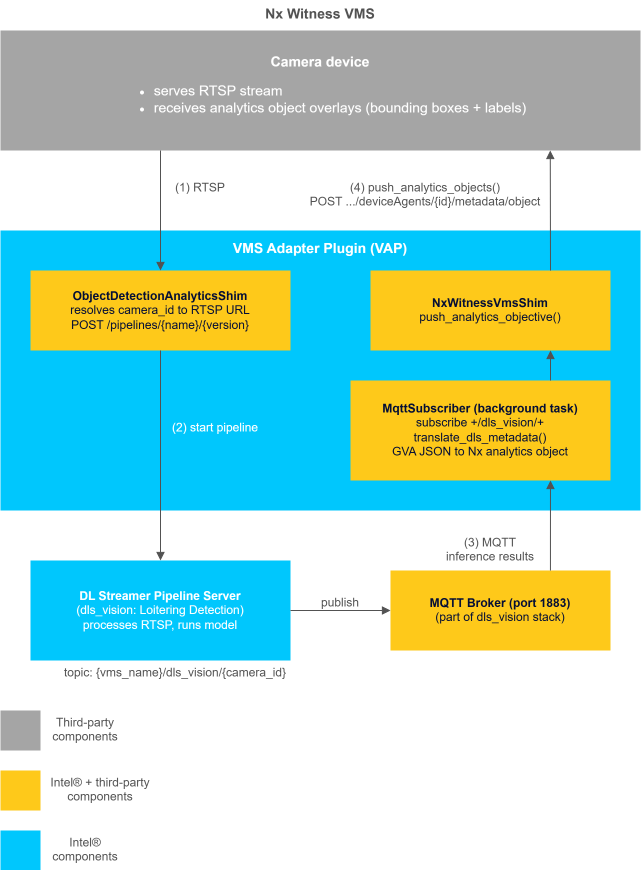
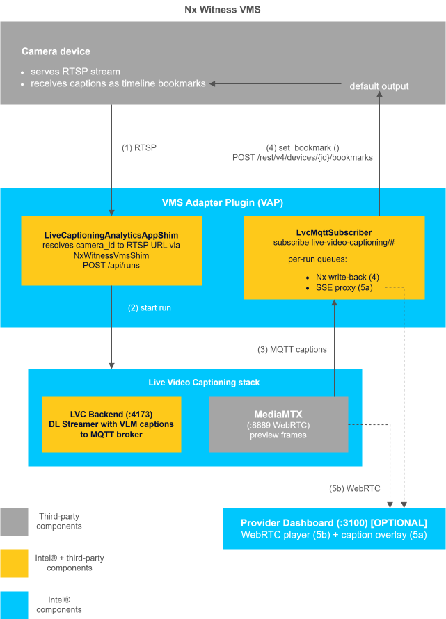
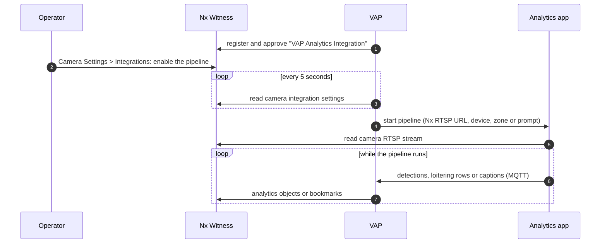

# Nx Witness Integration

This guide explains how to run **Loitering Detection** and **Live Video Captioning** on
cameras managed by the **Nx Witness** VMS. VAP registers with Nx Witness as a REST API
integration, starts the analytics pipelines from the camera settings in the Nx Witness
Desktop Client, and writes the results back to Nx Witness.

When you finish this guide, you will have:

- VAP registered in Nx Witness as the **VAP Analytics Integration**.
- Analytics pipelines started and stopped for each camera from the Nx Witness Desktop Client.
- Loitering Detection boxes and the loitering zone drawn on the camera video, and loitering
  events added as bookmarks.
- Live Video Captioning captions added as bookmarks on the camera timeline.

## Concepts

### Nx Witness

Nx Witness is Network Optix's video management software (VMS). It has two parts:

| Component | Role in this integration |
| --- | --- |
| Nx Witness Server | Connects to the cameras, records their video, and serves the REST API and the RTSP streams on port `7001`. |
| Nx Witness Desktop Client | The administrator's and operator's tool. You use it to add cameras, allow the integration, start pipelines from the camera settings, and view detections and bookmarks. |

### API integrations

Nx Witness accepts *API integrations*: external applications that register with the server
over the REST API. An administrator must allow registration requests; VAP then registers and
approves its own integration with the administrator account it is given.

An approved integration gets:

- An **integration user**, which VAP uses to push analytics metadata.
- An **engine**, with a **device agent** for each camera. Nx Witness accepts metadata for a
  camera only while its device agent is enabled.
- A **settings panel** in each camera's settings, under **Integrations**. VAP adds a group of
  fields for each analytics app to this panel, so operators can start and stop pipelines from
  the Desktop Client.

### Analytics apps

- **Loitering Detection**, from the
  [Metro Vision AI App Recipe](https://docs.openedgeplatform.intel.com/dev/edge-ai-suites/loitering-detection/index.html),
  runs a DL Streamer Pipeline Server (DLSPS) pipeline that detects and tracks people, and
  measures how long each person stays in a zone. It publishes detections on an MQTT broker,
  and its `mqtt-table-flattener` sidecar publishes a *loitering row* for each person who stays
  in the zone longer than a threshold.
- **Live Video Captioning (LVC)**, from
  [Live Video Analysis](https://docs.openedgeplatform.intel.com/dev/edge-ai-suites/live-video-captioning/get-started.html),
  runs a DL Streamer pipeline with a vision-language model (VLM), and publishes a caption of
  the video every few seconds on its MQTT broker.

### Where VAP fits

Neither Nx Witness nor the analytics apps know about each other. VAP connects them:

1. On startup, registers the VAP Analytics Integration with Nx Witness, with a settings group
   for each configured app.
2. Every 5 seconds, reads each camera's integration settings, and starts or stops the
   pipelines that an operator enabled or disabled.
3. Starts a pipeline on the camera's Nx Witness RTSP stream.
4. Reads the pipeline's results from MQTT and writes them to Nx Witness: detection boxes and
   the zone as analytics objects, loitering events and captions as bookmarks.

## Architecture

**Loitering Detection with Nx Witness:**

**Live Video Captioning with Nx Witness:**

Starting a pipeline from the Desktop Client:

VAP, the analytics apps and the Nx Witness Server can share one host.

## What you get in Nx Witness

| Result | Nx Witness feature | Where you see it |
| --- | --- | --- |
| Detection boxes and the loitering zone | Analytics objects (`vap.<category>`, `vap.zone`) | Live camera video, with the **Object Search** panel (Alt+O) |
| Loitering events | Bookmarks | **Bookmarks** panel (Ctrl+B) and the camera timeline |
| Captions | Bookmarks | **Bookmarks** panel (Ctrl+B) and the camera timeline |

See [Reference and Troubleshooting](./reference.md#limitations) for what is not yet
supported.

## Tested versions

| Component | Version |
| --- | --- |
| Nx Witness Server | 6.1.2.42921, on Ubuntu 24.04 |
| Nx Witness Desktop Client | 6.1.2.42921, on Windows and Ubuntu |
| VMS Adapter Plugin | 2026.3 |
| Loitering Detection | 2026.3 |
| Live Video Captioning | 2026.2.0 |

## How to use this guide

Follow the pages in order:

1. [Set Up Nx Witness](./set-up-nx-witness.md): hosts, ports, Nx Witness installation and
   configuration, and how to check that VAP can reach Nx Witness and its cameras.
2. [Run Loitering Detection](./run-loitering-detection.md): bring up Loitering Detection and
   VAP, start a pipeline from the Desktop Client, see the detections, and get loitering events
   as bookmarks.
3. [Run Live Video Captioning](./run-live-video-captioning.md): bring up LVC and VAP, start
   a captioning pipeline from the Desktop Client, and see the captions as bookmarks.
4. [Run Both Applications](./run-both-applications.md): run Loitering Detection and Live
   Video Captioning on the same cameras.
5. [Reference and Troubleshooting](./reference.md): configuration reference, how the
   integration works, limitations, and troubleshooting.

<!--hide_directive
:::{toctree}
:hidden:

Set Up Nx Witness <./set-up-nx-witness>
Run Loitering Detection <./run-loitering-detection>
Run Live Video Captioning <./run-live-video-captioning>
Run Both Applications <./run-both-applications>
Reference and Troubleshooting <./reference>

:::
hide_directive-->
