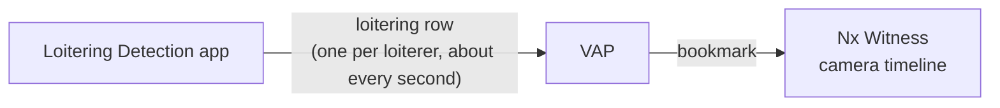

# Run Loitering Detection with Nx Witness

This page brings up Loitering Detection and VAP, registers VAP with Nx Witness, and runs
Loitering Detection on an Nx Witness camera. When you finish, the Desktop Client shows the
detection boxes and the loitering zone on the camera's live video, and a bookmark for each
loitering event.

## Prerequisites

- Nx Witness set up and checked, as in [Set Up Nx Witness](./set-up-nx-witness.md).
- An analytics host with Ubuntu 24.04 or 26.04, Docker and Docker Compose.
- The `metro-ai-suite` repository cloned on the analytics host:

  ```bash
  git clone --filter=blob:none --branch main https://github.com/open-edge-platform/metro-ai-suite.git
  cd metro-ai-suite
  ```

## Part 1: Bring up Loitering Detection

### 1.1 Install the application

Install Loitering Detection as described in its
[Get Started Guide](https://docs.openedgeplatform.intel.com/dev/edge-ai-suites/loitering-detection/get-started.html).
In short:

```bash
cd metro-vision-ai-app-recipe
./install.sh loitering-detection
```

Do not run `sample_start.sh`. It starts pipelines on the bundled sample videos; VAP starts the
pipelines on your Nx Witness cameras instead.

### 1.2 Set the loitering threshold

In `metro-vision-ai-app-recipe/.env`, set how many seconds a person must stay in the zone to
count as loitering:

```bash
LOITERING_THRESHOLD_SEC=5.0
```

The `mqtt-table-flattener` sidecar uses this value to decide when to publish a loitering row,
and so when VAP adds a bookmark. Use the same value for VAP in
[Part 2](#22-configure-the-environment).

### 1.3 Check the MQTT broker

The application includes an Eclipse Mosquitto MQTT broker. VAP subscribes to it from outside
the application's Docker network, so the broker must publish port `1883` on the host. In
`docker-compose.yml`, check the port, and that the DL Streamer Pipeline Server publishes to
the broker through the host:

```yaml
broker:
  image: docker.io/library/eclipse-mosquitto:2.0.22
  ports:
    - "1883:1883"

dlstreamer-pipeline-server:
  environment:
    - MQTT_HOST=${HOST_IP} # the broker runs on the same host
    - MQTT_PORT=1883
```

This is the default configuration. The broker allows anonymous access, which VAP and the
pipeline server need to subscribe and publish without credentials.

### 1.4 Start the application

```bash
docker compose up -d
docker compose ps
```

Check that `dlstreamer-pipeline-server`, `broker` and `mqtt-table-flattener` are running.

## Part 2: Configure VAP

### 2.1 Open the VAP directory

```bash
cd ../vms-adapter-plugin
cp .env.example .env
```

### 2.2 Configure the environment

Edit `.env`. The values below are the ones this integration needs; leave the rest as they
are. Variables of other VMS and apps, such as `AIB_*` and `LVC_*`, are not used.

```bash
# PostgreSQL
PG_PASSWORD=<choose-a-password>

# Nx Witness
NX_HOST=<NX_HOST_IP>
NX_USERNAME=<nx-admin-user>
NX_PASSWORD=<nx-admin-password>
NX_TLS_VERIFY=false

# Loitering Detection (DL Streamer Pipeline Server)
DLS_VISION_HOST=host.docker.internal
DLS_VISION_PORT=443
DLS_VISION_TLS_VERIFY=false
DLS_PIPELINE_GPU=loiter_detect_roi_gpu
# Same value as LOITERING_THRESHOLD_SEC in the recipe .env (Part 1.2).
LOITERING_THRESHOLD_SEC=5.0

# Loitering Detection MQTT broker, as VAP reaches it
MQTT_HOST=host.docker.internal
MQTT_PORT=1883
```

- Set at least one of `DLS_PIPELINE_CPU`, `DLS_PIPELINE_GPU` and `DLS_PIPELINE_NPU`. The
  pipelines must exist in Loitering Detection, and the host must support the device; see the
  application's GPU and NPU setup documentation. Only the devices you set can be chosen when
  you start a pipeline.
- `host.docker.internal` works when Loitering Detection runs on the same host as VAP;
  otherwise, use its address.
- `NX_TLS_VERIFY` and `DLS_VISION_TLS_VERIFY` are `false` for self-signed certificates. To
  verify certificates, see [TLS and Certificate Configuration](../../tls-and-certificates.md).

### 2.3 Generate `config/config.yaml`

Generate the VAP configuration for Nx Witness and Loitering Detection:

```bash
./setup.sh --vms nx --apps ld
```

`setup.sh` builds `config/config.yaml` from the configuration fragments below, and warns about
their variables that are not set in `.env`. The values come from `.env` at startup, so you do
not need to run `setup.sh` again after editing `.env`.

| Fragment | Content |
| --- | --- |
| `vms_shim/nxwitness/vap-config.yaml` | The Nx Witness instance |
| `analytics_app_shim/object_detection/vap-config.yaml` | The Loitering Detection app |

To change a setting, edit the fragment and run `setup.sh` again; do not edit
`config/config.yaml`, as `setup.sh` overwrites it. Check these parts.

**The Nx Witness instance**, in `vms_shim/nxwitness/vap-config.yaml`:

```yaml
- name: nx-main
  vendor: nx_witness
  base_url: "https://${NX_HOST}:7001"
  tls_verify: ${NX_TLS_VERIFY:-false}
  tls_ca_bundle: "${NX_CA_BUNDLE:-}"
  auth:
    username: "${NX_USERNAME}"
    password: "${NX_PASSWORD}"
    auth_type: digest
```

**The labels, loitering zone, threshold and events**, in
`analytics_app_shim/object_detection/vap-config.yaml`:

```yaml
- type: object_detection
  app_id: "dls_vision"
  display_name: "Loitering Detection"
  label_map:
    vehicle: vehicle
    pedestrian: pedestrian
    background: background
  zones:
    region1:
      label: "Loitering Zone"
      bounding_box: [0.0, 0.25, 0.3, 0.7]
  default_zone_polygon: [[0.0, 0.25], [0.3, 0.25], [0.3, 0.7], [0.0, 0.7]]
  loitering_threshold_s: "${LOITERING_THRESHOLD_SEC:-5.0}"
  events_enabled: true
```

- `label_map` maps the model's detection labels to categories. Nx Witness shows each
  category as the object type `vap.<category>`, for example `vap.pedestrian`. Labels that are
  not in the map are shown as `python.detected.object`. If your model uses other labels, such
  as `person` or `car`, add them, for example `person: person`.
- `default_zone_polygon` is the zone the pipeline measures loitering in, as fractions of the
  frame (0 to 1). It is the default value of the **Loitering Zone** field in Nx Witness, which
  you can change for each camera.
- `zones` is the box drawn on the video as the object type `vap.zone`. Keep `bounding_box`
  equal to the rectangle of `default_zone_polygon`, so the drawn box matches the measured zone.
- `events_enabled` adds a bookmark for each loitering event; see
  [Part 6](#part-6-get-loitering-events-as-bookmarks).

Every setting is described in the [Reference](./reference.md#configuration-reference).

## Part 3: Start VAP

```bash
docker compose up -d
docker compose ps
```

Expect `vms-adapter-backend`, `vms-adapter-ui` and `vms-adapter-postgres` to be up, and the
backend to be `healthy`. Compose pulls the images; to build them from source instead, run
`docker compose build` first.

On startup, VAP registers the VAP Analytics Integration with Nx Witness, approves it, and
starts reading the camera settings. Check the log:

```bash
docker compose logs backend | grep -E "nx_integration_|nx_settings_poll_started"
```

Expected on the first start:

```text
nx_integration_autoregistered  vms=nx-main analytics_app_id=VAP Analytics Integration status=approved
nx_settings_poll_started       vms=nx-main
```

On later starts, VAP reuses the integration and logs `nx_integration_already_registered` and
`nx_integration_credentials_restored` instead.

To check in Nx Witness, open **Main Menu** → **System Administration** → **Integrations** in
the Desktop Client. **VAP Analytics Integration** is listed.

## Part 4: Start a pipeline

Pipelines are started and stopped from the camera settings in the Desktop Client. VAP reads
the settings every 5 seconds.

1. In the Desktop Client, close any open view of the camera. Detections do not render in a
   view that was open before the pipeline started.
2. In the resource tree, right-click the camera, and choose **Camera Settings**.
3. Open the **Integrations** tab, and select **VAP Analytics Integration**. If it is off,
   turn it on.
4. In the **Loitering Detection** group, set the fields:

   | Field | Description |
   | --- | --- |
   | **Enable Loitering Detection pipeline** | Starts or stops the pipeline for this camera. |
   | **Device** | Inference device. Only the devices with a pipeline in `.env` are listed. |
   | **Loitering Zone** | Zone as normalized `[[x,y],...]` points, each 0 to 1. Defaults to `default_zone_polygon`. VAP scales it to the camera's resolution when the pipeline starts. |

   

5. Check **Enable Loitering Detection pipeline**, and click **Apply**, then **OK**.

Within 5 seconds, VAP starts the pipeline. Check the log:

```bash
docker compose logs backend | grep -E "od_run_started|nx_pipeline_started"
```

Expected:

```text
od_run_started       pipeline=user_defined_pipelines/loiter_detect_roi_gpu run_id=<run-id>
nx_pipeline_started  app_id=dls_vision device_id=<device-uuid> run_id=<run-id>
```

If you change **Device** or **Loitering Zone** while the pipeline runs, VAP restarts it with
the new values.

## Part 5: See the detections

1. In the Desktop Client, open the camera.
2. Open the **Object Search** panel (Alt+O).
3. Within a few seconds, boxes appear around detected objects, labelled with their object
   type, for example `vap.pedestrian`. The loitering zone is drawn as a `vap.zone` box.


If no boxes appear, see [Troubleshooting](./reference.md#pipeline-and-detections).

## Part 6: Get loitering events as bookmarks

With `events_enabled: true`, VAP adds a bookmark to the camera's timeline for each loitering
event.



1. The `mqtt-table-flattener` sidecar publishes a row for each person who has stayed in the
   zone longer than `LOITERING_THRESHOLD_SEC`. It repeats the row about once a second while
   the person stays.
2. VAP adds a bookmark for every row. The bookmark name is the event, for example
   `pedestrian 119 loitering 12.0s in zone vap_zone`. It starts when VAP receives the row,
   and lasts 30 seconds.

To view them, open the camera in the Desktop Client, and open the **Bookmarks** panel
(Ctrl+B).

Check that VAP publishes the events:

```bash
docker compose logs -f backend | grep loitering_event_published
# loitering_event_published camera_id=nx:<device-uuid> result=True track_id=12 with_box=True
```

> [!NOTE]
> VAP adds a bookmark for every loitering row, so a person who stays in the zone adds about
> one bookmark per second. To turn the bookmarks off, set `events_enabled: false` in
> `analytics_app_shim/object_detection/vap-config.yaml`, run `./setup.sh --vms nx --apps ld`
> again, and restart the backend with `docker compose restart backend`.

### Change the loitering threshold

The threshold is set in two places, which should hold the same value:

| Where | Setting | What it does |
| --- | --- | --- |
| Recipe `.env` | `LOITERING_THRESHOLD_SEC` | Decides when the sidecar publishes a row, and so when a bookmark is added. |
| VAP `.env` | `LOITERING_THRESHOLD_SEC`, read by `loitering_threshold_s` | Sent to the pipeline at run start; turns the on-video dwell text red. |

After changing the recipe value, recreate the sidecar from `metro-vision-ai-app-recipe`:

```bash
docker compose up -d --no-deps --force-recreate mqtt-table-flattener
```

After changing the VAP value, recreate the backend with
`docker compose up -d --force-recreate backend`, and restart the pipeline.

## Part 7: Start from the VAP dashboard (optional)

You can also start and stop pipelines from the VAP dashboard instead of the Desktop Client.

1. Open `https://<vap-host>:3443` in a browser.
2. In the **Camera Discovery** panel, click **Discover Cameras**, and turn on the camera you
   want to analyze. Its ID is `nx:<device-uuid>`.
3. In the **Analytics Engine** panel, click **Discover Apps**, and select
   **Loitering Detection**.
4. Select the **Camera** and the **Device**, and click **Start Analysis**.
5. To stop, click **Stop Analysis** on the active run.

The same steps through the API:

```bash
curl -k -X POST https://localhost:3443/v1/cameras/discover
curl -k -X POST https://localhost:3443/v1/cameras/enable \
  -H "Content-Type: application/json" \
  -d '{"camera_ids": ["nx:<device-uuid>"], "enabled": true}'
curl -k https://localhost:3443/v1/analytics-apps/dls_vision/runs
curl -k -X DELETE https://localhost:3443/v1/analytics-apps/dls_vision/runs/<run_id>
```

## Part 8: Stop

To stop the pipeline, uncheck **Enable Loitering Detection pipeline** in the camera settings,
and click **Apply**, then **OK**. VAP stops it within 5 seconds and logs
`nx_pipeline_stopped`.

To stop VAP, run `docker compose down`.

> [!CAUTION]
> Do not add `-v`: it deletes the database volume, including the integration credentials
> VAP stored. The integration in Nx Witness then becomes stale; see
> [Troubleshooting](./reference.md#vap-and-nx-witness).

## Next step

[Run Live Video Captioning with Nx Witness](./run-live-video-captioning.md).
